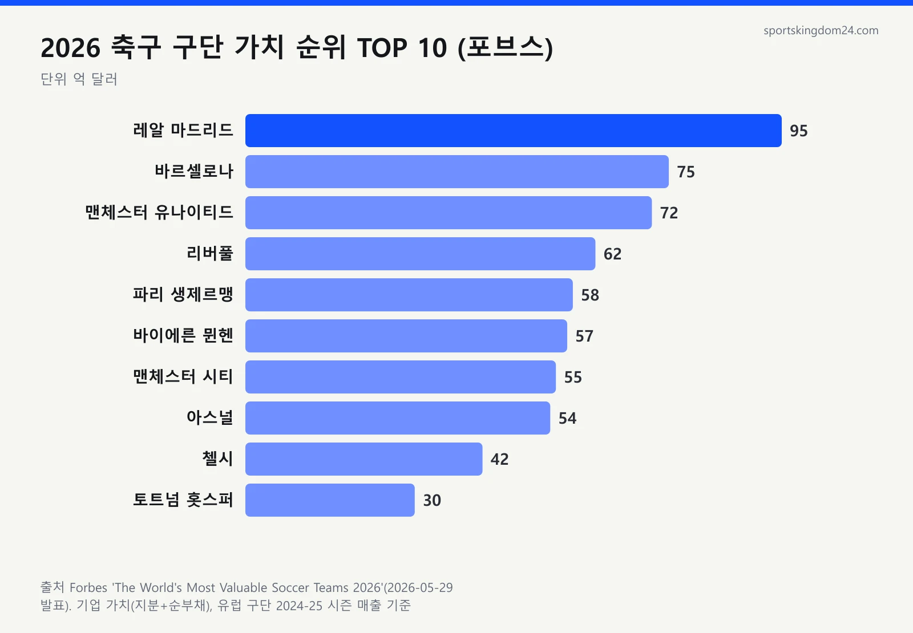
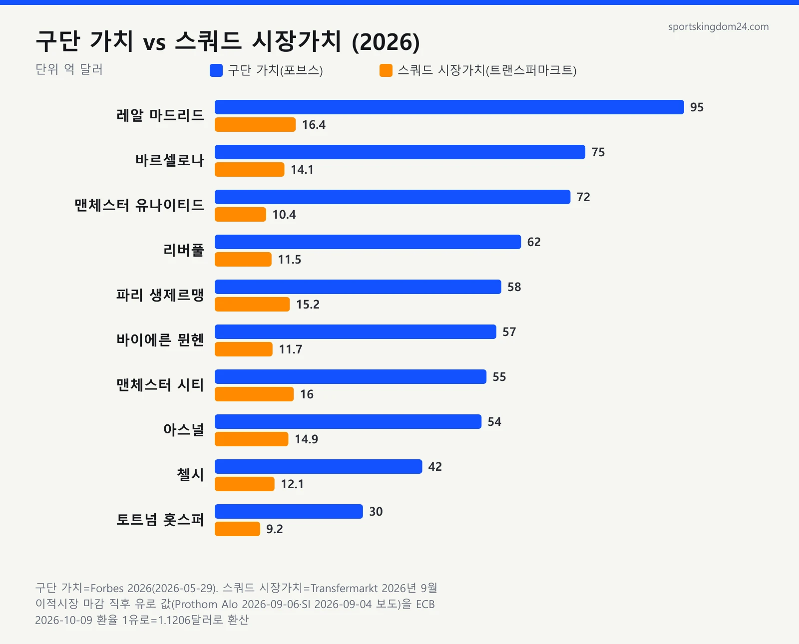

2026년 축구 구단 가치 순위 1위는 포브스 기준 레알 마드리드이고, 평가액은 95억 달러(약 12조 7천억 원)입니다. 그런데 검색해 보면 1위가 맨체스터 시티라는 글도 있고, 레알 마드리드 금액을 15억 유로 가까이로 적은 글도 있어서 저도 처음엔 한참 헤맸어요. 자료를 하나씩 열어 보니 두 숫자는 아예 다른 것을 재고 있었습니다. 포브스는 구단이라는 회사의 값을, 트랜스퍼마크트는 선수단 몸값의 합을 매기거든요. 그래서 가장 비싼 구단과 가장 비싼 스쿼드는 순서가 다릅니다.

📌 3줄 요약
2026년 포브스 축구 구단 가치 순위는 <b>1위 레알 마드리드(95억 달러)</b>, 2위 바르셀로나(75억 달러), 3위 맨체스터 유나이티드(72억 달러) 순이고, 스포티코 평가도 1~3위가 같습니다.

트랜스퍼마크트 <b>스쿼드 시장가치</b>는 선수 몸값의 합이라 전혀 다른 숫자입니다. 2026년 9월 이적시장 마감 직후 기준 레알 마드리드 14억 6천만 유로, 맨시티 14억 3천만 유로 순이고 맨유는 9위예요.

톱10 구단의 기업 가치는 선수단 몸값의 <b>약 3~7배(제 계산)</b>입니다. 구단 가치에는 매출과 수익성, 브랜드, 부채까지 반영되기 때문입니다.

## 2026 축구 구단 가치 순위 TOP 10 (포브스 기준)

포브스가 2026년 5월 29일 발표한 세계 축구 구단 가치 순위에서 레알 마드리드가 5년 연속 1위에 올랐습니다. 30개 구단 합계는 약 870억 달러예요.

| 순위 | 구단 | 리그 | 구단 가치 | 원화 환산(약) | 전년 대비 |
| --- | --- | --- | --- | --- | --- |
| 1 | 레알 마드리드 | 라리가 | 95억 달러 | 12조 7천억 원 | +41% |
| 2 | 바르셀로나 | 라리가 | 75억 달러 | 10조 1천억 원 | +33% |
| 3 | 맨체스터 유나이티드 | EPL | 72억 달러 | 9조 7천억 원 | +9% |
| 4 | 리버풀 | EPL | 62억 달러 | 8조 3천억 원 | +15% |
| 5 | 파리 생제르맹 | 리그앙 | 58억 달러 | 7조 8천억 원 | +26% |
| 6 | 바이에른 뮌헨 | 분데스리가 | 57억 달러 | 7조 6천억 원 | +12% |
| 7 | 맨체스터 시티 | EPL | 55억 달러 | 7조 4천억 원 | +4% |
| 8 | 아스널 | EPL | 54억 달러 | 7조 2천억 원 | +59% |
| 9 | 첼시 | EPL | 42억 달러 | 5조 6천억 원 | +29% |
| 10 | 토트넘 홋스퍼 | EPL | 30억 달러 | 4조 원 | -9% |

원화는 유럽중앙은행 2026년 10월 9일 환율(1달러 약 1,341원)로 다시 계산한 값입니다. 발표 당일인 5월 29일 환율(1달러 약 1,506원)로 계산하면 약 14조 3천억 원이었으니, 그사이 환율이 내려가 1조 5천억 원 넘게 줄어든 셈이에요. 기사끼리 비교할 땐 달러 금액을 기준으로 보는 게 안전합니다.

30위 안에는 프리미어리그 구단 11개, 미국 MLS 구단 7개가 들었습니다. 톱10에서는 아스널(+59%)과 레알 마드리드(+41%)가 크게 올랐고, 가치가 내려간 구단은 토트넘 하나였어요.

## 가장 비싼 구단과 가장 비싼 스쿼드는 왜 다를까?

구단 가치는 회사의 값이고 스쿼드 시장가치는 선수단 몸값의 합이라서 순위가 다릅니다. 선수 한 명 한 명의 몸값은 [축구선수 몸값 순위](/football-player-market-value-ranking/)에 따로 정리했어요. 여기서는 9월 초 기준 선수단 합계라 10월 갱신 뒤엔 조금 달라졌을 수 있습니다. 제가 포브스 TOP 10과 9월 초 트랜스퍼마크트 스쿼드 가치를 같은 구단끼리 한 표에 맞춰 보니 차이가 바로 보였어요.

| 구단 | 구단 가치 순위 | 스쿼드 시장가치 | 스쿼드 순위 | 배수(약) |
| --- | --- | --- | --- | --- |
| 레알 마드리드 | 1위 | 14억 6천만 유로 | 1위 | 5.8배 |
| 바르셀로나 | 2위 | 12억 6천만 유로 | 5위 | 5.3배 |
| 맨체스터 유나이티드 | 3위 | 9억 2,430만 유로 | 9위 | 7.0배 |
| 리버풀 | 4위 | 10억 3천만 유로 | 8위 | 5.4배 |
| 파리 생제르맹 | 5위 | 13억 6천만 유로 | 3위 | 3.8배 |
| 바이에른 뮌헨 | 6위 | 10억 4천만 유로 | 7위 | 4.9배 |
| 맨체스터 시티 | 7위 | 14억 3천만 유로 | 2위 | 3.4배 |
| 아스널 | 8위 | 13억 3천만 유로 | 4위 | 3.6배 |
| 첼시 | 9위 | 10억 8천만 유로 | 6위 | 3.5배 |
| 토트넘 홋스퍼 | 10위 | 8억 2,400만 유로 | 10위 | 3.2배 |

배수는 스쿼드 가치를 10월 9일 환율(1유로 약 1.12달러)로 달러로 바꿔 구단 가치를 나눈 값입니다. 포브스 금액은 시즌 평균 환율(1유로 약 1.09달러)로 매긴 값이라 배수에는 몇 % 오차가 있어요. 맨유는 구단 가치 3위인데 스쿼드 가치는 9위이고, 맨시티는 반대로 스쿼드 2위인데 구단 가치 7위예요. 선수 몸값만 보면 맨시티가 맨유보다 5억 유로 넘게 비쌉니다.

배수가 큰 쪽은 맨유, 레알 마드리드, 리버풀, 바르셀로나처럼 팬층과 상업 매출이 오래 쌓인 구단입니다. 작은 쪽은 토트넘, 맨시티, 첼시, 아스널이에요. 선수단 투자만큼 회사 값이 따라붙지 않았다는 게 제 해석인데, 기관이 낸 평가가 아니라 두 숫자를 나눠 본 계산이라는 점은 밝혀 둡니다.

## 구단 가치·스쿼드 시장가치·브랜드 가치, 무엇을 재는 숫자인가

세 숫자는 재는 대상이 다릅니다. 포브스·스포티코는 기업을, 트랜스퍼마크트는 선수를, 브랜드 파이낸스는 구단 브랜드의 값을 잽니다.

| 구분 | 대표 출처 | 무엇을 재나 | 레알 마드리드 2026 |
| --- | --- | --- | --- |
| 구단 가치(기업 가치) | 포브스, 스포티코 | 지분 가치와 순부채, 매출과 수익성 | 95억 달러(포브스) |
| 스쿼드 시장가치 | 트랜스퍼마크트 | 선수 개인 몸값 추정치의 합 | 14억 6천만 유로 |
| 브랜드 가치 | 브랜드 파이낸스 | 브랜드를 빌려줄 때 받을 사용료 가치 | 24억 유로 |

포브스는 지분 가치에 순부채를 더한 기업 가치로 매깁니다. 과거 구단 매각 사례와 앞으로의 수익성을 바탕으로 하고, 유럽 구단은 2024-25 시즌 매출을 씁니다. 선수 판매 수익과 경기장 부동산 가치는 넣지 않아요.

여기서 많이들 헷갈리는데, 트랜스퍼마크트 숫자는 구단을 사고팔 때의 가격이 아닙니다. 선수마다 매긴 추정 몸값을 더한 값이라 이적시장과 시즌 활약에 따라 수시로 바뀌어요. 브랜드 파이낸스는 2026년 8월 레알 마드리드를 3년 연속 브랜드 가치 1위로 꼽았습니다.

💡 기사 속 구단 가치, 어떤 숫자인지 구별하는 법
같은 레알 마드리드라도 <b>95억 달러, 14억 6천만 유로, 24억 유로</b>가 모두 맞는 숫자입니다. 출처가 포브스·스포티코면 기업 가치, 트랜스퍼마크트면 선수단 몸값, 브랜드 파이낸스면 브랜드 가치예요.

## 포브스와 스포티코, 평가 기관마다 숫자가 다른 이유

평가 항목과 발표 시점이 달라서 금액은 다르지만, 상위권 순서는 거의 같습니다. 스포티코가 4월 22일 공개한 2026년 데이터를 받아 포브스와 나란히 놓아 봤어요.

| 구단 | 포브스(2026년 5월) | 스포티코(2026년 4월) |
| --- | --- | --- |
| 레알 마드리드 | 1위, 95억 달러 | 1위, 77억 달러 |
| 바르셀로나 | 2위, 75억 달러 | 2위, 66억 5천만 달러 |
| 맨체스터 유나이티드 | 3위, 72억 달러 | 3위, 64억 7천만 달러 |
| 리버풀 | 4위, 62억 달러 | 5위, 57억 4천만 달러 |
| 파리 생제르맹 | 5위, 58억 달러 | 8위, 50억 달러 |
| 바이에른 뮌헨 | 6위, 57억 달러 | 4위, 57억 8천만 달러 |
| 맨체스터 시티 | 7위, 55억 달러 | 6위, 57억 달러 |
| 아스널 | 8위, 54억 달러 | 7위, 54억 3천만 달러 |
| 첼시 | 9위, 42억 달러 | 9위, 40억 달러 |
| 토트넘 홋스퍼 | 10위, 30억 달러 | 10위, 35억 달러 |

1~3위와 9~10위는 두 기관이 똑같고 4~8위만 엇갈립니다. 레알 마드리드 금액은 포브스가 18억 달러 높게 봤어요.

유럽 축구 구단 가치 순위를 따로 내는 풋볼 벤치마크도 5월 28일 레알 마드리드를 77억 유로로 1위에 올렸고, 바르셀로나가 2위, 맨유는 처음으로 3위 밖이었습니다. 스포티코의 77억 달러와 숫자는 같지만 단위가 달라 같은 값이 아니에요. 세 평가의 공통값은 레알 마드리드 1위, 바르셀로나 2위입니다.

## 레알 마드리드 구단 가치는 왜 1년 새 41% 올랐나

매출이 축구 구단 사상 최고치를 찍었기 때문입니다. 포브스 기준 2024-25 시즌 매출은 12억 6,500만 달러(선수 판매 제외)였고, 구단 가치는 67억 5천만 달러에서 95억 달러로 뛰었어요.

매출의 축은 상업 수익, 중계권, 재단장한 산티아고 베르나베우와 경기일 수입입니다. 2위 바르셀로나도 매출 10억 6,300만 달러로 10억 달러를 넘긴 두 번째 구단이 됐어요. 두 구단이 리그에서 받는 배분금 구조는 [라리가 우승 상금](/la-liga-prize-money/) 글에 정리해 뒀습니다.

다만 레알 마드리드는 회원이 소유한 구단이라 주식시장에서 거래되지 않습니다. 95억 달러는 실제 매각 가격이 아니라 포브스의 추정치예요.

## 맨유 구단 가치는 성적이 부진해도 왜 3위일까

맨유를 3위에 붙잡아 두는 건 성적보다 매출과 세계적인 팬층입니다. 2024-25 시즌 프리미어리그 15위에 그쳤는데도 매출은 8억 6,500만 달러였어요. 중계로 지난 시즌 맨유 경기를 챙겨 본 분이라면 의아할 만한 순위죠.

상승 폭은 +9%로 톱10 중 맨시티(+4%) 다음으로 작았고, 순위도 2위에서 3위로 내려갔습니다. 풋볼 벤치마크에서는 3위 밖으로 밀렸고 스쿼드 가치는 9위예요. 지금 선수단보다 쌓아 온 브랜드와 매출이 받쳐 주는 값이라고 볼 수 있습니다.

맨유는 톱10 중 유일하게 뉴욕증권거래소에 상장돼 시가총액이 따로 있는데, 주가에 따라 매일 바뀌는 숫자라 포브스의 72억 달러와는 다른 개념입니다. 프리미어리그 구단이 리그에서 받는 기본 배분금은 [프리미어리그 우승 상금](/epl-prize-money/)에서 볼 수 있어요.

## 토트넘은 왜 톱10에서 유일하게 가치가 떨어졌나

토트넘은 포브스(-9%)와 스포티코(36억 8천만 달러에서 35억 달러) 두 평가 모두에서 톱10 중 유일하게 가치가 내려갔습니다.

포브스 기준 토트넘 매출은 7억 3,300만 달러로 9위 첼시(6억 3,700만 달러)보다 많아요. 매출이 더 많은데 가치가 낮다는 건 수익성과 부채, 성장 기대까지 함께 반영된다는 뜻입니다. 기관들이 하락 요인을 항목별로 공개하진 않아서 정확한 원인은 추정으로 남겨 둘게요.

손흥민 선수가 2025년 8월 옮긴 LAFC도 순위에 있습니다. 포브스 기준 13억 2천만 달러로 18위, 스포티코 기준 14억 달러로 17위예요.

## K리그 구단 가치 순위는 왜 없을까

포브스 30위, 스포티코 50위, 풋볼 벤치마크 유럽 32개 구단 어디에도 K리그 구단은 없습니다. 이런 평가는 매출이 크고 구단 매각 사례가 쌓인 리그 위주로 이뤄지기 때문으로 보입니다.

규모를 가늠할 공식 숫자는 연봉입니다. 한국프로축구연맹이 2025년 12월 30일 발표한 자료로는 K리그1 11개 구단(김천 상무 제외) 연봉 총액이 약 1,368억 원, 최다 지출 구단인 울산 HD가 약 206억 원이었어요. 레알 마드리드 한 시즌 매출(10월 9일 환율로 약 1조 7천억 원)이 K리그1 11개 구단 연봉 총액의 12배를 넘습니다.

그래서 K리그 구단 가치는 아직 공신력 있는 순위표가 없습니다. 팀별 특징은 [K리그 입문 가이드 2026](/k-league-2026-guide/)에 정리해 뒀어요.

## 자주 묻는 질문 (FAQ)

**Q. 2026년 세계에서 가장 비싼 축구 구단은 어디인가요?** 레알 마드리드입니다. 포브스(95억 달러), 스포티코(77억 달러), 풋볼 벤치마크(77억 유로) 세 평가 모두 1위로 꼽았습니다.

**Q. 축구 구단 가치와 스쿼드 시장가치는 같은 건가요?** 다릅니다. 구단 가치는 매출·수익성·부채를 반영한 회사의 값이고, 스쿼드 시장가치는 선수 몸값의 합이라 톱 구단 기준 구단 가치가 약 3~7배 큽니다(포브스 값을 트랜스퍼마크트 값으로 나눠 본 제 계산).

**Q. 포브스 축구 구단 가치 순위는 언제 발표되나요?** 보통 매년 5월 말에 나오고, 2026년판은 5월 29일 공개됐습니다. 스포티코는 이보다 앞선 4월에 발표했어요.

**Q. 토트넘 구단 가치는 세계 몇 위인가요?** 포브스와 스포티코 모두 10위입니다. 포브스 기준 30억 달러로 전년보다 9% 내려갔습니다.

**Q. 바르셀로나 구단 가치는 맨유보다 높은가요?** 2026년에는 그렇습니다. 포브스 기준 바르셀로나 75억 달러, 맨유 72억 달러이고 스포티코도 같은 순서입니다.

## 정리하며

축구 구단 가치 순위 2026은 포브스 기준 레알 마드리드, 바르셀로나, 맨유 순입니다. 선수단 몸값으로 보면 맨유는 9위, 맨시티는 2위로 그림이 달라지니, 구단 가치라는 말을 보면 출처가 포브스인지 트랜스퍼마크트인지부터 확인하세요. 원문 순위와 산정 방식은 [포브스 2026 축구 구단 가치 순위](https://www.forbes.com.au/news/sport/ranking-worlds-most-valuable-soccer-teams-2026/)에서, 구단 매출의 바탕인 리그 배분금은 [분데스리가 우승 상금](/bundesliga-prize-money/)에서 이어서 볼 수 있습니다.

---

**관련 키워드** — #축구구단가치순위 #축구구단가치순위2026 #세계축구구단가치순위 #유럽축구구단가치순위 #포브스축구구단가치 #레알마드리드구단가치 #맨유구단가치 #바르셀로나구단가치 #토트넘구단가치순위 #스쿼드가치순위 #K리그구단가치 #스포티코축구구단가치
