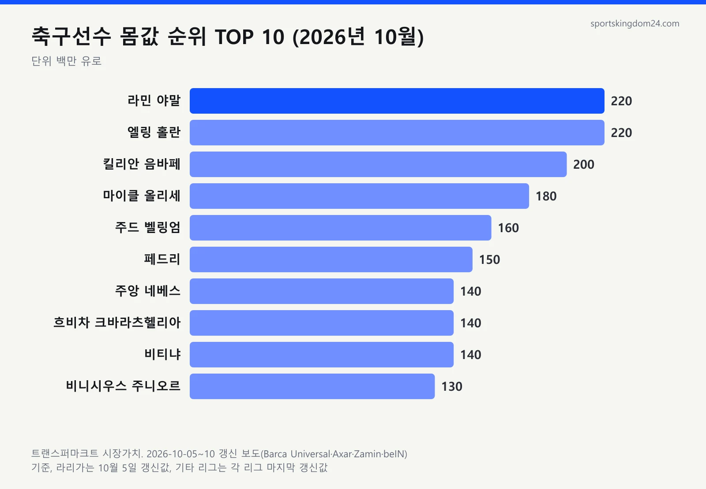
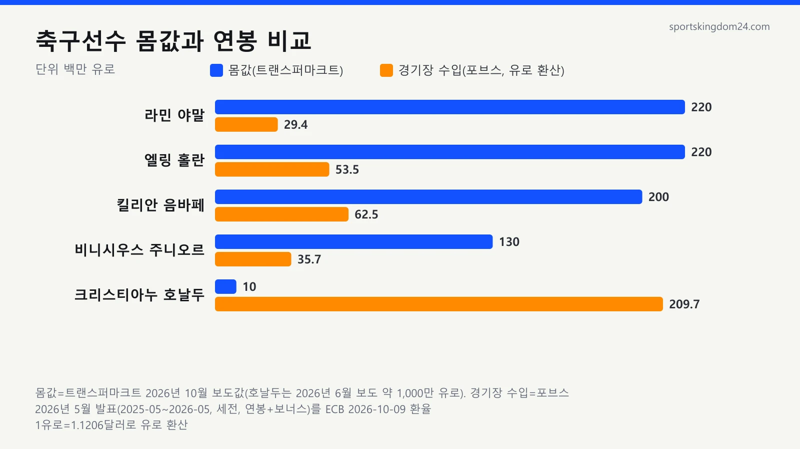
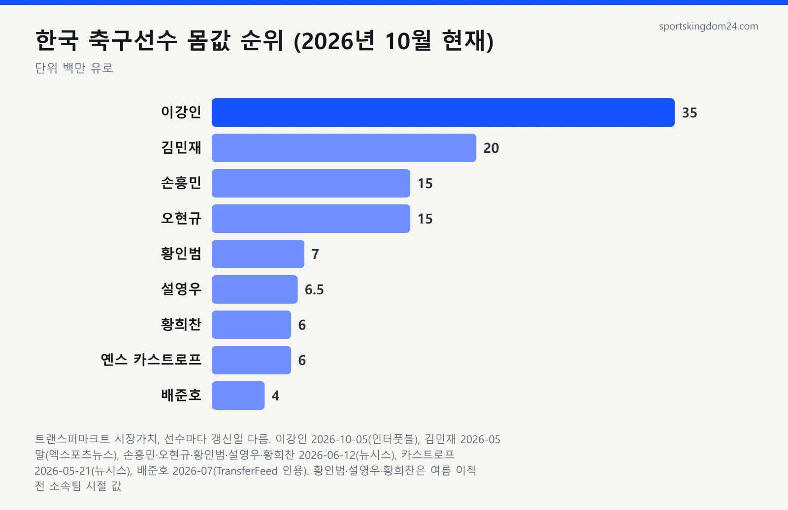

2026년 10월 기준 **축구선수 몸값 순위** 1위는 트랜스퍼마크트 시장가치 2억 2,000만 유로로 나란히 선 라민 야말과 엘링 홀란입니다. 그런데 이 숫자를 연봉으로 읽으면 틀립니다. 같은 시기 가장 많이 번 축구선수는 몸값 1,000만 유로 안팎의 크리스티아누 호날두였거든요. 저도 처음엔 "몸값 2억 유로면 1년에 그만큼 버나?" 하고 헤맸어요. 그래서 트랜스퍼마크트 갱신 보도와 포브스·선수노조 연봉 자료를 맞춰 보며 흔한 오해를 하나씩 풀어 봤습니다.

📌 3줄 요약
2026년 10월 트랜스퍼마크트 기준 세계 몸값 1위는 <b>라민 야말·엘링 홀란(각 2억 2,000만 유로)</b>, 3위는 킬리안 음바페(2억 유로)입니다.

몸값은 이적시장에서 매긴 <b>추정 가치</b>, 연봉은 구단이 주는 <b>급여</b>라 순위가 따로 움직입니다. 2026년 포브스 수입 1위 호날두의 몸값은 1,000만 유로 안팎입니다.

한국 선수 몸값 1위는 <b>이강인(3,500만 유로, 10월 5일 갱신)</b>이고 김민재·손흥민·오현규가 뒤를 잇습니다. 센터백은 1억 유로가 사실상 천장입니다.

## 축구선수 몸값 순위 TOP 10 (2026년 10월 기준)

지금 세계에서 몸값이 가장 높은 축구선수는 라민 야말과 엘링 홀란으로, 둘 다 트랜스퍼마크트 시장가치 **2억 2,000만 유로**입니다.

| 순위 | 선수 | 소속팀 | 포지션 | 시장가치 |
|---|---|---|---|---|
| 1 | 라민 야말 | 바르셀로나 | 윙어 | 2억 2,000만 유로 |
| 1 | 엘링 홀란 | 맨체스터 시티 | 스트라이커 | 2억 2,000만 유로 |
| 3 | 킬리안 음바페 | 레알 마드리드 | 공격수 | 2억 유로 |
| 4 | 마이클 올리세 | 바이에른 뮌헨 | 윙어 | 1억 8,000만 유로 |
| 5 | 주드 벨링엄 | 레알 마드리드 | 미드필더 | 1억 6,000만 유로 |
| 6 | 페드리 | 바르셀로나 | 미드필더 | 1억 5,000만 유로 |
| 7 | 주앙 네베스 | 파리 생제르맹 | 미드필더 | 1억 4,000만 유로 |
| 7 | 흐비차 크바라츠헬리아 | 파리 생제르맹 | 윙어 | 1억 4,000만 유로 |
| 7 | 비티냐 | 파리 생제르맹 | 미드필더 | 1억 4,000만 유로 |
| 10 | 비니시우스 주니오르 | 레알 마드리드 | 윙어 | 1억 3,000만 유로 |

이 표는 10월 5~10일에 나온 트랜스퍼마크트 갱신 보도로 만들었고, 보도 네 건을 대조해 보니 10위까지 숫자가 모두 같았습니다. 다만 라리가 선수는 10월 5일 값이고, 다른 리그 선수는 그 리그의 마지막 갱신값입니다.

이번 갱신에서 비니시우스는 1,000만 유로 내려갔습니다. 그리고 10위 안에 수비수와 골키퍼는 한 명도 없는데, 이건 센터백 편에서 다시 짚겠습니다.

## 오해 1. 몸값이 곧 연봉일까요?

아닙니다. 몸값은 다른 구단이 그 선수를 데려가려면 대략 얼마를 내야 하는지 추정한 **이적시장 가치**이고, 연봉은 소속 구단이 선수에게 주는 1년치 급여입니다. 이적료도 선수가 아니라 파는 구단이 받습니다.

아래 표의 경기장 수입은 포브스 2026 집계(SI 보도, 2025년 5월~2026년 5월)의 연봉·보너스 세전 추정치이고, 총수입은 광고 수입까지 더한 값입니다.

| 선수 | 몸값(트랜스퍼마크트) | 경기장 수입(포브스) | 총수입(포브스) |
|---|---|---|---|
| 라민 야말 | 2억 2,000만 유로 | 3,300만 달러 | 4,300만 달러 |
| 엘링 홀란 | 2억 2,000만 유로 | 6,000만 달러 | 8,000만 달러 |
| 킬리안 음바페 | 2억 유로 | 7,000만 달러 | 9,500만 달러 |
| 비니시우스 주니오르 | 1억 3,000만 유로 | 4,000만 달러 | 6,000만 달러 |
| 크리스티아누 호날두 | 약 1,000만~1,200만 유로 | 2억 3,500만 달러 | 3억 달러 |

야말 수치는 포브스가 2026년 6월 낸 월드컵 출전 선수 수입 집계에서 가져왔습니다.

야말의 경기장 수입은 호날두의 7분의 1 수준인데, 몸값은 거꾸로 호날두의 약 20배입니다. 몸값은 나이와 남은 계약 기간, 앞으로 오를 가능성을 크게 봅니다. 19세 야말은 미래 가치가 높게 잡히고, 41세 호날두는 사우디에서 최고 연봉을 받아도 이적시장 값은 낮을 수밖에 없습니다.

연봉은 리그 재정과 계약 시점이 좌우해서, 어린 선수는 몸값이 폭등해도 재계약 전까지 연봉이 그대로입니다.

## 오해 2. 몸값만큼 이적료를 받을까요?

꼭 그렇지 않습니다. 몸값은 추정치이고 이적료는 두 구단의 협상 결과라 위아래로 벌어집니다. 트랜스퍼마크트도 자기 수치를 실제 이적료로 보면 안 된다고 밝힙니다. 한국 선수 세 명으로 보면 이렇습니다.

| 선수 | 이적 | 보도된 이적료 | 이적 당시 시장가치 |
|---|---|---|---|
| 이강인 | PSG → 아틀레티코 마드리드(2026년 7월) | 기본 3,500만 + 보너스 최대 500만 유로 | 2,800만 유로 |
| 김민재 | 나폴리 → 바이에른 뮌헨(2023년 7월) | 약 5,000만 유로 | 6,000만 유로(최고점) |
| 오현규 | 헹크 → 베식타시(2026년 2월) | 1,400만~1,500만 유로 | 약 700만 유로 |

이강인은 이적료가 몸값보다 25~43% 높았고, 김민재는 나폴리 계약의 바이아웃 조항 때문에 몸값보다 낮은 선에서 거래됐다고 보도됐습니다. 오현규는 이적료가 몸값의 두 배쯤 됐는데, 이적 한 달 뒤인 3월 6일 갱신에서 트랜스퍼마크트가 시장가치를 1,500만 유로로 올렸습니다. 몸값이 이적료를 따라가기도 한다는 얘기입니다.

이적료를 흔드는 건 남은 계약 기간, 사는 구단의 급한 정도, 바이아웃과 보너스 조항입니다. 이강인 이적료가 3,500만과 4,000만 유로로 갈리는 것도 보너스 포함 여부 차이예요. 이적 배경은 [이강인 아틀레티코 이적 분석](/lee-kang-in-atletico-madrid/)에 정리해 두었습니다.

## 오해 3. 몸값 순위는 어느 사이트나 같을까요?

다릅니다. 축구선수 몸값 사이트마다 계산 방식이 달라 같은 선수도 금액이 크게 벌어집니다. 국제스포츠연구센터(CIES)나 풋볼트랜스퍼스도 트랜스퍼마크트와 다른 자체 수치를 냅니다.

CIES는 2026년 1월 야말의 가치를 3억 4,310만 유로로 발표했는데, 트랜스퍼마크트 10월 값은 2억 2,000만 유로입니다. 같은 선수인데 1억 2,000만 유로 넘게 차이가 납니다. 제가 이강인 한 명으로 비교해 봤더니 트랜스퍼마크트는 3,500만 유로(10월 5일), 풋볼트랜스퍼스는 2026년 10월 1일 갱신 기준 3,100만 유로(범위 2,790만~3,400만)였습니다.

트랜스퍼마크트는 2000년 독일 함부르크에서 시작된 사이트로, 정해진 공식 없이 이적료·연봉·나이·계약 상황을 놓고 이용자 토론을 거쳐 값을 정하고 리그별로 몇 달에 한 번 갱신합니다. CIES나 풋볼트랜스퍼스는 이적 데이터를 넣은 통계 모델로 예상 이적료를 계산합니다. 재는 자가 다르니 출처부터 확인해야 합니다.

## 한국 축구선수 몸값 순위는 어떻게 되나요?

2026년 10월 현재 한국 선수 몸값 1위는 아틀레티코 마드리드의 이강인으로, 트랜스퍼마크트 시장가치 3,500만 유로이고 김민재·손흥민·오현규가 뒤를 잇습니다.

| 순위 | 선수 | 소속팀(2026년 10월) | 시장가치 | 마지막 갱신 보도 |
|---|---|---|---|---|
| 1 | 이강인 | 아틀레티코 마드리드 | 3,500만 유로 | 2026년 10월 5일 |
| 2 | 김민재 | 바이에른 뮌헨 | 2,000만 유로 | 2026년 5월 말 |
| 3 | 손흥민 | LAFC | 1,500만 유로 | 2026년 6월 12일 |
| 3 | 오현규 | 베식타시 | 1,500만 유로 | 2026년 6월 12일 |
| 5 | 황인범 | FC 포르투 | 700만 유로 | 2026년 6월 12일 |
| 6 | 설영우 | 아우크스부르크 | 650만 유로 | 2026년 6월 12일 |
| 7 | 황희찬 | 샬케 04(울버햄프턴에서 임대) | 600만 유로 | 2026년 6월 12일 |
| 7 | 옌스 카스트로프 | 묀헨글라트바흐 | 600만 유로 | 2026년 5월 21일 |
| 9 | 배준호 | 스토크 시티 | 400만 유로 | 2026년 7월(TransferFeed 인용) |

이 표를 만들면서 가장 애먹은 게 갱신일이었어요. 이강인만 10월 값이고 나머지는 5~7월 값이 마지막입니다. 그사이 황인범은 7월 21일 FC 포르투로, 설영우는 아우크스부르크로 이적했고 황희찬은 샬케로 임대됐습니다. 배준호는 리옹행이 무산돼 스토크에 남았습니다. 이적 뒤 가을 갱신값은 찾지 못해 직전 값을 적었습니다. 8월 클뤼프 브뤼허로 옮긴 이한범처럼 최신값을 확인하지 못한 선수는 표에서 뺐어요.

이강인은 2,800만에서 3,500만 유로로 올라 2024년 10월의 개인 최고치 3,000만 유로를 넘었고, 보도 기준 아시아 선수 중 3위입니다. 김민재는 2023년 6월 6,000만 유로였던 몸값이 3분의 1로 줄었는데, 우파메카노와 타에 밀려 출전 시간이 준 영향이 크다는 분석이 많습니다. 자세한 커리어는 [김민재 프로필](/kim-minjae-profile/)에 있습니다.

손흥민은 나이 요인이 큽니다. 2021년 9월에는 8,500만 유로로 세계 공동 13위였지만 지금은 1,500만 유로 선입니다. 토트넘부터 LAFC까지의 기록은 [손흥민 기록 정리](/son-heung-min-profile/)에서 볼 수 있습니다.

## 오해 4. 수비수는 몸값이 오르지 않는다? 센터백 몸값 순위로 보면

절반만 맞습니다. 센터백도 1억 유로까지는 오르지만 그 선을 넘은 사례가 아직 없습니다. 트랜스퍼마크트 역사에서 1억 유로에 닿은 센터백은 2019년 버질 반 다이크, 2026년 6월 윌리엄 살리바, 2026년 7월 파우 쿠바르시 세 명뿐입니다. 공격수 1위가 2억 2,000만 유로이니 포지션별 천장이 절반 이하인 셈입니다.

| 선수 | 소속팀 | 시장가치 | 기준 |
|---|---|---|---|
| 윌리엄 살리바 | 아스널 | 1억 유로 | 2026년 6월 갱신 |
| 파우 쿠바르시 | 바르셀로나 | 1억 유로 | 2026년 7월 갱신, 10월 5일 유지 |
| 김민재 | 바이에른 뮌헨 | 2,000만 유로 | 2026년 5월 말 |

살리바의 가을 갱신값은 제가 찾은 자료에서 확인하지 못해 6월 값으로 적었습니다.

CIES는 몸값 모델에 출전 시간·골 같은 경기 기록을 넣는다고 밝히는데, 골·도움이 적은 수비수가 불리한 구조입니다. CIES 2017년 1월 집계에서도 포지션별 1위가 공격수 네이마르 2억 4,680만 유로, 센터백 바란 6,400만 유로로 4배 가까이 벌어졌습니다.

## 축구선수 연봉 순위 2026, 몸값 순위와 왜 다를까요?

2026년 축구선수 수입 1위는 크리스티아누 호날두입니다. 포브스 2026 집계(SI 보도, 2025년 5월~2026년 5월)에서 12개월 동안 3억 달러를 벌었습니다.

| 순위 | 선수 | 소속팀 | 총수입 | 경기장 수입 |
|---|---|---|---|---|
| 1 | 크리스티아누 호날두 | 알 나스르 | 3억 달러 | 2억 3,500만 달러 |
| 2 | 리오넬 메시 | 인터 마이애미 | 1억 4,000만 달러 | 7,000만 달러 |
| 3 | 카림 벤제마 | 알 힐랄 | 1억 400만 달러 | 1억 달러 |
| 4 | 킬리안 음바페 | 레알 마드리드 | 9,500만 달러 | 7,000만 달러 |
| 5 | 엘링 홀란 | 맨체스터 시티 | 8,000만 달러 | 6,000만 달러 |
| 6 | 비니시우스 주니오르 | 레알 마드리드 | 6,000만 달러 | 4,000만 달러 |

몸값 TOP 10과 겹치는 선수는 음바페·홀란·비니시우스 셋뿐이고, 1~3위는 모두 30대 후반 이상으로 사우디나 미국 리그에서 뜁니다. 포브스는 세전 금액을 추정하며 카폴로지 같은 연봉 집계 사이트와 업계 취재를 근거로 삼았다고 밝힙니다.

한국 선수 중 손흥민은 MLS 선수노조가 공개한 2026시즌 보장 연봉이 1,115만 달러(4월 16일 기준)로 메시(2,833만 달러)에 이어 리그 2위입니다. 김민재는 2025-26시즌 주급 약 20만 파운드(기브미스포츠 집계), 이강인은 주급 16만 유로 수준이라는 보도가 있지만 구단 발표가 아니라 추정치입니다. 몸값 1위 이강인보다 2위 김민재의 급여가 높다는 보도만 봐도 둘이 따로 논다는 걸 알 수 있습니다. 영국 언론은 급여를 주급으로 전하는 경우가 많아, 웨인 루니도 2014년 2월 맨유 재계약 때 최대 주급 약 30만 파운드로 보도됐습니다(AP 보도 기준).

## 몸값 순위표, 이렇게 읽으면 안 헷갈립니다

몸값 기사는 출처, 갱신일, 통화 세 가지만 확인하면 됩니다. 같은 2,800만 유로가 5월 기사에선 약 490억 원, 10월 기사에선 약 421억 원으로 소개될 만큼 원화 환산은 환율을 탑니다. 표로 묶어보면 이렇습니다.

| 용어 | 뜻 | 돈을 받는 쪽 | 확인하는 곳 |
|---|---|---|---|
| 몸값(시장가치) | 이적시장에서 매긴 추정 가치 | 없음(추정치) | 트랜스퍼마크트·CIES |
| 이적료 | 구단끼리 실제로 거래한 금액 | 파는 구단 | 구단 발표·이적 보도 |
| 연봉·주급 | 구단이 선수에게 주는 급여 | 선수 | 포브스·카폴로지·선수노조 |
| 바이아웃 | 계약서에 적힌 강제 이적 금액 | 파는 구단 | 계약 관련 보도 |

최신 몸값은 [트랜스퍼마크트 가장 비싼 선수 순위](https://www.transfermarkt.com/spieler-statistik/wertvollstespieler/marktwertetop)에서, 연봉 순위는 [포브스 2026 축구선수 수입 순위를 정리한 SI 기사](https://www.si.com/soccer/highest-paid-soccer-players-world-ranked-2026)에서 확인할 수 있습니다.

## 자주 묻는 질문 (FAQ)

**Q. 2026년 축구선수 몸값 1위는 누구인가요?** 라민 야말과 엘링 홀란이 트랜스퍼마크트 시장가치 2억 2,000만 유로로 공동 1위입니다.

**Q. 축구선수 몸값과 연봉은 뭐가 다른가요?** 몸값은 이적시장에서 매긴 추정 가치이고 연봉은 구단이 선수에게 주는 급여입니다. 그래서 몸값이 낮은 호날두가 수입 1위에 오릅니다.

**Q. 한국 축구선수 중 몸값이 가장 높은 선수는 누구인가요?** 아틀레티코 마드리드의 이강인으로, 10월 5일 갱신에서 3,500만 유로를 기록했습니다.

**Q. 김민재 몸값은 왜 이렇게 떨어졌나요?** 바이에른에서 출전 시간이 줄어든 영향이 크다는 분석이 많습니다.

**Q. 센터백 중 몸값이 가장 높은 선수는 누구인가요?** 윌리엄 살리바와 파우 쿠바르시가 1억 유로로 가장 높습니다.

**Q. 축구선수 몸값은 어느 사이트에서 확인하나요?** 한국 기사 대부분이 인용하는 곳은 트랜스퍼마크트입니다. 다른 사이트는 계산 방식이 달라 같은 사이트끼리 비교해야 합니다.

---

**관련 키워드** — #축구선수몸값순위 #축구선수몸값 #한국축구선수몸값순위 #이강인몸값 #김민재몸값 #손흥민몸값 #센터백몸값순위 #축구선수연봉순위 #트랜스퍼마크트 #시장가치 #몸값과연봉차이
