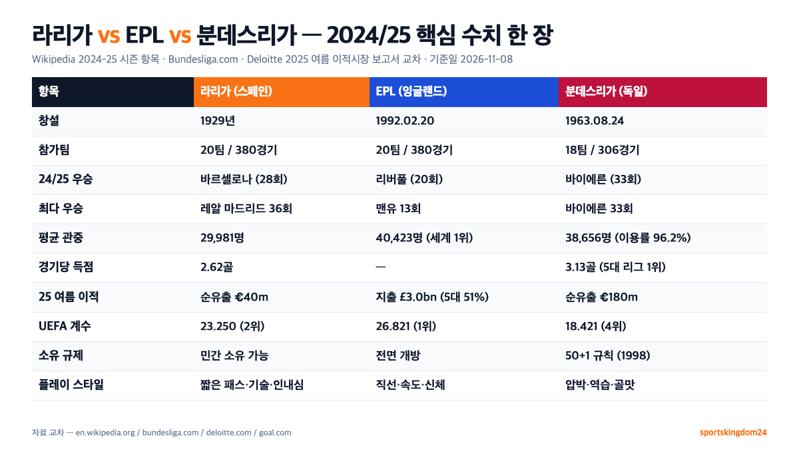
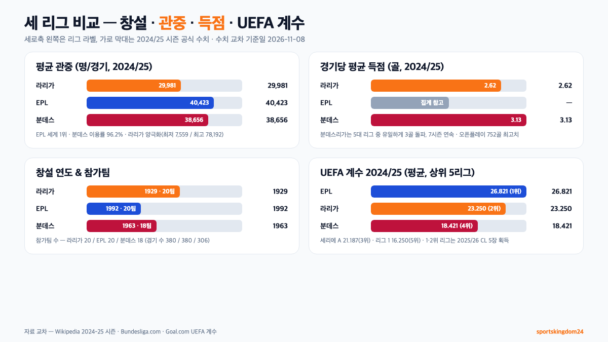

**라리가 vs EPL vs 분데스리가**는 "어느 리그가 더 좋은가"가 아니라 **어느 축구를 좋아하느냐**로 갈립니다. 2024/25 시즌 공식 수치만 놓고 보면 EPL은 평균 관중 40,423명으로 세계 1위, 분데스리가는 경기당 평균 **3.13골**(5대 리그 1위)로 득점왕, 라리가는 **UEFA 챔피언스리그 우승 20회**(단일 리그 최다)의 트로피 리그예요. 재정은 EPL이 2025년 여름 이적시장에서 **£30억**(5대 리그 51%)을 혼자 쓸 만큼 압도적이고, 분데스리가는 **50+1 규칙**(1998년 도입)으로 팬이 과반 지분을 쥐는 유일한 리그입니다. 이 글은 숫자 하나하나를 wikipedia 공식 시즌 페이지·Bundesliga.com·Deloitte 보고서로 교차한 뒤, 세 리그를 **한 장 표**로 묶어 정리했습니다.

📌 3줄 요약
<b>돈·시청자 스케일</b>은 EPL 압승(평균 관중 40,423·2025 여름 이적시장 £30억·국제중계 €2.55bn/년). <b>경기 재미(득점)</b>는 분데스리가 1위(경기당 3.13골, 5대 리그 중 유일하게 3골 돌파). <b>트로피 밀도</b>는 라리가(CL 우승 20회·발롱도르 24회).

구조 차이의 핵심은 <b>소유권</b>이에요. EPL은 외국 자본에 거의 전면 개방, 라리가는 레알·바르사·아틀레틱 같은 회원제 구단 혼재, 분데스리가는 1998년부터 <b>50+1 규칙</b>으로 구단 지분 과반을 회원(팬)이 쥐어야 합니다.

경기 스타일도 다릅니다. EPL은 신체·속도·다이렉트 플레이, 라리가는 짧은 패스·기술·인내심, 분데스리가는 강한 압박·역습·3골 리그. 하나만 본다면 EPL이 가장 "일요일 저녁 TV용"에 가깝고, 전술을 공부한다면 라리가, 골맛이면 분데스리가가 정답에 가까워요.

이 글은 영문 Wikipedia의 "La Liga", "Premier League", "Bundesliga", "50+1 rule", "2024–25 La Liga", "2024–25 Premier League", "2024–25 Bundesliga" 항목과 Bundesliga.com의 2024/25 유럽 5대 리그 비교 기사, Deloitte 2025년 여름 이적시장 보고서, Goal.com의 2024/25 UEFA 계수 랭킹 표, Daum 뉴스의 유럽 5대 리그 입문 가이드를 교차해 정리한 것입니다.

## 라리가 vs EPL vs 분데스리가 — 30초 요약 비교표

먼저 세 리그를 한 장에 압축한 비교표입니다. 아래 수치는 모두 **2024/25 시즌 공식 자료**(Wikipedia 시즌별 항목, Bundesliga.com, Deloitte 2025) 교차 확인한 값이에요.

| 항목 | 라리가(스페인) | EPL(잉글랜드) | 분데스리가(독일) |
| --- | --- | --- | --- |
| 창설 | 1929년 | 1992년 2월 20일 | 1963년 8월 24일 |
| 참가팀 수 | 20팀 | 20팀 | 18팀 |
| 2024/25 우승 | 바르셀로나(28회) | 리버풀(20회) | 바이에른 뮌헨(33회) |
| 최다 우승팀 | 레알 마드리드(36회) | 맨체스터 유나이티드(13회) | 바이에른 뮌헨(33회) |
| 2024/25 평균 관중 | 29,981명 | 40,423명 | 38,656명 |
| 2024/25 경기당 득점 | 2.62골 | 2.93골 | 3.13골(5대 리그 1위) |
| 2024/25 득점왕 | 음바페(31골) | 모하메드 살라(29골) | 해리 케인(26골) |
| 2025 여름 이적시장 | 순유출 €40m | 지출 £30억(순지출 £12억) | 순유출 €180m |
| 소유권 규제 | 민간 소유 가능 | 민간 소유 전면 허용 | 50+1 규칙(1998년) |
| 2024/25 UEFA 계수 | 평균 23.250(2위) | 평균 26.821(1위) | 평균 18.421(4위) |
| CL 우승 누적 | 20회(단일 리그 최다) | 15회 | 8회 |
| 플레이 스타일 | 짧은 패스·기술·인내심 | 직선·속도·신체 | 압박·역습·골맛 |

표 한 줄 요약. "**EPL은 돈, 분데스리가는 재미, 라리가는 트로피**"로 외우면 편해요. 아래 각 섹션에서 숫자 하나하나가 어디서 왔는지 그대로 풀어 보여드립니다.

## 세 리그 창설과 규모 — 1929·1992·1963년, 참가팀 수의 비밀

세 리그는 **창설 순서**부터 다릅니다. **라리가**(1929년)가 가장 먼저 열렸어요. **분데스리가**(1963년 8월 24일)는 2차 세계대전 패전 뒤 서독 각 지역 리그를 하나로 묶은 통합 리그로 시작됐습니다. **EPL**(1992년 2월 20일)은 가장 늦게 생긴 리그예요. 원래 잉글랜드 1부 리그(First Division)가 1888년부터 있었지만, 1992년 1부 구단들이 "중계권 수입을 상위 구단끼리만 나누자"고 Football League에서 분리 독립해 Premier League를 만들었습니다. EPL의 유별난 재정 스케일은 이 "분리 독립" 역사에서 시작돼요.

참가팀 수는 **라리가·EPL이 20팀, 분데스리가만 18팀**입니다. 분데스리가가 2팀 적다는 건 **경기 수가 적다**는 뜻이기도 해요. 20팀 리그는 팀당 38경기·리그 전체 380경기, 18팀 리그는 팀당 34경기·리그 전체 306경기입니다. 분데스리가 팬이 "짧고 굵게 끝난다"고 말하는 이유가 여기 있어요. 선수 체력 부담은 적고, 그만큼 선수들이 **챔피언스리그·DFB 포칼**(독일 FA컵) **대회에 체력을 남길 수 있는 구조**입니다.

흥미로운 차이는 **승강제 규모**예요. 라리가는 매 시즌 하위 **3팀**이 라리가2(Segunda División)로 강등되고, EPL도 하위 **3팀**이 챔피언십(2부)으로 떨어집니다. 반면 분데스리가는 **하위 2팀 직접 강등 + 16위는 2부 3위와 플레이오프**입니다. 즉 분데스리가는 2.5팀이 강등되는 셈이에요. 2024/25 시즌 EPL에서는 승격 3팀(사우샘프턴·레스터·입스위치)이 한 시즌 만에 모두 강등되는 "**영국 축구 역사상 3번째 트리플 강등**"이 발생했을 만큼, EPL의 중하위 격차는 세 리그 중 가장 큽니다.

## 평균 관중 비교 — EPL 40,423명, 분데스 38,656명, 라리가 29,981명(2024/25)

관중 수는 세 리그의 "**체감 열기**"를 가장 솔직하게 보여주는 지표예요. 2024/25 시즌 공식 수치로 보면 이렇습니다.

- **EPL**: 평균 **40,423명**/경기, 시즌 총 15,360,627명 — **세계 1위**
- **분데스리가**: 평균 **38,656명**/경기, 시즌 총 11,828,684명, 스타디움 평균 이용률 **96.2%** — 세계 2위
- **라리가**: 평균 **29,981명**/경기, 시즌 총 11,392,732명

수치만 보면 "EPL > 분데스 > 라리가" 순이지만, 결이 조금 다릅니다. **분데스리가는 18팀 리그**(경기 수가 적음)인데도 EPL과 평균 관중 격차가 2,000명도 안 나요. 즉 분데스리가는 **경기 1개당 관중 밀도**가 사실상 EPL과 어깨를 나란히 하는 수준입니다. 대표 사례가 **보루시아 도르트문트의 지그날 이두나 파크**로, 평균 **81,365명**이 들어와 **2024/25 시즌 유럽 최대 평균 관중**을 기록했고, 18팀 리그 기준 홈 17경기 모두 **100% 매진**이었어요(출처. Bundesliga.com 2024/25 유럽 5대 리그 비교 기사, "how-germany-compares-to-europe-s-other-top-leagues-2024-25-goals-attendance"). 바이에른의 알리안츠 아레나(평균 약 7만 5천 명)와 함께 "유럽에서 티켓이 가장 안 구해지는 두 경기장"이 모두 분데스리가에 있습니다.

라리가가 상대적으로 낮은 이유는 구조에 있어요. **레알 마드리드·바르셀로나·아틀레티코가 평균 6만~8만 명**을 꽉 채우는 반면, 하위권(알라베스·헤타페·에스파뇰 등)이 1만~2만 명대로 떨어지는 **양극화**가 큽니다. 2024/25 시즌 **최저 관중은 7,559명**(헤타페 vs 에스파뇰, 2024.12.9)이었어요. 반대로 **최고 관중은 78,192명**(레알 vs 바르사 엘 클라시코, 2024.10.26)입니다. 라리가의 평균 관중을 끌어내리는 건 상위 3팀이 약해서가 아니라, 하위권이 분데스·EPL 중하위권만큼 "**매번 꽉 차는 지역 열기**"를 못 만들어서예요.

## 중계권·재정 격차 — EPL이 이적시장 51%를 차지하는 이유

재정 규모 차이는 **중계권**과 **이적시장**, 두 숫자에서 갈립니다.

**EPL 중계권**은 압도적입니다. 2022~2025 사이클 기준 **영국 내 £6.7bn**(Sky+TNT) + **해외 £5.3bn**이었고, 2025~2028 사이클은 **£12.25bn**(US$15.3bn)으로 **17% 인상**됐어요. 라리가·분데스리가의 같은 창(2025~2028) 중계권 총액은 **EPL의 절반 수준에 머무는 것**으로 각 리그의 공식·언론 보도를 통해 알려져 있고, EPL은 리그 내 **상·하위 구단 간 분배 격차**가 다른 리그보다 크게 벌어지는 구조로 자주 지적됩니다.

**이적시장**에서는 더 벌어져요. Deloitte 2025년 보고서 기준, **2025년 여름 이적시장에서 EPL 구단이 쓴 돈은 £3.0bn**(순지출 £1.2bn)으로, 유럽 5대 리그 전체 지출의 **51%를** EPL 혼자 차지했습니다. 역사 평균이 46%였으니 **격차가 더 벌어지고 있는 것**이에요. 반면 같은 창에서 **라리가 순지출 €40m, 분데스리가 순유출 €180m, 리그앙 순유출 €305m**로, EPL을 제외한 4개 리그는 모두 "**순유출**(파는 쪽)" 입장이었습니다. 쉽게 말해, 다른 리그가 EPL에 선수를 "**팔면서 리그를 굴린다**"는 뜻이에요.

흥미로운 역설. **스타 선수 밀도는 라리가가 여전히 1위**입니다. 발롱도르 수상 횟수 누적은 라리가 선수가 **24회**(단일 리그 최다)이고, 챔피언스리그 우승 횟수도 라리가 소속 구단이 **20회**(단일 리그 최다)예요. 돈은 EPL이 쓰지만, 트로피는 아직 라리가가 더 많이 들어 올린 셈입니다. 이 돈 vs 트로피의 분기점을 가장 선명하게 보여주는 선수 비교가 [메시 vs 호날두 통산 기록, 골·도움·트로피까지 숫자로 본 두 선수 커리어](/messi-vs-ronaldo-career-stats/) 쪽에 자세히 담겨 있어요.

💡 EPL이 돈을 쓰는데 왜 CL은 라리가가 더 많나
EPL의 재정 우위는 2010년대 후반부터 급격히 벌어진 현상입니다. 반면 라리가 CL 우승 20회 중 상당수는 레알 마드리드(역대 15회·CL 최다)와 바르셀로나(5회) 두 구단이 2000년대~2010년대 초반에 쌓은 것이에요. 돈 격차가 트로피 격차로 넘어오려면 몇 년 더 걸릴 가능성이 크고, 이미 2023년 맨시티 CL 첫 우승·2024·25년 EPL 구단의 깊은 CL 진출로 신호가 보이기 시작했습니다.

## 플레이 스타일 차이 — 압박의 분데스, 기술의 라리가, 속도의 EPL

세 리그는 **득점 수**부터 다릅니다. 2024/25 시즌 경기당 평균 득점은 이렇게 집계됐어요.

- **분데스리가**: 경기당 **3.13골** — 5대 리그 중 **유일하게 3골 돌파**, 7시즌 연속 3골 돌파
- **EPL**: 경기당 **2.93골** (1,115골/380경기), 득점왕 **모하메드 살라 29골**(리버풀)
- **라리가**: 경기당 **2.62골** (995골/380경기), 득점왕 **킬리안 음바페 31골**(레알 마드리드)

Bundesliga.com 공식 기사가 공개한 분데스리가의 **752골이 오픈플레이에서 터졌다**는 수치는 "**기록 집계 이후 역대 최고치**"예요. 즉 **PK·세트피스에 기대지 않고 흐르는 경기 안에서 터진 골**이 가장 많은 리그가 분데스리가라는 얘기입니다. 이 숫자는 "분데스리가는 수비가 약하다"가 아니라 "**빠른 전환과 공격 수가 많다**"는 신호예요. 상위 전술 분석 매체들이 "**분데스리가 = 유럽 5대 리그 중 가장 많은 역습**"으로 분류하는 근거가 여기 있습니다. 압박과 전환 비교는 [게겐프레싱·티키타카 차이, 반대가 아니라 쌍둥이 전술인 이유](/soccer-pressing-tactics/)에서 숫자까지 다뤘어요.

EPL은 "**직선 플레이·신체 접촉·속도**"로 요약됩니다. 공식 Premier League 매체와 코치 인터뷰에서 자주 나오는 표현이 "**다른 리그와 비교하면 다른 종목에 가깝다**(like playing another sport)"예요. 공을 뺏자마자 바로 길게 던지는 다이렉트 플레이 빈도가 5대 리그 중 가장 높고, 헤더·지상 경합 빈도도 가장 많습니다. 2024/25 리버풀의 우승 역시 **고강도 압박 + 빠른 전환**이라는 EPL형 템플릿 안에서 나온 성과예요.

라리가는 "**짧은 패스·점유·인내심**"의 리그입니다. 상위 구단(바르셀로나·레알·소시에다드 등)의 평균 점유율이 60%대를 꾸준히 유지하고, 상대 압박을 유인하며 뒤에서부터 공을 올리는 **빌드업** 패턴이 전 리그에 퍼져 있어요. 주심이 신체 접촉을 더 엄격하게 잡는 경향도 있어, 선수들이 "공을 돌리는 쪽"을 더 선호합니다. 결과적으로 **경기 속도는 EPL보다 느리지만, 패스 성공률·개인 테크닉 밀도는 5대 리그 중 최상위**예요.

**분데스리가는 두 리그 사이**에 있는 변칙입니다. 압박 강도는 EPL급이고, 전환 속도는 EPL보다 빠른 경우도 많아요. 반면 상위 구단(바이에른·레버쿠젠·라이프치히)은 후방 빌드업을 EPL보다 세밀하게 사용합니다. 바이에른의 **조슈아 킴미히**처럼 중원 깊은 위치에서 많은 패스를 뿌리는 "딥 플레이메이커" 유형이 각 상위 구단에 배치돼 있어, 분데스리가가 "압박만 있는 리그"가 아니라 **압박 + 후방 빌드업 둘 다 가진 리그**라는 평가를 받습니다.

## 역대 최다 우승 구단 지도 — 바이에른 11연패 vs 레알·바르사 vs 맨유 20회

**각 리그의 왕관 분포**도 세 리그를 가르는 포인트입니다.

**라리가**는 "**듀오폴리**(이원 지배)"예요. **레알 마드리드 36회 + 바르셀로나 29회 = 두 구단이 65회**로, 라리가 역사 95시즌 중 **68% 이상을 둘이 나눠 가졌습니다**. 2024/25 시즌 우승팀도 바르셀로나(28번째 리그 우승). 2010년대에 아틀레티코 마드리드(2013/14, 2020/21)와 레알 소시에다드가 간헐적으로 왕좌를 노렸지만, 라리가의 상단 구조는 여전히 레알-바르사 축입니다.

**EPL**은 "**경쟁적 과점**"입니다. 1992년 창설 이후 지금까지 리그 우승 구단은 **8팀**뿐이에요(맨유·맨시티·첼시·아스널·리버풀·블랙번·레스터·노팅엄은 창설 전). 이 중 맨유 13회, 맨시티 8회, 첼시 5회, 아스널 3회로 "빅4~빅6"가 돌아가며 들고 있습니다. 2024/25 시즌에는 **리버풀이 20번째 잉글랜드 1부 리그 우승**을 들어 올리며 맨유와 **역대 1부 리그 우승 20회 타이**를 이뤘어요. EPL만 치면 맨유가 13회로 여전히 1위입니다.

**분데스리가**는 "**바이에른 왕국**"이에요. 총 61시즌 중 **바이에른 뮌헨이 33회 우승**, 2012/13부터 2022/23까지 **리그 역사상 유일무이한 11연패**를 이뤘습니다. 2024/25 시즌에는 **바이에른이 2023/24 레버쿠젠 우승 뒤 1시즌 만에 왕좌를 되찾아 33번째 리그 우승**을 추가했어요. 바이에른 다음으로 우승이 많은 구단은 **분데스리가 시대**(1963년 이후) 기준으로 보루시아 도르트문트(5회)·보루시아 묀헨글라트바흐(5회)·베르더 브레멘(4회)·슈투트가르트(3회)·함부르크(3회) 순인데, 바이에른을 제외하면 어느 구단도 "**6회 이상 리그 우승**"을 쉽게 못 넘고 있습니다. 상금·중계권 분배가 상위권에 편중된 구조가 유지되는 한, 이 왕조는 당분간 흔들리기 어려워요. 각 리그 상금 분배는 [라리가 우승 상금, 우승팀이 실제로 받는 돈의 구조](/la-liga-prize-money/), [프리미어리그 우승 상금 구조](/epl-prize-money/), [분데스리가 우승 상금 구조](/bundesliga-prize-money/)에 자세히 풀어 뒀습니다.

## 분데스리가만의 50+1 소유 규칙 — 팬이 과반을 쥐는 이유

세 리그 중 **구조적으로 가장 다른 리그**가 분데스리가입니다. 이유는 **50+1 규칙**(50+1 Regel)이에요. 1998년 DFL(독일 축구 리그 기구)이 "구단의 지분 **50% + 1표**는 반드시 구단 회원(팬)에게 남아 있어야 한다"고 못 박았습니다. 즉 **외부 투자자는 49% 이하만 가질 수 있어요**. 분데스리가에서 1부 경기를 뛰려면 구단 대부분이 이 규칙을 지켜야 합니다.

**왜 만들었나**. 1998년 이전까지 독일 축구는 비영리 회원제 협회(e.V.) 형태로만 운영됐어요. 1990년대 자본 유입을 열어 두되, **잉글랜드형 민간 인수**로 구단 정체성이 흔들리지 않게 안전장치를 걸어 놓은 것이 50+1입니다. 결과적으로 **분데스리가 시즌권이 EPL 상위 구단보다 현저히 저렴한 편**이고, **울트라스 응원 문화**(열성 팬), **100%에 가까운 경기장 이용률**이 이 규칙 위에서 지탱되고 있어요.

**예외 구단**도 있습니다. **바이엘 레버쿠젠**(제약사 Bayer AG의 사내 축구부로 시작)과 **VfL 볼프스부르크**(폭스바겐 직장 스포츠부로 시작)는 **20년 이상 모기업이 지속 투자한 역사**를 인정받아 예외로 인정됐어요. **1899 호펜하임**은 SAP 공동창업자 디트마르 호프가 예외 승인을 받았다가 **2024년 11월 투표권을 회원에게 돌려주며 복귀**했습니다. **RB 라이프치히**는 "회원을 거의 다 Red Bull 직원으로 제한"하는 구조로 규칙을 우회한 사례예요. 2014년 기준 회원 수가 **17명**(대부분 Red Bull 직원)에 불과했다는 보고가 있을 정도입니다.

⚠️ 50+1이 "팬 민주주의"의 완성형은 아니다
50+1 규칙은 EPL식 과잉 외자화를 막는 안전장치이지만, 동시에 <b>자본 유입 상한선</b>이기 때문에 챔피언스리그에서 EPL·라리가 최상위권과 같은 선수 영입을 하기가 구조적으로 어렵습니다. 독일 구단의 역대 유러피언컵/챔피언스리그 우승은 <b>바이에른 6회·도르트문트 1회(1997)·함부르크 1회(1983)</b>로 총 8회이고, 2010년대 이후로는 바이에른(2013·2020) 외에는 결승 문턱을 넘지 못했어요. 2009년 Hannover 96 등은 규칙을 EU 경쟁법 위반으로 제소했지만, 32-4 투표로 유지가 결정됐습니다.

## UEFA 계수 2024/25 — 유럽 5대 리그 순위

"어느 리그가 더 강한가?"를 숫자로 가장 공정하게 비교하는 지표가 **UEFA 리그 계수**(country coefficient)예요. 시즌 내 UEFA 주관 대회(챔피언스리그·유로파리그·컨퍼런스리그)에서 각국 구단이 거둔 **승 2점·무 1점**을 **참가 구단 수로 나눠 평균**을 낸 값입니다. 이 평균이 리그의 UEFA 진출권 수(CL 4~5장) 배정 기준이에요.

**2024/25 시즌 공식 수치**(Goal.com 2025.3.14 집계)로 상위 5대 리그는 이렇게 정리됐습니다.

| 순위 | 리그 | 총점 | 평균 계수 |
| --- | --- | --- | --- |
| 1위 | 잉글랜드(EPL) | 187.750 | **26.821** |
| 2위 | 스페인(라리가) | 162.750 | **23.250** |
| 3위 | 이탈리아(세리에 A) | 169.500 | 21.187 |
| 4위 | 독일(분데스리가) | 147.375 | **18.421** |
| 5위 | 프랑스(리그 1) | 81.250 | 16.250 |

**EPL과 라리가**가 2024/25 시즌 1·2위에 오른 결과로 **2025/26 시즌 챔피언스리그 5팀 출전권**을 가져갔습니다(기본 4장 + 전년 성적 보너스 1장). **분데스리가는 4위**로, UEFA 평가 기준으로는 세 리그 중 가장 낮지만, 이는 **18팀 리그라 참가 구단이 적어 분모가 작게 잡히는 구조적 불리함**과도 관련 있어요. 2023/24 시즌엔 레버쿠젠의 CL 깊은 진출과 바이에른·도르트문트의 선전으로 분데스리가가 **1위**를 찍은 적도 있을 만큼, UEFA 계수는 매 시즌 흔들리는 **단기 지표**예요.

반면 한국의 [K리그](https://www.kleague.com/)는 AFC(아시아 축구 연맹) 계수로 분류되므로 UEFA 계수와 직접 비교되지 않지만, 아시아 챔피언스리그 성적을 기준으로 **아시아 상위 3~4위** 계수를 꾸준히 유지하고 있고, 2024년 울산 HD의 ACL 결승 진출·광주FC의 ACL 데뷔 시즌 호성적으로 아시아 계수가 다시 반등했습니다.

## 어느 리그부터 볼까 — 시청자 취향별 추천

여기까지 왔으면 "**그래서 뭘 봐야 하냐**"가 궁금하실 거예요. 세 리그 각각이 "어느 시청자에게 가장 맞는가"를 추려 정리했습니다.

"**TV 리모컨 1개로 가장 재밌는 걸 고르겠다**"면 **EPL**이 답에 가깝습니다. 상위 6팀의 격차가 좁고, 골문 앞 전개가 가장 빠르며, 한국 중계(쿠팡플레이·SPOTV NOW)의 해설·자막도 가장 세밀해요. 2024/25 리버풀의 우승 확정 경기, 맨시티의 역전 드라마, 하위권 3팀의 동시 강등 등 **스토리 라인이 매주 터집니다**. 대신 정규 시즌 9개월 내내 매주 4~6경기를 소화해야 해 "**덕질 비용**"이 가장 큰 리그이기도 해요.

"**전술을 공부하면서 보고 싶다**"면 **라리가**입니다. 상위 구단의 평균 점유율이 60% 이상, 수비 뒷공간을 어떻게 만들고 공을 꽂아 넣는지가 매 경기 반복돼 "**[빌드업 교과서](/soccer-build-up-play-basics/)**"로 통하는 리그예요. 엘 클라시코(레알 vs 바르사)와 마드리드 더비(레알 vs 아틀레티코)는 전 세계 시청률 최상위권이고, 전술 유튜브·분석 채널이 라리가 경기를 소재로 쓰는 비중이 가장 높아요. 아직 '결과 축구'보다 '**과정 축구**'를 좋아하는 팬에게 맞습니다.

"**골맛이 중요하다**"면 **분데스리가**예요. 경기당 3.13골(2024/25)은 세 리그 중 1위이고, 역습 빈도도 가장 높습니다. 바이에른·도르트문트·레버쿠젠·라이프치히 4팀이 **매 경기 3골 이상을 노리는** 공격 성향이에요. 스타디움 이용률 96.2%, 스탠딩 응원 문화까지 더하면 "**경기장에 가는 리그**"로서 가치가 가장 큽니다. 다만 EPL·라리가에 비해 **한국어 중계·해설이 적어** 접근성이 떨어지는 단점도 있어요.

**취향별 요약**. "글로벌 트렌드·돈·속도 = EPL", "기술·점유·트로피 = 라리가", "득점·응원·전환 = 분데스리가". 세 리그를 모두 보기 어렵다면, **처음엔 EPL로 시작해 전술이 궁금해질 때 라리가, 골이 고플 때 분데스리가**로 넓혀 가는 쪽이 현실적입니다.

## 자주 묻는 질문 (FAQ)

**Q. 라리가 vs EPL vs 분데스리가 중에 어느 리그가 제일 강하나요?** 단일 지표는 없습니다. 2024/25 UEFA 계수 기준으로는 EPL(평균 26.821) > 라리가(23.250) > 분데스리가(18.421) 순이지만, 챔피언스리그 누적 우승 횟수는 라리가 20회로 단일 리그 최다예요. 돈은 EPL, 트로피는 라리가, 경기당 득점은 분데스리가가 1위라고 보시면 됩니다.

**Q. 분데스리가 50+1 규칙은 뭔가요?** 1998년 독일 축구 리그(DFL)가 도입한 소유권 규제입니다. 구단 지분의 50% + 1표를 반드시 구단 회원(팬)이 보유해야 1부 리그 출전이 가능해요. 외부 투자자는 49% 이하만 가질 수 있어, 잉글랜드식 외국 자본 전면 인수가 차단됩니다. 바이엘 레버쿠젠·볼프스부르크·호펜하임·RB 라이프치히는 예외·우회 사례예요.

**Q. EPL이 다른 리그보다 돈을 많이 쓰는 건 사실인가요?** 네, 그 격차가 2020년대 들어 더 벌어졌습니다. Deloitte 2025 보고서 기준 2025년 여름 이적시장에서 EPL 구단이 지출한 금액은 £3.0bn으로, 유럽 5대 리그 전체 지출의 51%였어요. 중계권도 2025~2028 사이클 £12.25bn(US$15.3bn)으로, 같은 기간 라리가·분데스리가 중계권의 2~3배 규모입니다.

**Q. 분데스리가 경기장은 왜 항상 꽉 차나요?** 2024/25 시즌 분데스리가 평균 스타디움 이용률이 96.2%였고, 도르트문트는 홈 17경기 전부 100% 매진이었습니다(Bundesliga.com 2024/25 5대 리그 비교 기사). 이유는 50+1 규칙 위에서 **EPL 상위 구단보다 현저히 낮게 유지되는 티켓 가격**, 스탠딩 구역(standing terrace)을 허용하는 독일식 경기장 설계, 지역 커뮤니티 기반 울트라스 응원 문화 세 가지입니다.

**Q. 라리가 평균 관중이 세 리그 중 가장 낮은 이유는 뭔가요?** 라리가는 레알·바르사·아틀레티코 등 상위 구단이 6만~8만 명을 꽉 채우지만, 하위권 구단이 1만~2만 명대에 머무는 양극화가 큽니다. 2024/25 시즌 최저 관중은 7,559명(헤타페 vs 에스파뇰, 2024.12.9), 최고는 78,192명(엘 클라시코, 2024.10.26)으로 10배 넘는 격차였어요. EPL·분데스리가는 중하위권도 지역 열기로 꾸준히 2만~3만 명을 채우는 구조입니다.

**Q. 세 리그 다 보긴 어려운데, 어느 리그부터 보면 좋을까요?** 처음이면 EPL이 가장 쉽습니다. 한국 중계(쿠팡플레이)가 가장 잘 돼 있고, 경기 속도가 빨라 지루함이 적어요. 전술 공부가 목적이면 라리가, 골이 많이 보고 싶으면 분데스리가입니다. "EPL로 축구 보는 습관을 들인 뒤 라리가·분데스리가로 넓힌다"가 가장 흔한 순서예요.

**Q. 왜 분데스리가는 18팀이고 다른 리그는 20팀인가요?** 분데스리가는 1963년 창설 당시부터 16팀으로 시작해, 1965년 18팀으로 확대된 뒤 현재까지 18팀 체제를 유지해 왔습니다. 18팀이면 리그 전체 경기 수가 306경기로, 20팀 리그(380경기)보다 74경기 적어요. 선수 체력 부담을 줄여 챔피언스리그·DFB 포칼 등 컵 대회에 체력을 분산할 수 있다는 장점이 커, 독일 축구협회가 확대 요구를 매번 거부해 왔습니다.

*이미지 출처. 대표 이미지(세 리그 비교 카드)와 본문 다이어그램(비교표·창설연도·관중/득점 그래프)은 모두 sportskingdom24에서 영문 Wikipedia "La Liga"·"Premier League"·"Bundesliga"·"2024–25 Premier League"·"2024–25 La Liga"·"2024–25 Bundesliga"·"50+1 rule" 항목, Bundesliga.com의 2024/25 유럽 리그 비교 기사, Deloitte 2025 여름 이적시장 보고서, Goal.com의 UEFA 계수 2024/25 랭킹을 교차해 직접 제작했습니다.*

---

**관련 키워드** — #라리가vsEPL #라리가vs분데스리가 #EPL분데스리가비교 #유럽5대리그비교 #프리미어리그중계권 #분데스리가50플러스1 #UEFA계수2024 #바이에른뮌헨11연패 #엘클라시코 #분데스리가평균관중 #라리가특징 #축구리그비교
