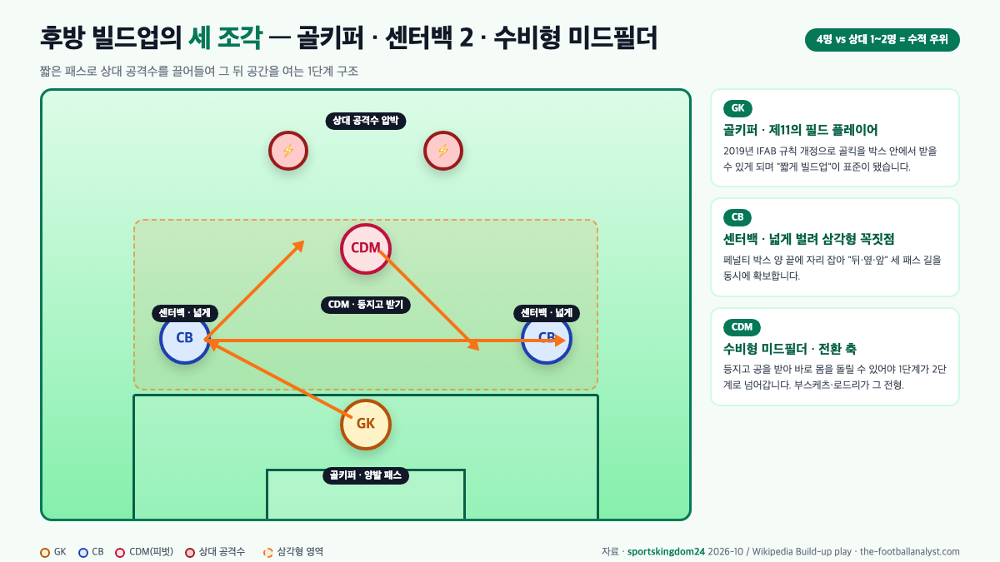
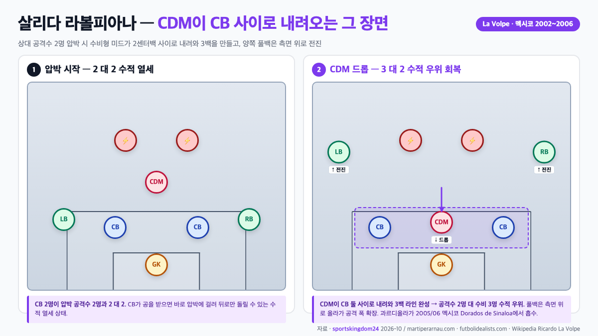

빌드업 축구란 한 줄로 "**상대 압박을 유인하면서 뒤에서부터 공을 안전하게 앞으로 꺼내는 과정**"입니다. "build up"이라는 영어 단어 그대로 "밑에서부터 쌓아 올린다"는 뜻이고, 축구에서는 보통 **골키퍼의 발 또는 센터백의 짧은 패스로 시작해, 수비형 미드필더가 그 패스를 받아 앞으로 전진하는 지점까지**를 가리켜요. 공을 길게 걷어내는 롱볼 축구의 반대편에 있는 전술입니다.

📌 3줄 요약
빌드업 축구는 <b>골키퍼·센터백·수비형 미드필더</b>가 짧은 패스로 상대 압박을 유인하고, 상대가 전진한 뒤 생긴 공간으로 공을 꽂아 넣는 과정입니다.

현대 빌드업의 표준 구조는 과르디올라의 <b>3-2-5</b>(수비 3·중원 2·공격 5)이고, 그 핵심 패턴이 수비형 미드필더가 센터백 사이로 내려오는 <b>살리다 라볼피아나</b>(La Volpe, 멕시코 2002~2006)예요.

이 틀을 세계에 심은 사람은 <b>요한 크루이프(바르셀로나 1988~1996 감독)</b>이고, 한국 축구에서는 벤투호(2018.8~2022.12)가 2022 카타르 월드컵 16강 진출로 그 유효성을 증명했습니다.

이 글은 영문 Wikipedia의 "Johan Cruyff"·"Pep Guardiola"·"Paulo Bento"·"Ricardo La Volpe" 항목, 한국어 Wikipedia "빌드업(축구)", brunch.co.kr 축구 전술 칼럼, martiperarnau.com과 futbolidealists.com의 "Salida Lavolpiana" 전술 해설, cupello.com·the-footballanalyst.com·kharasportsdaily.com의 영문 빌드업 코칭 가이드, interfootball.co.kr의 벤투호 전술 분석을 교차해 정리한 것입니다.

## 빌드업 축구란 뭘까 — 한 줄 정의부터 시작

**빌드업 축구란** 뒤에서부터 짧은 패스로 공을 꺼내 앞으로 전진하는 "경기 시작 방식"입니다. 상위 10개 글(cupello.com, zone14.ai, the-footballanalyst.com 등)이 공통으로 쓰는 정의가 "**골킥·수비 지역에서 공을 받아 공격 3분의 1까지 조직적으로 운반하는 과정**"이에요. 반대말은 공을 하프라인 너머로 바로 걷어내는 "롱볼" 또는 "다이렉트 플레이"입니다.

핵심은 "그냥 짧게 돌리는 것"이 아니라 **의도적으로 상대 압박을 끌어들여 공간을 만드는 것**이에요. 상대 공격수 두 명이 우리 센터백을 압박하러 올라오면, 그만큼 상대 미드필드와 수비 라인 사이가 벌어지죠. 바로 그 열린 공간으로 공을 넣는 것이 빌드업의 목적입니다. 짧게 돌리는 건 수단이고, 공간을 만드는 건 목적이에요. 상위 코칭 가이드(the-footballanalyst.com)가 "**빌드업의 성패는 상대가 어떻게 압박하느냐에 따라 결정된다**"고 말하는 것도 그래서입니다.

빌드업은 보통 **3단계**로 나눕니다. 1단계 **후방 빌드업**(자기 진영 수비 3분의 1), 2단계 **중원 빌드업**(미드필드), 3단계 **최종 3분의 1**(상대 진영 침투)이에요. 이 글이 다루는 "후방 빌드업"은 1단계예요. 가장 안전하지만 가장 위험한 구역, 즉 "실수하면 바로 실점"으로 이어지는 자리에서 어떻게 공을 꺼내는지가 전술의 뼈대입니다.

## 왜 "뒤에서부터" 꺼내는가 — 상대 압박 유인의 원리

후방에서 짧게 꺼내는 쪽을 택하는 이유는 세 가지예요. **첫째, 상대 수비 라인을 끌어올려 그 뒤에 공간을 만든다.** 상대 공격수가 우리 센터백에게 압박을 걸러 오면, 상대 미드필더도 함께 전진해야 하고, 결과적으로 수비 라인도 올라옵니다. 이때 수비 라인과 골키퍼 사이가 벌어진 바로 그 공간이 "빌드업으로 얻어내려는 상품"이에요.

**둘째, 공을 소유한 시간이 길수록 상대가 공격할 시간이 짧다.** 영문 비교 글(kharasportsdaily.com)이 집계한 바로 과르디올라 체제 바르셀로나·맨시티는 평균 **65% 이상의 점유율**을 유지해 왔습니다. 공을 가진 쪽이 득점 기회를 더 자주 만들고, 반대로 공을 뺏겼을 때는 가장 가까운 선수들이 즉시 재압박(이른바 **게겐프레싱**·역압박)으로 되찾아 공격 흐름을 끊지 않아요. 짧은 패스로 "덜 뺏기도록 가깝게 서는" 포지션 플레이와 "뺏기자마자 다 같이 뺏는" 역압박이 서로 짝처럼 붙어 다니는 이유가 여기 있습니다. 두 개념의 쌍둥이 관계는 [게겐프레싱·티키타카 차이, 반대가 아니라 쌍둥이 전술인 이유](/soccer-pressing-tactics/)에서 숫자까지 비교해 두었습니다.

**셋째, 공격 조직을 사전에 세팅할 수 있다.** 롱볼로 공을 꽂으면 공격수들이 공중볼 경합을 하는 동안 뒤 선수들은 자리를 못 잡습니다. 반면 뒤에서 짧게 돌리는 동안 윙어는 측면 넓이를 잡고, 공격형 미드필더는 라인 뒤 침투 자세를 미리 잡아요. 그래서 수비형 미드필더가 상대 압박을 뚫고 공을 받는 순간 **다섯 명의 공격수가 이미 준비된 상태**가 됩니다. 이 "준비된 상태"가 과르디올라의 3-2-5 구조로 이어지는데, 그 그림은 아래 섹션에서 다시 보여드릴게요.

💡 "빌드업"과 "포지션 플레이"는 뭐가 다를까
포지션 플레이(Juego de Posición)는 그라운드를 가로 5·세로 4로 나눈 뒤 각 격자에 선수를 "같은 격자 2명 금지, 같은 라인 3명 금지" 식으로 배치하는 <b>자리 배치 규칙</b>입니다. 빌드업은 그렇게 배치된 자리에서 뒤에서부터 공을 꺼내는 <b>동작</b>이에요. 포지션 플레이가 "그림", 빌드업이 "그 그림을 그려 가는 과정"입니다.

## 후방 빌드업의 세 조각 — 골키퍼·센터백·수비형 미드필더

후방 빌드업은 세 자리의 톱니바퀴로 돌아갑니다. **골키퍼·두 명의 센터백·한 명의 수비형 미드필더**(홀딩/피벗), 이 4명이 핵심이에요. 상대 공격수가 1명으로 압박해 오면 수적 **4 대 1**로 쉽게 꺼내고, 2명이 올라오면 **4 대 2**로 패스 길이 하나는 열려 있습니다. 수적 우위를 유지하면서 공을 꺼내는 것이 1차 원칙이에요.

**골키퍼**는 "제11의 필드 플레이어"로 바뀐 지 오래입니다. 2019년 IFAB 경기규칙 개정으로 "**골킥을 페널티 박스 안에서 받아도 된다**"는 조항이 명문화되면서, 골키퍼의 발 앞에서 빌드업이 시작되는 그림이 전 세계 표준이 됐어요. 그 전에는 골킥 때 공이 반드시 박스 밖으로 나가야 유효했는데, 이 한 줄의 규칙 변경으로 "**골키퍼가 센터백처럼 짧게 패스**"하는 장면이 폭발적으로 늘었습니다. 현대 1군 레벨 골키퍼는 세이빙만큼이나 **패스 성공률 80% 이상**과 양발 사용 능력을 요구받아요.

**센터백 두 명**은 보통 넓게 벌려 섭니다. 페널티 박스 양 끝 혹은 그보다 더 바깥에 자리 잡아 **골키퍼와 삼각형**을 만들어요. 삼각형이 되는 이유는 간단합니다. 공을 가진 센터백이 압박을 받을 때 "뒤로 패스(골키퍼)" "옆으로 패스(다른 센터백)" "앞으로 패스(수비형 미드필더)" 세 개의 선택지를 모두 갖추기 위해서예요. 상위 코칭 가이드(the-footballanalyst.com)가 설명하는 "**삼각형과 마름모**(diamond)" 패턴의 가장 밑 변이 바로 이 지점입니다.

**수비형 미드필더**(피벗·레지스타)는 센터백 둘 사이, 혹은 그 바로 앞 자리에서 공을 받아 전진시킵니다. 2008/09 바르셀로나의 세르히오 부스케츠, 맨체스터 시티의 로드리가 이 자리의 교과서 사례예요. 패스 성공률·공중볼·태클 능력 모두 필요하지만, 가장 중요한 자질은 "**뒤돌아서 공을 받을 줄 아는가**"입니다. 상대 압박을 등지고 공을 받아 바로 몸을 돌려 전진 패스를 넣을 수 있어야 빌드업이 다음 단계로 넘어가요. 이 포지션의 역할·숫자는 [축구 포지션 완전 정리, 골키퍼부터 윙어까지 11개 역할](/soccer-positions-guide/)에서 번호별로 자세히 다뤘습니다.

## 살리다 라볼피아나 — 과르디올라가 멕시코에서 배워 온 CDM 드롭

후방 빌드업에서 가장 자주 쓰이는 패턴 이름이 **살리다 라볼피아나**(Salida Lavolpiana)예요. "La Volpe의 꺼내기(salida)"라는 뜻입니다. 상대 공격수가 2명으로 압박해 들어와 센터백 2명이 **2 대 2** 열세에 빠지는 순간, **수비형 미드필더가 두 센터백 사이로 쑥 내려와 3백 라인을 만들어** 공격수 2명 대 수비 3명(**3 대 2**) 수적 우위를 다시 회복하는 패턴이에요. 그 사이 양쪽 풀백은 과감히 올라가 측면 넓이를 잡습니다.

이 패턴을 체계로 정리한 사람이 **리카르도 라 볼페**입니다. 아르헨티나 출신 멕시코 감독으로, **2002년부터 2006년까지 멕시코 대표팀 감독**을 맡아 2003년 CONCACAF 골드컵 우승·2006년 FIFA 월드컵 16강에 이르렀어요. 그가 멕시코 1부 리그 아틀란테 FC·아틀라스 FC·아메리카 등에서 1990년대부터 쓰던 "뒤에서 꺼내는 자동화된 움직임(automatismos)"이 멕시코 대표팀에서 집약돼 패턴 이름으로 굳어졌습니다.

흥미로운 점은 과르디올라가 이 패턴을 멕시코에서 **직접** 배워 왔다는 사실이에요. 과르디올라는 선수 커리어 황혼기였던 **2005/06 시즌 멕시코 2부 Dorados de Sinaloa에서 뛰며** 당시 멕시코 축구를 지배하던 라 볼페의 전술을 가까이서 관찰했습니다. martiperarnau.com과 futbolidealists.com의 전술 해설 모두 이 멕시코 체류 시절을 "과르디올라가 수비형 미드필더 드롭을 자신의 전술로 흡수한 결정적 시기"로 꼽아요. 그는 2008년 바르셀로나 감독으로 돌아온 뒤 세르히오 부스케츠에게 이 역할을 맡기면서 라리가·CL을 모두 쓸어 담았습니다. 결국 "유럽 축구의 상징으로 통하는 포지션 플레이"의 핵심 패턴 하나가 **멕시코에서 수입된 전술**이라는 점이 흥미로운 사실이에요.

⚠️ 살리다 라볼피아나의 위험성
CDM이 아래로 내려오는 순간, <b>중원 바로 앞 공간이 통째로 비어버립니다</b>. 상대 공격형 미드필더가 그 공간을 선점하면 빌드업이 되자마자 2선 침투 한 번에 뚫려요. 그래서 살리다 라볼피아나는 "압박 뚫는 가장 좋은 패턴"인 동시에 "압박 못 뚫으면 가장 치명적인 패턴"입니다. 상대 압박 수에 따라 쓸지 말지 즉석에서 바꾸는 판단력이 필수예요.

## 과르디올라의 3-2-5 — 현대 빌드업의 표준

2020년대 유럽 상위권 팀의 빌드업 그림을 거의 다 지배하는 구조가 **3-2-5**입니다. 수비 3·중원 2·공격 5인 자리 배치예요. 겉으로는 4-3-3이나 4-2-3-1처럼 보이지만, **공을 가진 순간** 포메이션이 자동으로 3-2-5로 바뀌어요. 변환 방식은 두 가지입니다.

**첫째, 인버티드 풀백 방식**(inverted full-back). 풀백 한 명이 측면이 아니라 **중앙 수비형 미드필더 옆자리**로 들어와 2명의 중원을 만듭니다. 다른 풀백은 반대편 측면 윙어 자리를 비집고 올라가 쓰리톱의 측면이 돼요. 수비 라인에는 센터백 2명 + 반대편 풀백 1명이 남아 3백을 이룹니다. 과르디올라의 **맨체스터 시티**가 조슈아 킴미히(바이에른)·주앙 칸셀루·존 스톤스(2022/23 시즌 CL 우승 당시) 등을 이 자리에 세워 2023년 UEFA 챔피언스리그 우승과 **2017/18~2023/24 사이 프리미어리그 6회 우승**을 완성한 틀이에요.

**둘째, 살리다 라볼피아나 방식.** 위에서 다룬 CDM 드롭이에요. 센터백 2명 사이로 수비형 미드필더 1명이 내려와 3백이 되고, 양쪽 풀백은 과감히 전진해 윙어 자리로 올라갑니다. 2008/09·2010/11 트레블 시즌 과르디올라의 바르셀로나(세르히오 부스케츠 드롭)와 2008~2012 스페인 대표팀 체제가 대표 사례예요. **라리가 3회 연속 우승**(2008/09·2009/10·2010/11)과 유로 2008·월드컵 2010·유로 2012 3연패가 이 구조로 쌓인 성과입니다.

두 방식 중 어느 쪽을 택할지는 **상대 압박 라인의 높이와 수**로 정해집니다. 압박 수가 적고(2명 이하) 라인이 중간이면 인버티드 풀백 쪽, 압박 수가 많고(2~3명) 라인이 높으면 살리다 라볼피아나 쪽을 쓰는 쪽이 유리해요. 포메이션 전체 구조를 더 넓게 보고 싶다면 [축구 포메이션 4-4-2와 4-3-3 차이, 중원 머릿수가 승부를 가르는 이유](/soccer-formation-442-vs-433/)와 함께 읽으면 그림이 선명해집니다.

## 역사 — 크루이프 토탈풋볼부터 과르디올라까지

빌드업 축구의 뿌리는 **1970년대 네덜란드의 토탈 풋볼**입니다. 리뉘스 미헐스 감독의 아약스가 1971·1972·1973년 유러피언컵(UEFA 챔피언스리그의 전신)을 3연패하며 "모든 선수가 포지션을 바꿔가며 공을 돌리는" 축구를 세계에 심었어요. 그 중심에 선수로 선 사람이 **요한 크루이프**입니다.

크루이프는 **1988년부터 1996년까지 FC 바르셀로나 감독**을 맡아 라마시아 유소년 아카데미의 전술 틀을 **포지션 플레이**(Juego de Posición)로 못 박았습니다. 라리가 4연패(1990/91~1993/94)와 바르셀로나 역사상 첫 유러피언컵 트로피(1992년 웸블리 결승)가 이 시기 성과예요. 그가 "라마시아 선수는 전원이 센터백도 할 수 있고, 전원이 미드필더도 할 수 있어야 한다"는 원칙을 세운 뒤로 바르셀로나는 "뒤에서 꺼내는 축구"의 상징이 됐습니다.

이 뼈대를 **최고 성적**으로 번역한 사람이 과르디올라예요. 2008/09 바르셀로나 1군 감독으로 부임한 첫 시즌 라리가·코파 델 레이·UEFA 챔피언스리그를 모두 들어 올려 스페인 축구 최초의 콘티넨털 트레블을 기록했고, 바이에른 뮌헨에서도 분데스리가 3연패(2013/14~2015/16), 맨체스터 시티에서 2023년 CL 우승과 EPL 6회 우승(2017/18·18/19·20/21·21/22·22/23·23/24)을 쌓았습니다. "크루이프가 뼈대를 세우고 과르디올라가 지붕을 올렸다"는 평가가 이 트로피 숫자에 그대로 담겨 있어요.

💡 짧게 보는 빌드업 축구 연표
1971~73년 아약스 유러피언컵 3연패(크루이프 선수) → 1988~96년 크루이프 바르셀로나 감독, 라마시아 포지션 플레이 → 2002~06년 라 볼페 멕시코 대표팀, 살리다 라볼피아나 체계화 → 2005/06년 과르디올라 Dorados de Sinaloa에서 라 볼페 관찰 → 2008~12년 과르디올라 바르셀로나 트레블·스페인 대표팀 메이저 3연패 → 2016~현재 맨체스터 시티 EPL 6회·CL 2023.

## 벤투호와 K리그 — 한국 축구가 받아들인 빌드업

한국 축구에 "빌드업"이 전면적 용어로 자리 잡은 계기는 **파울루 벤투 감독** 체제(**2018년 8월 17일 ~ 2022년 12월 5일**)입니다. 포르투갈 출신 벤투는 "선수들이 공을 가지고 경기를 지배하는 축구(proactive football)"를 전면에 내걸고, 수비진에서 짧은 패스로 빌드업하는 틀을 한국 대표팀에 심었어요. 당시 interfootball.co.kr 전술 분석 보도는 "**4-2-1-3 포메이션에서 수비형 미드필더가 센터백 사이로 내려오고, 풀백이 넓게 올라가는 유럽식 빌드업**"을 벤투호의 공식 전술로 서술합니다.

성과는 **2022 FIFA 카타르 월드컵**에서 나왔어요. 조별리그 최종전 포르투갈을 **2-1**로 꺾고 **12년 만의 16강 진출**에 성공했고, 16강에서 브라질에 **1-4**로 패배하며 대회를 마감했습니다. 승점 확보 과정에서 "뒤에서부터 공을 꺼내는 벤투 축구"의 유효성이 전 세계 시청자에게 공개됐어요. 롱볼 중심의 전통 한국 축구에서 **점유율 50% 이상·패스 성공률 80%대**를 월드컵 본선에서 유지한 것도 벤투호가 처음이었습니다.

K리그로 내려오면 빌드업 성향 감독이 더 세분화됩니다. 2024년 광주FC를 **K리그1 3위**로 끌어올린 **이정효 감독**은 "2-3 빌드업"(센터백 2 + 수비형 미드 3)으로 유명하고, 그 구체적 숫자와 포메이션은 [이정효 감독 전술 분석, 4-4-2 포메이션과 2-3 빌드업 압박 원리](/lee-junghyo-tactics/)에 자세히 담겨 있어요. 공식 지도자 교육 커리큘럼은 [대한축구협회(KFA)](https://www.kfa.or.kr/)의 지도자 라이선스 과정이 가장 체계적이고, 포지션 플레이·게겐프레싱·빌드업 세 축을 모두 포함하고 있습니다.

## 한눈에 보는 빌드업 축구 핵심 비교표

지금까지 내용을 한 장으로 묶으면 아래와 같습니다. 중계에서 "저 팀 빌드업이 안 되네"라는 말이 나올 때 이 표의 어느 조건이 깨졌는지를 거꾸로 짚어 보면 바로 보여요.

| 항목 | 내용 |
| --- | --- |
| 정의 | 상대 압박을 유인하며 수비 지역에서 짧은 패스로 공격 지역까지 공을 꺼내는 과정 |
| 반대 개념 | 롱볼·다이렉트 플레이 |
| 핵심 자리 | 골키퍼·센터백 2명·수비형 미드필더(피벗) |
| 1차 목표 | 상대 수비 라인을 끌어올려 라인 뒤 공간 만들기 |
| 자주 쓰는 구조 | 3-2-5 (인버티드 풀백 또는 살리다 라볼피아나) |
| 대표 패턴 | 살리다 라볼피아나(La Volpe, 멕시코 2002~2006) |
| 체계화한 감독 | 요한 크루이프(바르셀로나 1988~1996), 과르디올라(바르셀로나·바이에른·맨시티) |
| 대표 성과 | 바르셀로나 트레블 2008/09, 스페인 유로·월드컵·유로 3연패, 맨시티 EPL 6회 |
| 한국 사례 | 벤투호(2018.8~2022.12), 2022 카타르 월드컵 포르투갈 2-1·16강 진출 |
| 치명적 약점 | CDM 뒤 공간 노출, 압박 못 뚫리면 바로 실점 |
| 조기축구 적합성 | 90분 체력·기술 요구치 높아 원리 1~2개만 떼어 적용 권장 |

핵심을 두 줄로 압축하면 이렇습니다. **빌드업은 그냥 짧게 돌리는 게 아니라, 상대를 끌어올려 공간을 열고 그 공간으로 공을 꽂아 넣는 유인 전술이에요.** 그 유인에 쓰이는 가장 안정적인 패턴이 수비형 미드필더가 센터백 사이로 내려오는 살리다 라볼피아나이고, 그걸 가장 자주 쓰는 구조가 공격 시 자동으로 3-2-5로 바뀌는 과르디올라 체제입니다.

## 조기축구·아마추어라면 어디서부터 적용할까

프로팀 빌드업을 조기축구·아마추어가 그대로 복제하기는 어렵습니다. 90분 내내 짧은 패스를 돌릴 체력과 패스 성공률 90%대 미드필더가 모두 필요한데, 그 조건이 아마추어 환경에선 거의 안 맞아요. 그래서 **원리 1~2개만 뽑아 쓰는 쪽**이 현실적입니다.

**첫째, 골키퍼가 공을 잡으면 무조건 롱킥 치는 습관부터 바꾼다.** 가장 가까운 센터백에게 **짧게 굴려주는 선택지**를 하나 추가하는 것만으로도 빌드업의 1단계가 됩니다. 상대 공격수가 1명으로 압박 와도 센터백 둘과 골키퍼 셋이 **3 대 1**로 쉽게 꺼낼 수 있어요.

**둘째, 수비형 미드필더 역할을 지정한다.** 센터백 사이로 내려와 공을 받을 수 있는 체력·기술이 되는 선수 1명만 지정해 두면, 상대 공격수 2명이 압박 와도 공을 안정적으로 받아낼 자리가 생깁니다. 이 선수는 반드시 **뒤돌아서 공을 받는 연습**을 반복해야 해요. 그 한 자세가 빌드업의 전환 축이기 때문입니다. 공을 받자마자 어디로 뺄지(옆·앞·뒤)를 결정하는 판단력이 함께 길러져야 합니다.

**셋째, 압박이 심하면 억지로 짧게 가지 말고 안전하게 걷어낸다.** 빌드업은 "할 수 있을 때 하는 전술"이지 "무조건 해야 하는 교리"가 아닙니다. 상대 공격수가 3명 이상으로 압박 와서 수적 열세가 나오면, 짧게 꺼내기를 포기하고 **골키퍼가 롱킥으로 하프라인을 넘기는 쪽**이 수적 열세에서 실수로 실점하는 쪽보다 훨씬 안전해요. "뒤에서 꺼내는 것"과 "뒤에서 걷어내는 것"을 상황에 맞춰 바꿔 쓰는 유연성이 빌드업의 진짜 완성입니다.

## 자주 묻는 질문 (FAQ)

**Q. 빌드업 축구란 간단히 말하면 뭔가요?** 뒤에서부터 짧은 패스로 공을 꺼내 앞으로 전진시키는 "경기 시작 방식"입니다. 상대 수비 라인을 끌어올려 그 뒤 공간을 만든 뒤, 수비형 미드필더가 그 공간으로 공을 꽂아 넣는 과정이에요. 반대말이 공을 길게 걷어내는 롱볼입니다.

**Q. 빌드업과 포지션 플레이는 뭐가 다른가요?** 포지션 플레이는 그라운드를 5x4 격자로 나눠 각 자리에 선수를 배치하는 "자리 배치 규칙"이고, 빌드업은 그렇게 배치된 자리에서 공을 꺼내 올리는 "동작"입니다. 포지션 플레이가 그림이면 빌드업은 그 그림을 그려 가는 과정이에요.

**Q. 살리다 라볼피아나는 뭔가요?** 수비형 미드필더가 두 센터백 사이로 내려와 3백 라인을 만들고, 양쪽 풀백이 측면 위로 올라가는 빌드업 패턴입니다. 아르헨티나 출신 멕시코 감독 리카르도 라 볼페(2002~2006 멕시코 대표팀 감독)의 이름에서 왔고, 과르디올라가 2005/06 멕시코 Dorados de Sinaloa 선수 시절 가까이서 보고 자기 전술로 흡수했어요.

**Q. 과르디올라의 3-2-5 구조란 뭔가요?** 공을 가진 순간 수비 3명·중원 2명·공격 5명으로 자동 변환되는 포메이션입니다. 풀백 한 명이 중앙으로 들어오는 "인버티드 풀백" 방식과 수비형 미드가 센터백 사이로 내려오는 "살리다 라볼피아나" 방식 두 가지로 구현해요. 2017/18~2023/24 사이 맨체스터 시티의 EPL 6회 우승이 이 틀 위에서 쌓인 성과입니다.

**Q. 한국 축구에서 빌드업을 본격적으로 쓴 감독은 누구인가요?** 포르투갈 출신 파울루 벤투 감독(2018.8.17 ~ 2022.12.5)이 대표팀에 "proactive football"이라는 이름으로 빌드업 축구를 전면 도입했습니다. 2022 카타르 월드컵에서 포르투갈을 2-1로 꺾고 12년 만의 16강 진출로 유효성을 증명했어요. K리그에선 광주FC의 이정효 감독이 "2-3 빌드업"으로 2024 K리그1 3위에 올랐습니다.

**Q. 빌드업 축구의 가장 큰 약점은 뭔가요?** 수비형 미드필더 뒤 공간이 비어 상대 2선 침투에 노출된다는 점입니다. 압박을 뚫지 못하면 그 자리에서 바로 역습을 맞고, 자기 진영 깊숙한 곳에서 공을 뺏기면 바로 실점으로 이어져요. 그래서 빌드업을 쓰는 팀일수록 공을 뺏긴 직후 즉시 되찾는 역압박(게겐프레싱)이 함께 훈련돼 있어야 합니다.

**Q. 조기축구에서도 빌드업 축구를 할 수 있나요?** 완성형 적용은 어렵습니다. 다만 "골키퍼가 상황에 따라 센터백에게 짧게 굴려 주는 선택지 추가하기", "수비형 미드필더 역할 1명 지정하기", "압박 심하면 안전하게 걷어내기"처럼 **원리 1~2개만 떼어 와도** 빌드업의 효과를 작게나마 볼 수 있어요. 전술을 통째로 복제하기보다 원리를 뽑아 쓰는 쪽이 현실적입니다.

*이미지 출처. 대표 이미지(빌드업 축구 후방 전개 카드)와 본문 다이어그램(골키퍼·센터백·CDM 삼각형, 살리다 라볼피아나 CDM 드롭)은 모두 sportskingdom24에서 영문 Wikipedia Johan Cruyff·Pep Guardiola·Ricardo La Volpe·Paulo Bento 항목, martiperarnau.com과 futbolidealists.com의 Salida Lavolpiana 해설, interfootball.co.kr 벤투호 전술 분석을 교차해 직접 제작했습니다.*

---

**관련 키워드** — #빌드업축구 #빌드업축구란 #후방빌드업 #살리다라볼피아나 #과르디올라3-2-5 #인버티드풀백 #포지션플레이 #크루이프토탈풋볼 #벤투호전술 #이정효빌드업 #축구전술기초 #축구빌드업뜻
