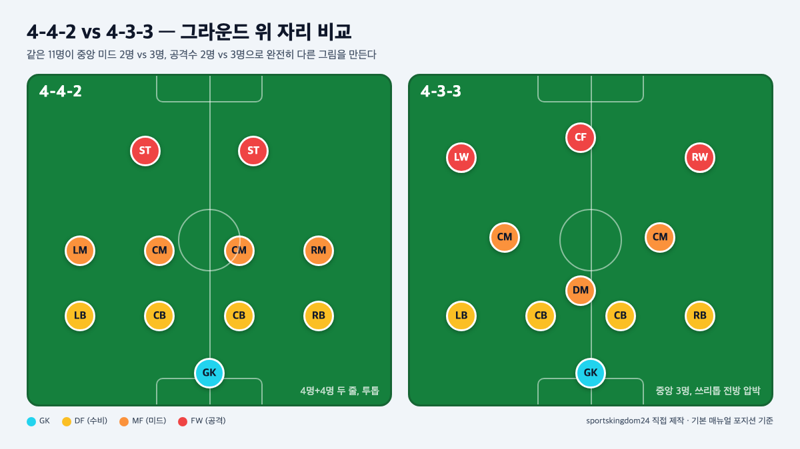
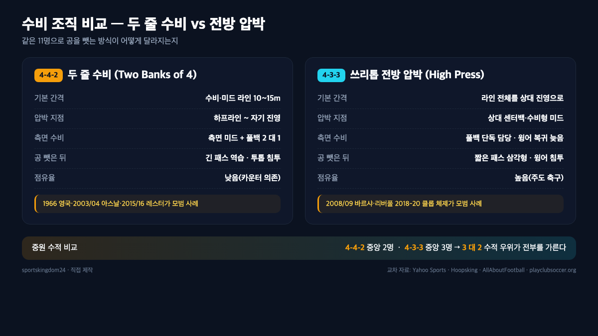
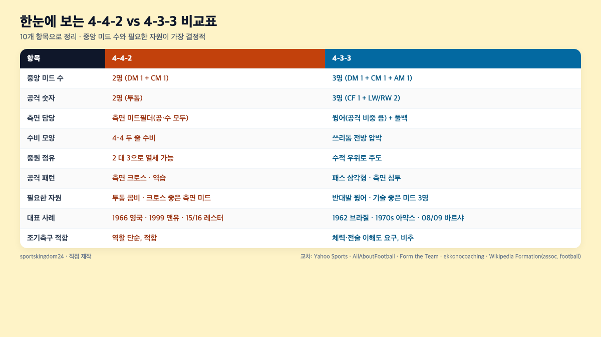

4-4-2와 4-3-3의 가장 큰 차이는 **가운데 미드필더 숫자**입니다. 4-4-2는 중앙 미드필더가 2명, 4-3-3은 3명이에요. 이 한 명 차이가 경기 전체의 중원 점유, 측면 공격 모양, 수비 뒷공간까지 전부 바꿉니다. 중원이 2 대 3으로 수적 열세에 몰리는 쪽은 공을 자주 뺏기고, 그만큼 측면 미드필더나 풀백에게 체력 부담이 몰리거든요. 포메이션 숫자를 "뒤 수비-중원-공격"으로 읽는 간단한 규칙만 알아도 두 포메이션의 성격이 바로 갈립니다.

📌 3줄 요약
4-4-2는 중앙 미드필더 <b>2명</b> + 투톱, 4-3-3은 중앙 미드필더 <b>3명</b> + 쓰리톱입니다. 가운데 한 명 차이가 중원 점유를 가릅니다.

측면은 4-4-2가 <b>측면 미드필더</b>(LM/RM)로 수비 가담까지 하고, 4-3-3은 <b>윙어</b>(LW/RW)가 공격에 집중합니다. 그 대가로 풀백 뒷공간이 열려요.

4-4-2는 1966년 알프 램지의 영국이 월드컵을 든 "윙리스 원더스"로, 4-3-3은 1962년 브라질과 1970년대 아약스를 거쳐 2008/09 바르샤의 트레블로 상징됐습니다.

이 글은 사이트별로 흩어진 두 포메이션 비교 자료 — 야후 스포츠·Hoopsking·playclubsoccer.org·AllAboutFootball·ekkonocoaching, Form the Team, FootballGPT, PitchMaster, Goal.com — 과 영문 위키백과의 포메이션 역사 항목, 그리고 1966 월드컵·1962 월드컵·2008-09 바르셀로나 시즌 기록을 교차해 정리했습니다.

## 결론 먼저: 4-4-2와 4-3-3, 승부를 가르는 한 가지

두 포메이션을 가르는 단 하나의 축은 **중원 머릿수**입니다. 4-4-2는 중앙 미드필더가 2명(그리고 측면 미드필더 2명), 4-3-3은 중앙 미드필더가 3명(그리고 윙어 2명)이에요. 축구는 11명으로 넓은 그라운드를 나눠 막는 종목이라 한 지점에 사람을 몰면 반드시 다른 지점이 얇아지는데, 이 두 포메이션은 "가운데 수를 더 둘지, 측면 공격 숫자를 더 둘지"를 서로 반대로 선택한 결과입니다.

그래서 두 팀이 붙으면 그 자리에서 2 대 3이라는 수적 격차가 생깁니다. 4-4-2의 중앙 미드 2명이 4-3-3의 미드 3명을 상대로 공을 가지려 들면 자꾸 뺏기고, 뺏기면 측면 미드필더가 안쪽으로 좁혀 2 대 3을 억지로 메우러 들어옵니다. 그러면 측면이 비죠. 이 체인 반응이 바로 두 포메이션의 모든 세부 차이의 뿌리입니다. 상위 비교 글(야후 스포츠·AllAboutFootball)들이 공통으로 "중원 열세는 4-4-2의 가장 큰 숙제"라고 짚는 것도 이 때문이에요.

반대로 보면 4-3-3의 약점도 같은 원리에서 나옵니다. 중앙에 미드 한 명을 더 넣느라 **투톱을 포기**했기 때문에 전방에서 상대 센터백 2명을 혼자 상대할 공격수가 없어요. 그래서 윙어가 측면에서 안쪽으로 접고 들어와 "쓰리톱"을 만들어줘야 하고, 그 대가로 윙어 뒤 공간이 열려 상대 역습에 노출됩니다. 두 포메이션 중 어느 쪽이 좋다는 결론 대신, "우리 팀 자원이 가운데에 두터운지, 측면에 두터운지"로 판단하는 쪽이 훨씬 현실적입니다.

## 중원 머릿수 — 2명 vs 3명이 가져오는 모든 것

4-4-2의 중앙 미드필더는 보통 **박스 투 박스 1명 + 수비형 미드필더 1명** 조합입니다. 공·수를 혼자서 왕복해야 하는 자리라, 둘의 체력 소모가 상당해요. Hoopsking 가이드는 이 구성을 "두 명이 공격과 수비를 끊임없이 오가야 해서 체력 부담이 크다"고 설명합니다.

반면 4-3-3의 중앙 미드필더 3명은 역할이 뚜렷하게 쪼개집니다. 뒤에서 공을 돌리는 **레지스타**(또는 홀딩 미드), 공·수 왕복의 **박스 투 박스**, 전방으로 침투하는 **메짤라**(또는 공격형 미드). 2008/09 바르셀로나의 세르히오 부스케츠-사비-이니에스타 조합이 이 분업의 교과서 사례예요. 상위 글(ekkonocoaching·FootballGPT)들이 "4-3-3은 자연스러운 패싱 삼각형을 만든다"고 말할 때 쓰는 것도 바로 이 세 역할의 삼각형 구조입니다.

그 결과 중원 머릿수 차이는 **공 점유율**로 바로 이어집니다. 2008-09 바르셀로나는 라리가 평균 점유율이 리그 1위였고 그 시즌 라리가·코파 델 레이·UEFA 챔피언스리그를 모두 들어 올려 스페인 축구 최초의 콘티넨털 트레블을 기록했습니다. 반대로 전통 4-4-2 팀은 점유율보다 "두 줄 수비로 공간 좁히고 역습으로 터뜨리는" 쪽을 택해 왔어요. 2003/04 무패우승 시즌의 아스날, 2015/16 레스터 시티의 리그 우승 모두 4-4-2 혹은 그 변형으로 역습 축구를 완성한 사례로 꼽힙니다.

## 측면 공격 — 측면 미드필더와 윙어의 결정적 차이

같은 "측면 선수"지만 4-4-2의 **측면 미드필더**(LM/RM)와 4-3-3의 **윙어**(LW/RW)는 역할이 다릅니다. 측면 미드필더는 공격 상황에선 터치라인을 따라 올라와 크로스를 올리고, 수비 상황에선 자기 쪽 풀백 바로 앞까지 내려와 2선 수비를 만들어요. 1999년 트레블을 달성한 맨체스터 유나이티드의 데이비드 베컴(RM)과 라이언 긱스(LM)가 전형이고, 긱스는 왼쪽에서 돌파와 수비 복귀를 번갈아 수행했습니다.

4-3-3의 윙어는 비중이 공격 쪽으로 훨씬 쏠려 있습니다. 2008/09 바르샤의 메시가 오른쪽 윙에서 안으로 접고 들어와 왼발로 슈팅하면서 "인버티드 윙어"라는 용어가 유럽 전체에 퍼졌고, 호날두가 2009년 레알 마드리드로 가면서 왼쪽에서 오른발로 접어 들어오는 반대 패턴도 표준이 됐어요. 이 두 선수가 각자 소속 팀에서 자기 반대발 측면에 서면서 4-3-3이 "메시-호날두 시대"의 상징이 됐습니다.

그 비용은 **풀백 뒷공간**입니다. 4-3-3에서는 윙어가 안쪽으로 접고 들어가므로 측면 넓이는 풀백이 혼자 올려야 합니다. 풀백이 전진한 사이 그 뒤가 비면 상대 윙어·측면 미드가 그 공간으로 뛰어들어 역습이 터지죠. Form the Team과 playclubsoccer.org가 공통으로 "4-3-3은 측면 역습에 취약하다"고 말하는 이유입니다. 반대로 4-4-2는 측면 미드필더가 풀백 바로 앞까지 내려와 측면 두 줄 수비를 만들기 때문에 측면 뒷공간이 상대적으로 덜 열립니다. 포메이션끼리 어떻게 서로를 공략하는지는 [축구 포메이션 상성, 4-4-2·4-3-3·3-5-2는 누가 누구에게 강할까](/soccer-formation-counters/)에 자세히 적어 두었습니다.

## 공격 숫자와 조합 — 투톱 vs 쓰리톱

4-4-2는 **투톱**이고 4-3-3은 **쓰리톱**입니다. 전방 숫자가 하나 많다고 4-3-3이 더 공격적이라고 단순히 말하기는 어려워요. 어떤 선수들이 서느냐에 따라 성격이 완전히 달라지거든요.

4-4-2 투톱의 전형은 "타겟맨 + 스트라이커" 조합입니다. 한 명이 공중볼을 따내 떨궈 주면 다른 한 명이 받아 침투해 들어가는 식이에요. 1999년 맨체스터 유나이티드의 앤디 콜-드와이트 요크, 2003/04 아스날의 티에리 앙리-데니스 베르캄프가 이 조합의 모범으로 꼽힙니다. **투톱의 가장 큰 장점**은 두 명이 서로를 커버하며 상대 센터백 2명을 동시에 흔든다는 점이에요. 반대로 **공격수 2명 뒤 2선 공격을 지원할 공격형 미드**가 비어 있어, 투톱이 고립되면 공격이 통째로 끊깁니다.

4-3-3의 쓰리톱은 "중앙 센터포워드 1명 + 좌우 윙어 2명"입니다. 겉보기엔 공격 숫자가 많지만, 중앙 센터포워드는 상대 센터백 2명을 혼자 상대해야 하고 윙어들은 측면에서 수비를 벗기는 데 체력을 쏟기 때문에 **최전방 득점 압박은 센터포워드 한 명에게 쏠립니다**. 2022/23 EPL 데뷔 시즌 36골([프리미어리그 공식 집계](https://www.premierleague.com/stats/top/players/goals?se=489))로 38경기 체제 한 시즌 득점 신기록을 세운 맨체스터 시티의 엘링 홀란드가 그 모범이에요. 반면 센터포워드 자원이 평범하면 "폴스 9(가짜 9번)"으로 바꿔 중앙을 비우고 메시 같은 공격형 미드가 자유롭게 활용하는 식의 변형도 가능합니다. 포지션별 세부 역할은 [축구 포지션 완전 정리, 골키퍼부터 윙어까지 11개 역할](/soccer-positions-guide/)에서 더 상세히 다뤘습니다.

## 수비 조직 — 두 줄 수비 vs 전방 압박

수비 모양도 두 포메이션의 성격을 가장 잘 드러내는 지점입니다. 4-4-2는 **4-4 두 줄 수비**로 상대의 패스 길을 좁히고, 4-3-3은 **3톱 전방 압박**으로 상대 센터백에게 바로 달려듭니다.

4-4-2 수비의 핵심은 **라인 간 간격 유지**입니다. 수비 라인 4명과 미드필드 라인 4명이 10~15m 간격을 유지하면서 통째로 좌우로 이동해요. 상대가 중앙으로 패스를 넣으려 하면 그 공간이 좁아져 있어 패스가 끊기고, 측면으로 넘기면 측면 미드와 풀백이 2 대 1로 압박해 공을 뺏습니다. 1990~2000년대 아스날·맨체스터 유나이티드·2015/16 레스터가 모두 이 두 줄 수비로 역습을 터뜨렸던 팀들이에요. AllAboutFootball의 비교 글은 이 구조를 "직접적이고 구조화된 수비, 낮은 점유율에서 카운터 의존"으로 요약합니다.

4-3-3의 수비는 반대 방향입니다. 쓰리톱이 상대 센터백·수비형 미드에게 바로 압박을 들어가 **빌드업 자체를 끊어버립니다**. 그 뒤를 중앙 미드 3명이 받쳐 2차 압박을 넣죠. 이 전방 압박이 작동하려면 윙어와 미드필더 모두 90분 내내 뛸 체력, 그리고 압박 트리거(언제 달려드는지)에 대한 전술 이해도가 필요해요. 그래서 Hoopsking과 FootballGPT가 공통으로 "4-3-3은 기술과 체력이 좋은 선수가 있어야 작동한다"고 말합니다. 리버풀의 2018-19·2019-20 시즌 위르겐 클롭 체제가 전방 압박형 4-3-3의 대표적 성공 사례예요.

⚠️ 전방 압박이 실패하면 벌어지는 일
4-3-3의 전방 압박이 한 번 뚫리면 미드필드 3명과 수비 4명 사이가 통째로 벌어진 상태에서 상대의 긴 패스 한 방에 역습을 맞습니다. 그래서 "압박이 안 통하면 4-3-3은 그 자리에서 가장 뚫리기 쉬운 포메이션으로 바뀐다"는 말이 있어요.

## 역사로 보는 두 포메이션 (1966 영국·1962 브라질·2008 바르샤)

두 포메이션의 성격 차이는 등장 배경을 보면 더 선명해집니다. 4-4-2는 **1966년 잉글랜드 월드컵 우승팀**에서 완성된 형태로 역사에 자리를 잡았어요. 알프 램지 감독이 전통적인 윙어를 포기하고 중원을 두껍게 깐 "윙리스 원더스(Wingless Wonders)" 체제로 조국에서 월드컵을 들어 올렸습니다. 당시 세계 축구는 1958·1962년 월드컵을 2연패한 브라질의 4-2-4가 유행이었는데, 램지의 선택은 그 트렌드에 역행해 미드필드에 사람을 더 모은 쪽이었어요.

4-3-3의 뿌리는 흥미롭게도 **같은 1962년 브라질 월드컵**입니다. 브라질이 4-2-4로 세운 1958 월드컵 우승 체제를 유지하는 과정에서, 공격 라인에 있던 마리오 자갈로를 미드필더로 내리면서 자연스럽게 4-3-3이 만들어졌습니다. 자갈로는 선수로 1962 월드컵을 들었고, 1970 월드컵에선 감독으로 다시 우승해 FIFA 월드컵 선수·감독 우승을 모두 경험한 첫 사례가 됐어요.

이 포메이션을 세계에 각인시킨 건 1970년대 네덜란드와 리뉘스 미헐스 감독의 **아약스**였습니다. 아약스는 1971·1972·1973 세 시즌 연속으로 유러피언컵(UEFA 챔피언스리그의 전신)을 들며 요한 크루이프 중심의 **토탈 풋볼**을 완성했고, 미헐스는 1974년 네덜란드 대표팀을 월드컵 결승까지 데려가 세계 축구 전체에 4-3-3과 토탈 풋볼을 퍼뜨렸어요.

현대 축구의 상징으로 다시 올라선 건 2008-09 시즌 **펩 과르디올라의 FC 바르셀로나**입니다. 바르샤는 4-3-3과 포지션 플레이·티키타카를 결합해 그 시즌 라리가·코파 델 레이·UEFA 챔피언스리그를 전부 들어 올리며 스페인 축구 최초의 콘티넨털 트레블을 기록했습니다. 과르디올라가 이후 바이에른 뮌헨·맨체스터 시티로 옮기며 이 틀을 변형해 쓰면서, 지금의 4-3-3은 "주도하는 축구"의 기본값이 됐어요. 포메이션별 장단점을 다른 포메이션까지 묶어 보고 싶다면 [축구 포메이션 장단점 비교 (4-4-2·4-3-3·4-2-3-1·3-5-2)](/soccer-formation-pros-cons/)를 함께 읽어 보세요.

## 한눈에 보는 4-4-2 vs 4-3-3 비교표

지금까지 내용을 한 장으로 묶으면 아래와 같습니다. 중계를 보다 "이 팀 왜 이렇게 중원을 밀리지?" 싶을 때 이 표를 거꾸로 읽으면 포메이션 궁합이 바로 보여요.

| 항목 | 4-4-2 | 4-3-3 |
| --- | --- | --- |
| 중앙 미드 수 | **2명** (DM 1 + CM 1) | **3명** (DM 1 + CM 1 + AM 1) |
| 공격 숫자 | **2명** (투톱) | **3명** (CF 1 + LW/RW 2) |
| 측면 담당 | 측면 미드필더(공·수 모두) | 윙어(공격 비중 큼) + 풀백 |
| 수비 모양 | 4-4 두 줄 수비 | 쓰리톱 전방 압박 |
| 중원 점유 | 2 대 3으로 열세 가능 | 수적 우위로 주도 |
| 공격 패턴 | 측면 크로스·역습 | 패스 삼각형·측면 침투 |
| 체력 부담 | 미드필더 2명·측면 미드 | 윙어·풀백·전방 압박 전원 |
| 필요한 자원 | 투톱 콤비·크로스 좋은 측면 미드 | 반대발 윙어·기술 좋은 미드 3명 |
| 대표 사례 | 1966 영국, 1999 맨유, 2015/16 레스터 | 1962 브라질, 1970s 아약스, 2008/09 바르샤 |
| 조기축구 적합 | 역할 단순, 적합 | 체력·전술 이해도 요구, 비추 |

이 표에서 가장 눈여겨볼 두 줄은 **중앙 미드 수**와 **필요한 자원**이에요. 중원 2 대 3에서 지는 쪽이 거의 모든 지표에서 끌려 다니고, 필요한 자원이 없으면 어떤 포메이션도 장점이 안 나옵니다.

## 어떤 팀에 어떤 포메이션이 맞을까

포메이션에 절대적 정답은 없습니다. 상위 비교 글(Form the Team·playclubsoccer.org·PitchMaster)이 입을 모아 하는 결론도 같아요. **우리 팀 선수 자원과 체력 수준에 맞춰** 고르라는 겁니다. 아래 질문을 순서대로 던져 보세요.

**첫째, 가운데에 공을 소화할 선수가 3명 있나요?** 공을 받아 뒤로 돌리고 앞으로 꽂을 수 있는 수준의 미드필더 셋이 있다면 4-3-3이 제대로 작동합니다. 셋이 안 되면 중원 점유가 안 돼서 쓰리톱이 고립돼요. 반대로 공격수 둘이 조직적으로 움직여줄 수 있다면 4-4-2 투톱이 훨씬 효율적입니다.

**둘째, 측면에 안으로 접고 들어올 반대발 윙어가 있나요?** 왼발잡이가 오른쪽, 오른발잡이가 왼쪽에 서서 안으로 꺾어 들어오는 선수가 있어야 4-3-3이 공격적으로 매섭습니다. 그런 윙어가 없다면 측면 미드필더가 터치라인 끝까지 치고 올라와 크로스를 올리는 4-4-2 쪽이 훨씬 현실적이에요.

**셋째, 90분 전방 압박을 유지할 체력이 있나요?** 4-3-3의 핵심은 전방 압박인데, 아마추어나 조기축구에선 후반 20분부터 체력이 바닥납니다. 그 순간부터 쓰리톱 압박이 안 돌아가면서 수비 라인과 미드필드 사이가 통째로 벌어져요. 반면 4-4-2 두 줄 수비는 역할이 단순해 체력이 떨어진 상태에서도 자리가 유지됩니다.

💡 조기축구·아마추어라면 4-4-2가 안전
조기축구에선 90분 체력 유지가 어렵고, 전술 훈련 시간도 짧습니다. 그래서 역할이 단순하고 두 줄만 유지하면 되는 4-4-2가 가장 사고가 적어요. 공격 비중을 더 두고 싶으면 4-4-2 다이아몬드(DM 1 + CM 2 + AM 1)로 중앙을 두껍게 하는 변형이 현실적입니다.

더 깊은 전술 자료나 공식 지도자 과정 정보는 [대한축구협회(KFA)](https://www.kfa.or.kr/) 홈페이지의 지도자 교육 섹션에서 확인할 수 있고, 2026 북중미 월드컵 포메이션 트렌드도 KFA·FIFA 공식 채널에서 따라가는 쪽이 가장 정확합니다.

## 포메이션 숫자 뒤에 숨은 "비운 자리" 읽는 법

마지막으로 중계·현장에서 두 포메이션을 빠르게 구별하는 요령을 정리할게요. 포메이션 숫자는 **뒤에서부터 수비-중원-공격** 순서로 읽습니다. 그러니 가운데 숫자가 "3"이면 중앙 미드가 3명, "4"면 중앙 미드 2명 + 측면 미드 2명이에요.

경기 시작 후 30초 안에 두 가지만 보면 됩니다. **첫째, 공격수가 몇 명이 올라가 있는가.** 두 명이 나란히 서면 투톱(4-4-2), 한 명이 중앙에 서고 양쪽에서 윙어가 받쳐주면 쓰리톱(4-3-3)이에요. **둘째, 측면 선수가 수비 라인까지 내려오는가.** 터치라인을 따라 자기 쪽 풀백 바로 앞까지 내려오면 측면 미드필더(4-4-2), 상대 하프라인 근처에서 멈춰 공격만 집중하면 윙어(4-3-3)입니다.

포메이션이 중계 중에 바뀌는 것도 익숙해지면 바로 보입니다. 리드를 지키려는 팀이 **4-3-3을 4-5-1로 바꾸는** 장면이 가장 흔해요. 윙어 한 명을 미드필드로 내리고, 나머지 윙어도 측면 미드필더처럼 아래로 가라앉혀 수비를 두껍게 하는 식입니다. 반대로 지고 있는 팀이 **4-4-2를 4-3-3으로 바꿔** 중원을 늘리는 교체도 자주 봅니다. 센터백이나 수비형 미드 한 명을 빼고 공격형 미드필더를 투입해 쓰리톱을 만드는 거예요. 2022년 7월 영구화된 교체 5명 규정 덕분에 이런 포메이션 전환 교체가 전보다 훨씬 과감해졌습니다.

## 자주 묻는 질문 (FAQ)

**Q. 축구 포메이션 4-4-2와 4-3-3 중 어느 쪽이 더 좋나요?** 절대적으로 좋은 쪽은 없습니다. 가운데에 공을 소화할 선수가 셋 있고 전방 압박 체력이 되면 4-3-3이 중원을 지배하고, 투톱 콤비가 좋고 측면 미드필더가 수비 가담까지 해주면 4-4-2가 안정적입니다.

**Q. 왜 4-4-2가 4-3-3에 중원에서 밀리나요?** 중앙 미드필더 수가 2명 대 3명으로 수적 열세이기 때문이에요. 2명이 3명을 상대하면 패스 길이 하나씩 열려 공을 자주 뺏기고, 그걸 메우려 측면 미드가 안쪽으로 좁혀 들어오면 이번엔 측면이 비는 체인 반응이 일어납니다.

**Q. 4-4-2 다이아몬드는 그냥 4-4-2와 뭐가 다른가요?** 중앙 4명을 다이아몬드로 세운 변형입니다. 수비형 미드 1명·중앙 미드 2명·공격형 미드 1명 구성이라, 측면 미드필더가 없어지는 대신 중앙에 3~4명이 몰려 4-3-3의 중원 머릿수를 어느 정도 따라잡습니다. 그 비용은 측면 공격이 풀백에게 전적으로 넘어간다는 점이에요.

**Q. 4-3-3에서 윙어가 왜 안쪽으로 접고 들어오나요?** 공격 숫자 3명 중 중앙 센터포워드 1명은 상대 센터백 둘을 혼자 묶어두는 역할이고, 좌우 윙어가 안쪽으로 접고 들어와 센터백 뒤·사이 공간으로 침투해야 득점 기회가 열리기 때문입니다. 2008/09 바르샤의 메시 이후 유럽 전체의 표준이 됐습니다.

**Q. 조기축구나 유소년 팀은 어떤 포메이션이 좋나요?** 4-4-2를 추천합니다. 역할이 단순하고 두 줄만 유지하면 되기 때문에 전술 훈련 시간이 짧아도 자리가 유지되고, 체력이 떨어진 후반에도 사고가 적어요. 4-3-3은 전방 압박과 중원 분업이 작동해야 장점이 나오는데, 아마추어 환경에선 그 조건이 좀처럼 안 맞춥니다.

**Q. 4-3-3이 전방 압박에 실패하면 어떻게 되나요?** 미드필드 3명과 수비 4명 사이 공간이 통째로 벌어진 상태에서 상대의 긴 패스 한 방에 역습을 맞습니다. 그래서 4-3-3을 쓰는 팀은 압박이 뚫렸을 때 미드필더 중 한 명이 재빨리 수비 라인 앞까지 내려와 공간을 좁히는 2차 수비가 반드시 훈련돼 있어야 해요.

*이미지 출처. 대표 이미지(4-4-2 vs 4-3-3 포메이션 비교 카드)와 본문 비교 다이어그램·전방 압박 비교·비교표 그림은 모두 sportskingdom24에서 야후 스포츠·Hoopsking·AllAboutFootball·ekkonocoaching·playclubsoccer.org·영문 위키백과 포메이션 역사 항목을 교차해 직접 제작했습니다.*

---

**관련 키워드** — #축구포메이션 #442포메이션 #433포메이션 #442와433차이 #축구전술 #포메이션비교 #포메이션기초 #중원점유 #전방압박 #인버티드윙어 #투톱 #쓰리톱 #조기축구포메이션
