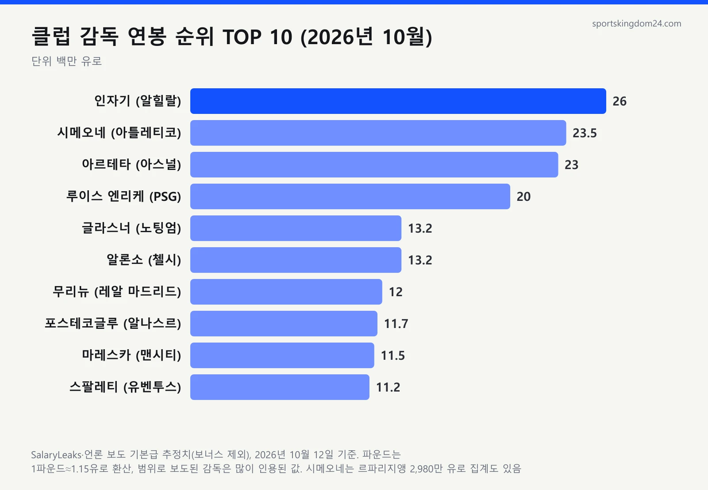
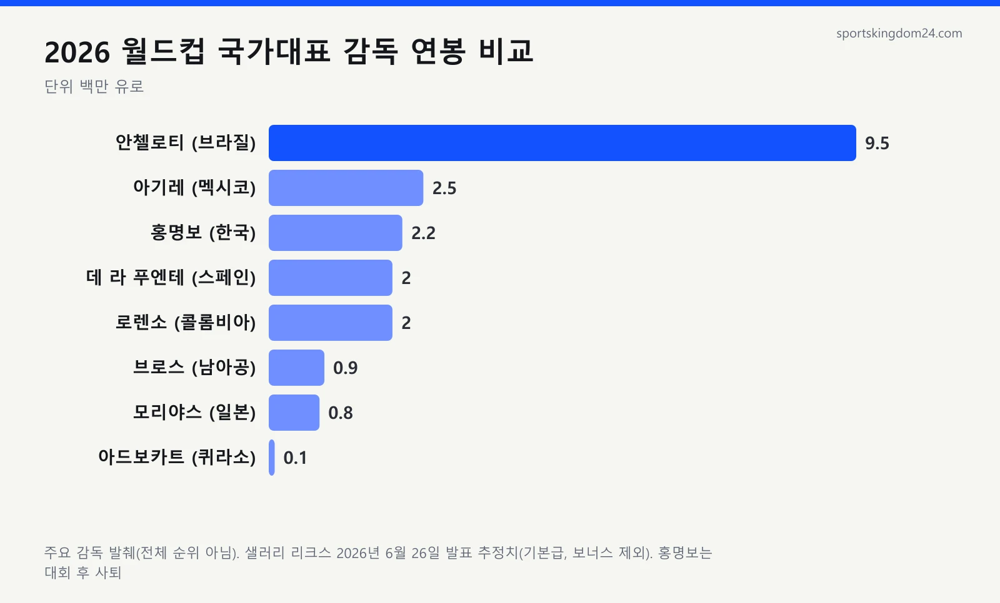

**축구 감독 연봉 순위** 1위는 기준에 따라 두 사람으로 갈립니다. 기본급 보도치로는 알힐랄의 시모네 인자기(약 2,600만 유로), 프랑스 르파리지앵(Le Parisien) 집계로는 아틀레티코 마드리드의 디에고 시메오네(약 2,980만 유로)가 맨 위예요. 저도 처음엔 과르디올라가 당연히 1위일 줄 알고 검색했다가, 그가 올해 맨체스터 시티를 떠났다는 기사를 보고 순위표를 처음부터 다시 짰습니다. 감독 연봉은 구단이 공개하지 않아서 모든 숫자가 언론 보도 기준 추정치예요.

📌 3줄 요약
2026년 10월 기준 축구 감독 연봉 1위권은 <b>인자기(알힐랄)와 시메오네(아틀레티코)</b>이고, 출처에 따라 순서가 바뀝니다.

10월 7일 재계약한 <b>아르테타(아스널)</b>는 연 약 1,700만~2,000만 파운드 보도로 3위권에 올라 프리미어리그 최고 연봉 감독이 됐습니다.

국가대표 감독 1위 <b>안첼로티(브라질)</b>는 약 950만 유로로, 클럽 1위의 절반이 안 됩니다. 홍명보 전 감독은 약 216만 유로로 48개국 중 16위였어요.

## 2026년 축구 감독 연봉 1위는 누구예요?

1위는 인자기와 시메오네의 2파전입니다. 인자기는 2025년 6월 알힐랄과 계약하면서 시즌당 2,600만 유로를 받는다고 이적 전문 기자 파브리치오 로마노와 급여 집계 사이트 SalaryLeaks가 똑같이 전했어요. 사우디아라비아는 개인 소득세가 없어서 세전과 세후 차이도 거의 없습니다.

시메오네는 숫자가 출처마다 크게 흔들립니다. SalaryLeaks는 기본급 2,350만 유로에 성적 보너스 최대 250만 유로를 붙였고, 2026년 4월 르파리지앵 집계는 2,980만 유로였어요. 레퀴프는 따로 월 217만 유로(연 약 2,600만 유로)로 보도했고요. 보도마다 숫자가 달라서 세 수치를 나란히 놓고 맞춰 봤는데, 어느 쪽을 쓰느냐에 따라 1위가 뒤집혔습니다.

그래서 이 글은 두 사람을 1위권으로 묶었습니다. 둘 다 10월 10일에도 각자 팀의 리그 경기를 지휘해 현직임을 확인했어요.

## 축구 감독 연봉 순위 TOP 10 한눈에 보기

2026년 10월 현직 클럽 감독만 넣고, 가장 많이 인용된 기본급 보도치 순으로 줄 세웠습니다. 파운드는 1파운드≈1.15유로로 환산해 순서를 매겼어요. 감독별 원래 숫자는 [SalaryLeaks 감독 연봉 순위](https://www.salaryleaks.com/football/managers)에서 바로 확인할 수 있습니다.

| 순위 | 감독 | 팀 | 추정 연봉(기본급) | 출처·시점 |
| --- | --- | --- | --- | --- |
| 1 | 시모네 인자기 | 알힐랄 | 약 2,600만 유로 | 로마노·SalaryLeaks, 2025.6 |
| 2 | 디에고 시메오네 | 아틀레티코 마드리드 | 약 2,350만~2,980만 유로 | SalaryLeaks / 르파리지앵 2026.4 |
| 3 | 미켈 아르테타 | 아스널 | 약 1,700만~2,000만 파운드 | 더 선 / 더 타임스·텔레그래프, 2026.10 |
| 4 | 루이스 엔리케 | 파리 생제르맹 | 약 2,000만 유로(세전) | 레퀴프 2026.4 전망, 2026.9 재계약 |
| 5 | 올리버 글라스너 | 노팅엄 포레스트 | 약 1,150만~1,300만 파운드 | SalaryLeaks / 더 선, 2026.7 |
| 6 | 사비 알론소 | 첼시 | 약 860만~1,150만 파운드 | SalaryLeaks 외, 2026.5 |
| 7 | 주제 무리뉴 | 레알 마드리드 | 약 1,200만 유로(세전) | 빌트·디 애슬레틱, 2026.6 |
| 8 | 앤지 포스테코글루 | 알나스르 | 약 1,170만 유로 | SalaryLeaks, 2026.7 |
| 9 | 엔초 마레스카 | 맨체스터 시티 | 약 1,000만 파운드 | SalaryLeaks(스카이스포츠 인용), 2026.6 |
| 10 | 루치아노 스팔레티 | 유벤투스 | 약 1,120만 유로(세전) | SalaryLeaks, 2026 |

핵심은 4위와 5위 사이의 절벽이에요. 상위 4명은 2,000만 유로 안팎인데 5위부터는 1,000만 유로대 초반으로 떨어집니다. 10위 바로 밖에는 브라질 대표팀 안첼로티(약 950만 유로)와 로마의 가스페리니(약 900만~930만 유로)가 있고, 에메리(아스톤 빌라)·데 제르비(토트넘)처럼 약 800만 파운드로 보도된 감독도 가까이 붙어 있어요.

원화로는 인자기 450억 원 안팎, 시메오네 410억~520억 원, 루이스 엔리케 350억 원 안팎입니다(2026년 6월 국내 기사의 1유로≈1,759원 환산 기준).

## 같은 감독인데 왜 보도마다 숫자가 다를까요?

세전·세후, 보너스 포함 여부, 환산 통화, 집계 시점이 다르기 때문입니다. 시메오네만 봐도 630만 유로 차이가 나는데, 누가 틀렸다기보다 계산 범위가 다른 경우가 대부분이에요.

집계 시점 차이도 큽니다. 2025년 3월에 갱신된 미국 매체 순위표에는 아직 과르디올라가 2위, 인자기가 인터밀란 감독으로 17위에 올라 있어요. 제목에 "2026"이 붙어도 갱신 날짜부터 봐야 해요.

💡 연봉 기사 읽는 법
숫자 옆에 <b>세전(gross)·세후(net)</b>, <b>보너스 포함 여부</b>, <b>집계 날짜</b> 세 가지가 적혀 있는지 보세요. 이 글의 표는 보너스를 뺀 기본급 기준입니다.

## 2026년 감독 대이동, 순위가 어떻게 바뀌었나요?

순위가 크게 흔들린 건 올해 5~7월 빅클럽 감독이 한꺼번에 바뀌었기 때문입니다. 펩 과르디올라는 5월 맨시티를 떠난다고 발표했고, 구단은 6월 29일 엔초 마레스카를 3년 계약으로 데려왔어요. 과르디올라는 시티 풋볼 그룹 글로벌 앰배서더를 맡고 당분간 지도자 일을 쉬겠다고 밝혔습니다.

그래서 "펩 과르디올라 연봉"은 이제 과거형입니다. 르파리지앵 집계는 4월 그를 연 2,380만 유로로 세계 3위에 올렸지만 지금은 감독이 아니라 표에서 뺐어요. 후임 엔초 마레스카는 SalaryLeaks가 스카이스포츠를 인용해 기본급 약 1,000만 파운드로 적어 9위에 넣었습니다.

알론소는 1월 레알 마드리드를 떠나 5월 첼시와 4년 계약을 맺었고, 레알은 무리뉴를 다시 불렀어요. 루이스 엔리케는 9월 PSG와 2030년까지 재계약하며 연봉이 약 1,200만 유로에서 2,000만 유로로 뛰었다는 보도가 나왔고, 10월 7일에는 아르테타가 2030년까지 재계약하며 프리미어리그 최고 연봉 감독 자리를 넘겨받았습니다.

## 시메오네 연봉은 왜 그렇게 높을까?

한 클럽에서 오래 결과를 냈기 때문입니다. 시메오네는 2011년 12월 부임해 15년 가까이 아틀레티코를 이끌었고, 그사이 라리가 우승 2회(2013-14, 2020-21)와 유로파리그 우승 2회를 가져왔어요.

계약은 2023년 11월 연장한 2027년 6월까지입니다. 스페인 매체 AS 보도로는 양쪽 모두 동행을 원해 재계약 논의가 진행 중이지만 서두르진 않는 분위기예요.

## 국가대표 감독 연봉은 클럽보다 얼마나 적을까?

국가대표 감독 연봉 1위 안첼로티(약 950만 유로)도 클럽 1위 인자기(약 2,600만 유로)의 37% 수준입니다. 급여 분석 매체 샐러리 리크스가 2026년 6월 발표한 북중미 월드컵 48개국 감독 추정치를 보면, 한국과 같은 A조였던 멕시코의 하비에르 아기레도 250만 유로라 클럽 1위와는 10배 넘게 벌어져요.

명단을 정리하다 놀란 건 바닥 쪽 숫자였어요. 퀴라소의 딕 아드보카트는 9만 6,000유로(약 1억 7,000만 원)로 최하위였는데, 2006년 독일 월드컵 때 한국을 이끌었던 바로 그 감독이에요. 같은 대회 감독끼리도 100배 가까이 차이 납니다.

스페인 스포츠지 AS(미국판) 집계로는 포체티노(미국)가 약 680만 달러로 3위, 투헬(잉글랜드)이 약 650만 달러로 4위였고, 두 감독 모두 올해 계약을 연장해 자리를 지켰습니다.

## 홍명보 연봉과 지금 한국 대표팀 감독 연봉은?

홍명보 전 감독의 연봉은 샐러리 리크스 추정 216만 유로(약 38억 원)로 48개국 중 16위였습니다. AS 집계도 약 247만 달러(약 37억 원)로 똑같이 16위였어요. 2024년 선임 당시 알려진 20억 원대보다 훨씬 높은 숫자지만, 대한축구협회는 정확한 금액을 공개한 적이 없습니다.

일본 모리야스 하지메 감독은 82만 1,000유로로 29위였어요. 일본은 F조 2위(1승 2무)로 32강에 올랐고 한국은 1승 2패로 탈락했죠. 홍명보 감독은 대회 뒤 물러났고, 협회 개편 과정은 [축구협회 혁신위원회 정리 글](/kfa-innovation-committee-2026/)에 따로 묶어 뒀어요.

지금 한국 대표팀은 스페인 출신 로베르트 모레노 임시 감독 체제입니다. 협회가 9월 1일 이사회에서 선임했고 계약은 11월 27일까지, 6경기 평가 뒤 2027 아시안컵까지 연장할 수 있는 조건이에요. 연봉은 비공개라 이 글에서는 숫자를 싣지 않았습니다.

## 감독 연봉에 세금과 보너스는 포함될까?

대부분의 순위표는 세전 기본급이고 보너스는 따로입니다. 저도 감독 연봉이 통장에 찍히는 실수령액인 줄 알았거든요. 영국 GB 뉴스는 2025년 투헬의 연 500만 파운드 계약이 세금과 국민보험료를 빼면 약 260만 파운드가 된다고 계산했어요. 세율 높은 나라에선 절반 가까이가 세금입니다.

보너스도 숫자를 키웁니다. SalaryLeaks 기준 무리뉴는 기본급 위에 성적 보너스가 최대 300만 유로 붙어요. 아르테타는 새 계약 기본급을 더 선은 1,700만 파운드, 더 타임스는 2,000만 파운드로 봤고, 보너스를 더하면 2,500만 파운드까지 간다는 보도도 있습니다.

반대로 사우디 리그 감독은 소득세가 없어 세전과 세후가 거의 같아요. 리그 돈 구조가 궁금하면 [프리미어리그 우승 상금 구조](/epl-prize-money/)도 이어서 보세요.

## 자주 묻는 질문 (FAQ)

**Q. 축구 감독 연봉 1위는 누구인가요?** 현재 보도로는 알힐랄 인자기(약 2,600만 유로)와 아틀레티코 시메오네(약 2,350만~2,980만 유로)가 1위권이고, 출처에 따라 순서가 바뀝니다.

**Q. 펩 과르디올라 연봉은 지금 얼마인가요?** 2026년 5월 맨시티를 떠나 현재 감독이 아니고, 직전 르파리지앵 집계로는 약 2,380만 유로였습니다.

**Q. 프리미어리그에서 연봉이 가장 높은 감독은 누구인가요?** 2026년 10월 7일 2030년까지 재계약한 아스널 아르테타로, 연 약 1,700만~2,000만 파운드라는 영국 언론 보도가 나왔습니다.

**Q. 홍명보 감독 연봉은 얼마였나요?** 공식 발표는 없고, 해외 집계 기준 약 216만 유로(약 38억 원)로 2026 월드컵 48개국 감독 중 16위였습니다.

**Q. 감독 연봉 기사는 세금을 뗀 금액인가요?** 대부분 세금을 떼기 전 기본급이고 보너스는 빠져 있습니다.

축구 감독 연봉 순위는 1위가 누구냐보다 "어떤 기준의 숫자인가"를 같이 보는 게 핵심이고, 이 표는 2026년 10월 12일까지의 보도로 맞췄어요. 아르테타 재계약 내용은 [텔레그래프 보도(야후 재게재)](https://sports.yahoo.com/articles/mikel-arteta-reaches-status-super-110038689.html)에서 볼 수 있어요. 안첼로티의 브라질 대표팀 계약 연장 소식은 [ESPN 보도](https://www.espn.com/soccer/story/_/id/48770451/brazil-coach-carlo-ancelotti-contract-extension-2030-world-cup)에서 원문으로 확인할 수 있습니다.

---

**관련 키워드** — #축구감독연봉순위 #축구감독연봉 #축구감독연봉1위 #시메오네연봉 #인자기연봉 #아르테타연봉 #펩과르디올라연봉 #안첼로티연봉 #홍명보연봉 #국가대표감독연봉 #월드컵감독연봉순위 #축구감독연봉세금
