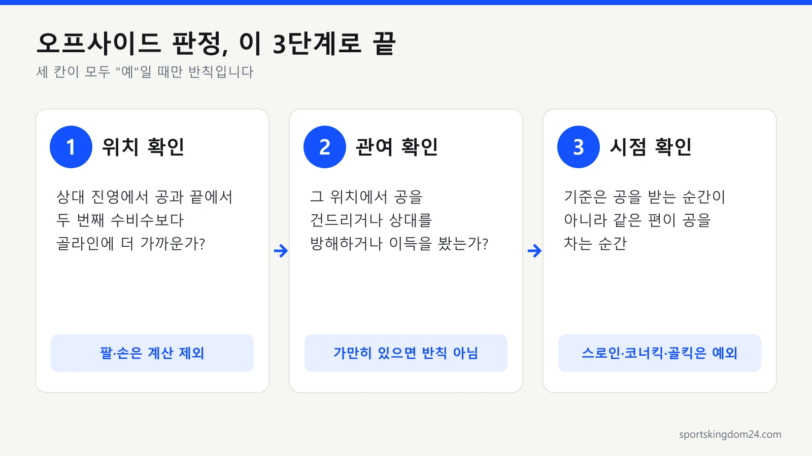

축구를 보다 보면 분명 골이 들어갔는데 심판이 손을 들고 취소하는 장면, 한 번쯤 보셨을 거예요. 십중팔구 **오프사이드**입니다. 솔직히 저도 오프사이드 볼 때마다 헷갈렸어요. 축구 규칙 중 가장 헷갈리는 게 바로 이 오프사이드인데, IFAB 경기규칙 원문을 다시 읽어 보니 핵심만 잡으면 의외로 단순하더라고요. 이 글에서는 축구 오프사이드 규칙을 처음 보는 분도 이해할 수 있게, 위치의 조건부터 실제 반칙이 되는 순간, 하프라인 기준, 그리고 요즘 중계에 나오는 반자동 오프사이드 판정까지 차근차근 풀어드릴게요.

📌 3줄 요약
오프사이드는 <b>위치 조건과 플레이 관여</b>가 겹칠 때만 반칙이고, 기준 시점은 같은 편이 공을 차는 순간입니다.

하프라인 위에 서 있는 것만으로는 상대 진영이 아니며, 팔과 손은 판정에서 빠집니다.

반자동 오프사이드는 위치만 계산하고 관여 여부는 여전히 심판이 판단합니다. 벵거 룰은 2026년 현재 시험 단계입니다.

## 오프사이드는 왜 있는 규칙일까

골문 앞에 미리 서 있다가 긴 패스만 받아 넣는 플레이를 막으려고 있는 규칙입니다. 만약 오프사이드가 없다면, 공격수 한 명이 상대 골문 앞에 미리 죽치고 서 있다가 긴 패스만 받아 넣으면 됩니다. 축구가 '골문 앞 뻥축구'가 돼버리는 거죠. 이걸 막아 공격과 수비의 균형을 맞추려고 만든 규칙이 오프사이드입니다.

## 오프사이드 '위치'의 조건

선수가 **오프사이드 위치**에 있다는 건 아래 세 가지를 모두 만족할 때입니다.

- 공보다 상대 골라인에 더 가까이 있고,
- **끝에서 두 번째 상대 선수**(보통 골키퍼가 가장 뒤에 있으니, 사실상 마지막 수비수)보다 골라인에 더 가까이 있으며,
- 상대 진영(하프라인 너머)에 있을 때.

머리·몸통·발 중 어느 부위든 앞서 있으면 위치상 오프사이드인데, **팔과 손은 계산에서 제외**됩니다. 그래서 어깨는 걸려도 쭉 뻗은 팔은 영향을 주지 않아요. 규정은 팔이 시작되는 경계를 겨드랑이 맨 아래 선으로 잡습니다. 참고로 마지막 수비수와 **나란히 선** 경우는 오프사이드가 아닙니다. 더 앞서 있어야 성립하거든요.

## 위치에 있는 것 ≠ 반칙

**오프사이드 위치에 서 있는 것만으로는 반칙이 아닙니다.** 여기가 가장 중요한 포인트예요. 저도 이 부분을 알고 나서야 중계가 다르게 보였어요. 그 위치에서 실제로 플레이에 관여할 때 비로소 반칙이 돼요. 관여한다는 건 이런 경우입니다.

- 같은 편이 보낸 공을 직접 건드리거나 플레이할 때,
- 상대(수비수·골키퍼)의 시야를 가리거나 방해할 때,
- 골대·수비수를 맞고 튄 공을 받아 이득을 볼 때.

그래서 오프사이드 위치에 있어도 공에 관여하지 않고 가만히 있으면 반칙이 아닙니다.

## 가장 헷갈리는 '패스 순간' 기준

오프사이드는 **공을 받는 순간이 아니라, 같은 편이 공을 차는(터치하는) 순간**의 위치로 판단합니다. 제가 중계 보면서 제일 오래 헷갈렸던 부분이 바로 이거예요. 예를 들어 패스하는 순간엔 수비 라인보다 뒤(정당한 위치)에 있던 선수가, 빠르게 뛰어나가 공을 받으면 오프사이드가 아닙니다. 받는 위치가 앞서 있어도, 기준은 '패스가 출발한 그 순간'이니까요.

규정은 이 순간도 정확히 정해 둡니다. 같은 편이 공을 차거나 건드릴 때는 공에 처음 닿은 순간을 기준으로 삼고, 골키퍼가 손으로 던질 때는 공이 손을 떠나는 마지막 접촉 순간을 기준으로 봅니다.

## 오프사이드가 아닌 경우 (예외)

다음 상황에서 공을 **직접** 받으면 오프사이드가 적용되지 않습니다.

- **스로인**으로 받을 때,
- **코너킥**으로 받을 때,
- **골킥**으로 받을 때.

또한 자기 진영(하프라인 안쪽)에 있을 때도 오프사이드가 아닙니다. 이 예외만 기억해도 경기 중 "왜 저건 오프사이드가 아니지?" 싶은 장면의 상당수가 풀립니다. 혼자 드리블할 때, 공보다 뒤에서 받을 때 같은 나머지 경우와 사례는 [오프사이드 예외 상황](/soccer-offside-exceptions/)에 따로 모아 두었어요.

## 하프라인 위에 걸쳐 서 있으면 오프사이드일까요?

아닙니다. 하프라인 선 자체는 상대 진영으로 치지 않기 때문에, 발이 선을 밟고 있기만 하면 오프사이드 위치가 될 수 없습니다. 규정 원문을 다시 읽어 보니 조건이 "머리·몸통·발 중 어느 부위라도 하프라인을 제외한 상대 진영에 들어가 있을 것"으로 적혀 있더라고요. 반대로 발끝이나 어깨 일부라도 선을 넘어 상대 진영 쪽에 들어가 있다면, 나머지 두 조건인 공보다 앞, 끝에서 두 번째 수비수보다 앞을 따져봐야 합니다.

선과 관련해 하나 더 알아두면 좋은 규정이 있습니다. 수비수가 심판 허락 없이 경기장 밖으로 나가 있으면, 그 선수는 오프사이드 계산에서 **자기 골라인이나 터치라인 위에 있는 것**으로 간주됩니다. 다음 경기 중단 때까지, 또는 수비 팀이 공을 하프라인 쪽으로 보내 페널티 에어리어 밖으로 나갈 때까지 이 처리가 이어져요. 수비수가 일부러 밖으로 빠져서 공격수를 오프사이드로 만드는 꼼수를 막는 장치입니다. 일부러 그렇게 나간 수비수는 다음 중단 때 경고를 받습니다.

공격수도 플레이에 관여하지 않겠다는 뜻으로 골라인 밖으로 나갈 수 있습니다. 다만 다시 들어와 곧바로 플레이에 관여하면 골라인 위에 있었던 것으로 보고 오프사이드를 따집니다.

## 수비수가 일부러 공을 건드리면 리셋되나요?

네, 상대 수비수가 **의도적으로 플레이한 공**을 받으면 오프사이드 위치에 있던 공격수라도 반칙이 아닙니다. 상대가 공을 통제할 수 있는 상태에서 패스나 걷어내기를 시도했다면, 그 시도가 빗나갔더라도 의도적 플레이로 봅니다. 일부러 손을 쓴 핸드볼도 여기에 들어갑니다.

예외는 **의도적 선방**입니다. 골문으로 가는 공을 막으려고 몸을 던진 경우는 리셋되지 않아서, 그 공을 오프사이드 위치의 공격수가 받으면 반칙이 됩니다. 굴절·선방·클리어링을 가르는 구체적인 기준과 장면별 사례는 [오프사이드 예외 상황](/soccer-offside-exceptions/)에서 길게 다뤘으니 여기서는 원칙만 짚고 넘어갈게요.

## 판정과 벌칙

오프사이드 반칙이 선언되면, 반칙이 일어난 지점에서 상대 팀에게 **간접 프리킥**이 주어집니다. 반칙 지점이 공격수 자기 진영 안쪽이어도 그 자리에서 찹니다. 요즘은 VAR로 선수의 신체 위치를 정밀하게 따져 판정하기 때문에, 과거보다 훨씬 촘촘하게 잡힙니다. 정확한 최신 규정은 [대한축구협회](https://www.kfa.or.kr/) 같은 공식 채널에서 확인할 수 있어요.

## VAR과 반자동 오프사이드는 어떻게 판정하나요?

카메라가 선수들의 몸 위치를 추적해 공을 찬 순간의 가상 오프사이드 선을 자동으로 그어 주고, 최종 확인은 사람이 합니다. 이게 반자동 오프사이드 기술(SAOT)이에요. '반자동'이라고 부르는 이유가 여기 있습니다. 위치 계산은 기계가 하지만, 그 선수가 플레이에 관여했는지는 여전히 심판이 판단하거든요.

2022 카타르 월드컵에서 처음 쓰였을 때는 경기장 지붕 아래 전용 카메라 12대가 선수 한 명당 29개 신체 지점을 추적했고, 공 안의 센서가 공의 움직임을 초당 500회 측정해 차는 순간을 잡아냈습니다. 그 뒤로 쓰는 대회가 빠르게 늘었어요. FIFA·UEFA·AFC·프리미어리그 발표를 하나씩 확인해 묶어보면 아래와 같습니다.

| 대회 | 도입 시점 | 비고 |
| --- | --- | --- |
| FIFA 월드컵 | 2022 카타르 대회 | 월드컵 첫 사용 |
| UEFA 챔피언스리그 | 2022-23시즌 | 2022년 8월 UEFA 슈퍼컵에서 첫선 |
| AFC 아시안컵 | 카타르 2023 대회(2024년 1~2월 개최) | 51경기 전부, 대륙 대항전 첫 사례 |
| 잉글랜드 프리미어리그 | 2025년 4월 12일(32라운드) | VAR이 결과를 확인 |
| FIFA 월드컵 | 2026 북중미 대회 | 개선판 사용 |

2026 북중미 월드컵에서는 방식이 한 단계 바뀌었습니다. FIFA 발표에 따르면 2022년에는 계산 결과가 VAR실로 갔지만, 개선판은 명백한 위치상 오프사이드를 경기장 부심에게 바로 알려 깃발을 더 빨리 들 수 있게 했어요. 참가 선수 전원을 3D로 스캔해 아바타를 시스템에 넣었다고도 합니다. 다만 FIFA도 이 시스템은 위치 판정에만 쓰이고, 공을 건드리지 않은 선수의 방해 여부는 판단하지 않는다고 밝혔습니다.

국내 K리그의 반자동 오프사이드 도입 여부는 이번에 공식 발표를 찾지 못해 표에 넣지 않았어요. 리그마다 도입 시점이 다르니 보는 대회의 공지를 확인하는 게 정확합니다.

## 오프사이드 규칙의 역사와 최근 변화

오프사이드는 크게 보면 수비에 유리하던 규칙이 공격 쪽으로 조금씩 완화돼 온 역사입니다. 처음엔 공격수와 골라인 사이에 상대 선수 3명이 있어야 했는데, 1925-26시즌부터 2명으로 줄었습니다. 그리고 1990 이탈리아 월드컵 뒤에는 마지막 수비수와 나란히 선 공격수를 온사이드로 보는 쪽으로 바뀌었어요. 득점이 유독 적었던 그 대회 분위기가 계기로 자주 거론됩니다.

| 시기 | 바뀐 내용 |
| --- | --- |
| 1925-26시즌 | 기준 상대 선수 3명에서 2명으로 축소 |
| 1990년 월드컵 이후 | 마지막 수비수와 나란히 서면 온사이드 |
| 2000년대 이후 | 머리·몸통·발 기준, 팔·손 제외 원칙 정비 |
| 2022년 | 의도적 플레이 판단 기준 구체화 |
| 2026년 | 캐나다 프리미어리그에서 벵거 룰 시험 시작 |

최근 가장 큰 이슈는 이른바 **벵거 룰**입니다. FIFA 글로벌 축구 발전 책임자인 아르센 벵거가 밀어 온 안으로, 득점에 쓸 수 있는 신체 부위 중 하나라도 수비수와 겹치면 온사이드로 보고, 둘 사이에 틈이 보일 만큼 완전히 앞서야 오프사이드가 됩니다. 그래서 데이라이트 오프사이드라고도 불러요.

현재 상태는 **시험 단계**입니다. FIFA가 주도하고 IFAB가 승인한 시험이 2026년 4월 4일 개막한 캐나다 프리미어리그(CPL) 시즌에서 진행 중이고, FIFA는 시험이 끝난 뒤 결과를 분석하겠다고 밝혔습니다. 2026년 7월 1일부터 시행된 2026/27 경기규칙 개정 내용도 확인해 봤는데 교체 인원, 드롭볼, 페널티킥 이중 터치 같은 항목이 중심이었고 오프사이드 위치 정의를 바꾼다는 내용은 찾지 못했습니다. 즉 월드컵과 유럽 주요 리그는 지금도 기존 규칙대로 판정하고, 벵거 룰을 언제 정식 규칙으로 넣을지는 2026년 10월 기준으로 정해진 게 없습니다.

💡 조문 원문 확인
오프사이드 조문 전체는 <a href="https://www.theifab.com/laws/latest/offside/" target="_blank" rel="noopener">IFAB 경기규칙 11조(오프사이드)</a>에서 볼 수 있고, 벵거 룰 시험 내용은 <a href="https://inside.fifa.com/news/canadian-premier-league-daylight-offside-trial-cooperation-fifa" target="_blank" rel="noopener">FIFA 공식 발표</a>에 정리돼 있습니다.

## 실전 예시로 이해하기

차는 순간 기준과 관여해야 반칙이라는 두 원칙을 장면에 대입하면 대부분 풀립니다. 미드필더 B가 공격수 A에게 패스를 보냅니다. **B가 공을 차는 그 순간** A가 마지막 수비수보다 앞(골라인에 더 가까이)에 있었다면 오프사이드 위치이고, A가 그 공을 직접 받아 골을 넣으면 반칙으로 취소됩니다. 반대로 B가 패스하는 순간 A가 수비수와 나란히 있거나 뒤에 있었고, 그다음 빠르게 침투해 공을 받았다면 골은 인정됩니다. 기준이 '받는 순간'이 아니라 '차는 순간'이기 때문이에요.

한 가지 더, A가 오프사이드 위치에 있었더라도 공을 건드리지 않고 옆에 있던 동료 C가 정당한 위치에서 그 공을 받아 처리했다면, A가 수비를 방해하지 않는 한 반칙이 아닙니다. "위치에 있는 것만으로는 반칙이 아니다"라는 원칙이 그대로 적용되는 거죠.

## 자주 묻는 질문 (FAQ)

**Q. 골키퍼도 오프사이드 기준 선수에 포함되나요?** 네. 규칙은 끝에서 두 번째 상대 선수를 기준으로 하고 골키퍼도 그 수에 들어갑니다. 보통 골키퍼가 가장 뒤에 있어 마지막 필드 수비수가 기준이 되지만, 골키퍼가 앞으로 나와 있으면 뒤에 남은 상대 선수 2명 중 앞쪽 선수가 기준이 됩니다.

**Q. 수비수와 나란히 서 있으면 오프사이드인가요?** 아닙니다. 더 앞서 있어야 성립하고, 같은 선상은 정당한 위치로 봅니다.

**Q. 손으로 받으면요?** 애초에 손·팔은 오프사이드 판정 대상에서 빠지고, 손으로 공을 다루면 그건 핸드볼이라는 다른 반칙입니다.

**Q. 하프라인 위에 서 있으면 오프사이드인가요?** 아닙니다. 하프라인 선 자체는 상대 진영이 아니라서, 몸 일부가 선을 넘어 상대 진영에 들어가 있어야만 오프사이드 위치가 될 수 있습니다.

**Q. 반자동 오프사이드와 VAR은 다른 건가요?** 반자동 오프사이드는 VAR을 돕는 도구입니다. 카메라로 위치와 선을 자동 계산하고, 관여 여부와 최종 판정은 심판과 VAR이 맡습니다.

**Q. 벵거 룰은 이제 정식 규칙인가요?** 아직 아닙니다. 2026년 10월 기준 캐나다 프리미어리그에서 FIFA 주도로 시험 중이고, IFAB 경기규칙 11조에는 반영되지 않았습니다.

**Q. 오프사이드 프리킥은 어디서 차나요?** 반칙이 일어난 지점에서 상대 팀이 간접 프리킥으로 찹니다. 그 지점이 공격수 자기 진영이어도 마찬가지입니다.

## 마무리

정리하면, 오프사이드는 ① 위치 조건을 만족하고 ② 그 위치에서 실제로 플레이에 관여할 때, ③ 같은 편이 공을 차는 순간을 기준으로 성립합니다. 저처럼 매번 헷갈렸더라도, 이 셋만 잡으면 경기 보는 재미가 확 달라져요. 반자동 오프사이드 화면이 떠도 결국 이 세 가지 중 위치 부분을 기계가 빠르게 계산해 주는 것뿐이고요. 예외 장면이 궁금하다면 [오프사이드 예외 상황](/soccer-offside-exceptions/)을, 추가시간이 왜 길어지는지 궁금하다면 [축구 경기 시간과 추가시간 규칙](/soccer-match-time-added-time/)도 이어서 보세요. 스포츠킹덤24가 어려운 규칙도 쉽게 풀어드릴게요. 처음 오셨다면 [스포츠킹덤24 소개](/about/)도 둘러보세요. ⚽

---

**관련 키워드** — #축구오프사이드규칙 #오프사이드위치 #오프사이드반칙 #하프라인오프사이드 #반자동오프사이드 #VAR오프사이드 #벵거룰 #오프사이드예외
