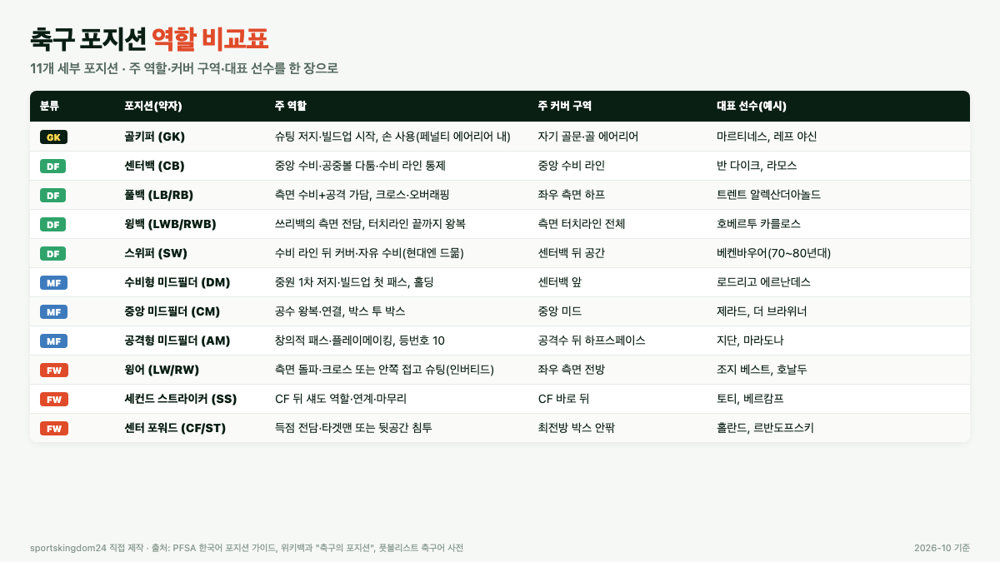
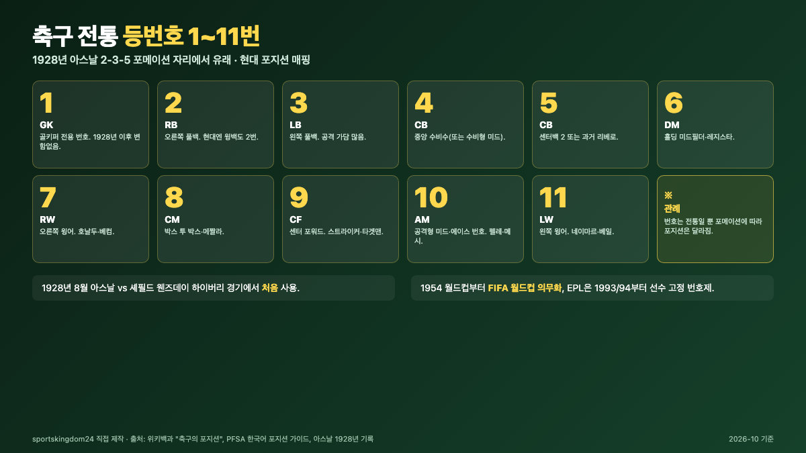

축구 포지션은 큰 틀로는 네 가지, 세부로는 열한 개입니다. 골키퍼 1명과 필드 10명이 전부라는 경기규칙 위에, 센터백·풀백·윙백·수비형 미드·공격형 미드·윙어·스트라이커 같은 세부 역할이 올려져 있어요. 2022년부터 교체 선수가 5명으로 영구화되면서 한 경기 안에서 포지션 조합을 바꾸는 폭도 더 넓어졌습니다.

📌 3줄 요약
IFAB 경기규칙은 한 팀을 <b>골키퍼 1명 + 필드 10명</b>으로만 정합니다. 수비수·미드필더·공격수 분류와 센터백·윙백 같은 세부 포지션은 <b>전술 언어</b>예요.

전통 등번호 1~11번은 1928년 아스날이 2-3-5 포메이션 자리 순서대로 붙인 데서 왔습니다. 1954 월드컵부터 의무, EPL은 1993/94부터 고정 번호제입니다.

2022년 7월부터 공식 교체 인원이 <b>5명</b>으로 영구화됐고, 2026 월드컵은 교체 선수가 10초 안에 나가야 합니다. 바뀌는 포지션이 전술의 핵심이 됐어요.

이 글은 IFAB 경기규칙, 위키백과 "축구의 포지션"·"축구 경기 규칙", PFSA 한국어 포지션 가이드, 풋볼리스트의 "가짜 9번" 용어 설명, 유벤투스 코리아의 메짤라·레지스타 설명을 대조해 정리했습니다. 아래는 사이트별로 흩어진 세부 포지션을 한 장의 지도로 묶은 그림이에요.

## 축구 포지션은 몇 가지로 나뉘나요?

큰 분류는 네 가지입니다. 골키퍼(GK), 수비수(DF), 미드필더(MF), 공격수(FW)예요. 다만 이 네 가지는 전술에서 쓰는 분류이고, 경기규칙 자체는 그렇게 세세하게 나누지 않습니다.

[IFAB 경기규칙 제3조](https://www.theifab.com/laws/latest/the-players/)는 한 팀을 "최대 11명이고, 그중 1명이 골키퍼"로만 정의합니다. 7명 미만이면 경기를 시작하거나 이어 갈 수 없다는 규정도 같은 조항에 있어요. 수비수·미드필더·공격수는 규칙서에 없는 말이고, 축구가 2-3-5(수비 2·미드 3·공격 5) 포메이션을 쓰던 1920~30년대의 자리 순서가 지금의 분류와 등번호로 굳어졌습니다.

세부 포지션은 더 쪼개집니다. 수비수는 센터백(CB)·풀백(FB)·윙백(WB)·스위퍼(SW), 미드필더는 수비형 미드필더(DM)·중앙 미드필더(CM)·공격형 미드필더(AM)·측면 미드필더(LM/RM), 공격수는 센터 포워드(CF)·스트라이커(ST)·세컨드 스트라이커(SS)·윙어(LW/RW)로 갈립니다. 야구가 수비 포지션을 숫자 1~9로 고정해 두는 것([야구 기본 규칙과 포지션 9개, 입문자용 정리](/baseball-rules-positions-beginner/))과 달리, 축구는 같은 11명을 포메이션에 따라 다른 포지션으로 재배치해 쓰는 종목입니다.

## 골키퍼 — 유일하게 손을 쓰는 선수

골키퍼는 자기 팀 페널티 에어리어 안에서만 손으로 공을 다룰 수 있는 유일한 선수입니다. 등번호는 1번, 축구에서 가장 오래된 "자리 번호"예요.

규칙상 골키퍼는 반드시 다른 선수와 구별되는 색의 유니폼을 입어야 하고, 교체 중 다른 선수가 골키퍼 자리를 맡으려면 심판에게 알리고 바꾸는 과정을 거쳐야 합니다. 2025/26 경기규칙부터는 손으로 공을 **8초**를 넘기면 상대에게 코너킥을 내주는 규정이 추가됐어요. 세트피스를 다룬 글 [축구 세트피스 뜻, 코너킥·프리킥·페널티킥 규칙과 득점 비중](/set-piece-meaning/)에 자세히 적어 두었습니다.

현대 골키퍼는 "스위퍼 키퍼"로 분류되는 경우가 많습니다. 수비 라인 뒤 공간을 미리 나와 커버하고, 발로 패스를 뿌려 빌드업을 시작하는 역할이에요. 2022 카타르 월드컵에서 아르헨티나의 에밀리아노 마르티네스가 결승 승부차기 3개를 막아 우승을 이끌었고, 소련의 레프 야신(1963년 발롱도르 수상, 역대 유일한 골키퍼 수상자)은 일찍이 "손을 쓰는 리베로"로 불렸습니다. 최근 유소년 코칭에서는 발 사용 기술 비중이 커지고 있습니다.

## 수비수(DF) — 센터백·풀백·윙백·스위퍼의 분업

수비수는 보통 포백에서 4명, 쓰리백에서 3명이 섭니다. 역할이 네 갈래로 갈라지는 포지션군이에요.

**센터백**(CB)은 중앙에서 공중볼을 다투고 상대 공격수를 1차로 막습니다. 전통적으로 등번호 4번이나 5번을 달고, 리버풀의 피르질 반 다이크처럼 공중볼·대인 수비·빌드업 패스를 한 번에 해내는 선수가 모범으로 꼽혀요. **풀백**(LB/RB)은 측면 수비수지만, 공격 상황에서는 터치라인을 따라 올라와 크로스를 올리거나 측면 공격수를 서포트합니다. 등번호는 2번(오른쪽)·3번(왼쪽)이 전통이고, 현대 풀백은 하프스페이스 안쪽으로 좁혀 들어가 미드필더처럼 뛰는 "인버티드 풀백"으로도 쓰여요.

**윙백**(LWB/RWB)은 쓰리백 포메이션의 측면 전담입니다. 수비 라인은 3명으로 유지하면서, 측면은 두 명이 터치라인 끝에서 끝까지 왕복해야 하기 때문에 체력 부담이 큰 자리예요. 3-5-2나 3-4-3에서 가장 많이 쓰입니다. **스위퍼**(SW)는 센터백 뒤에서 공간을 쓸어주는 자유 수비수인데, 1970~90년대 프란츠 베켄바우어로 전성기를 보낸 뒤 오프사이드 트랩이 보편화되면서 쓰이는 팀이 급격히 줄었습니다. 지금은 리베로라는 말과 함께 역사 용어에 가깝고, 그 역할을 스위퍼 키퍼가 흡수한 셈이에요.

*▲ 11개 세부 포지션의 주 역할·커버 구역·대표 선수를 한 장으로 묶었습니다(sportskingdom24 직접 제작, 출처 PFSA·위키백과·풋볼리스트).*

## 미드필더(MF) — 수비형·중앙·공격형·측면의 4층 구조

미드필더는 공수를 잇는 포지션입니다. 보통 포메이션 숫자 중 가운데 자리가 미드필더예요. 4-3-3에서 3명, 4-4-2에서 4명, 4-2-3-1에서 2+3=5명으로 가장 수가 많은 포지션입니다.

**수비형 미드필더**(DM)는 센터백 바로 앞에서 상대 공격을 1차로 걸러 내고, 공을 뺏자마자 빌드업의 첫 패스를 넣습니다. 등번호 6번이 전통이에요. 맨체스터 시티의 로드리가 2024년 발롱도르를 수상(수비 포지션으로는 2006년 센터백 파비오 칸나바로 이후 처음)한 뒤로 이 자리의 가치가 다시 조명되고 있습니다. **중앙 미드필더**(CM)는 공격·수비 둘 다를 왕복합니다. 등번호 8번이 전통이고, 리버풀 시절 스티븐 제라드처럼 두 박스 사이를 끝까지 뛰어다니는 유형을 "박스 투 박스"라고 불러요.

**공격형 미드필더**(AM)는 공격수 뒤에서 창의적 패스를 뿌리는 자리입니다. 전통 등번호 10번이 이 자리와 세컨드 스트라이커의 중간쯤이에요. 지네딘 지단, 디에고 마라도나처럼 "경기를 끌어가는 10번"이 이 역할의 상징입니다.

**측면 미드필더**(LM/RM)는 측면에서 수비·공격 둘 다 가담하는 포지션입니다. 4-4-2 포메이션에서는 측면 미드필더가 공격 상황에선 터치라인을 따라 올라와 크로스를 올리고, 수비 상황에선 자기 쪽 풀백 바로 앞까지 내려와 2선 수비 라인을 풀백과 함께 메우는 식으로 "4-4" 두 줄 수비의 바깥쪽을 담당해요. 1999년 트레블을 달성한 맨체스터 유나이티드의 데이비드 베컴(RM)과 라이언 긱스(LM)가 대표 사례로, 베컴은 오른쪽에서 정확한 크로스로 공격을 열고 긱스는 왼쪽에서 돌파와 수비 복귀를 번갈아 수행했습니다. 다만 4-3-3처럼 측면에 윙어가 서는 포메이션에서는 역할이 윙어와 비슷해져 LW/RW로 분류돼요.

이탈리아 전술 용어는 미드필더에서 특히 세밀합니다. [유벤투스 코리아의 메짤라 설명](https://www.juventus.kr/special/5274986)에 따르면 **메짤라**(mezzala)는 "하프 윙"이라는 뜻으로 측면 지향 중앙 미드필더를 가리키고, **레지스타**(regista)는 후방에서 경기를 설계하는 수비적 플레이메이커, **트레콰르티스타**(trequartista)는 "경기장의 3/4 지점"에서 공격을 조립하는 공격형 미드필더예요. 중계에서 이 세 단어가 나오면 "어디에 서서 어떤 역할을 하는지"를 가늠하는 지도로 쓰면 편합니다.

## 공격수(FW) — 센터포워드·세컨드 스트라이커·윙어

공격수는 포메이션에 따라 1~3명이 섭니다. 4-4-2는 2명, 4-3-3은 3명, 4-2-3-1은 1명이에요.

**센터 포워드**(CF)는 공격의 축입니다. 등번호 9번이 전통이고, 공중볼을 받아 동료에게 떨궈 주는 "타겟맨" 유형과 뒷공간으로 치고 들어가 결정짓는 "스트라이커" 유형으로 다시 갈라집니다. 르반도프스키·드록바가 타겟맨 쪽이고, 엘링 홀란드는 2022/23 EPL 데뷔 시즌 36골([프리미어리그 공식 집계](https://www.premierleague.com/stats/top/players/goals?se=489))로 38경기 체제 프리미어리그 한 시즌 득점 신기록을 세운 스트라이커 유형이에요. **세컨드 스트라이커**(SS)는 센터 포워드 바로 뒤, 공격형 미드필더 바로 앞 공간을 쓰는 선수입니다. "섀도 스트라이커"로도 불려요. **윙어**(LW/RW)는 측면에서 수비를 벗겨 크로스를 올리거나, 자기 안쪽으로 치고 들어가 슈팅합니다. 전통 등번호는 7번(오른쪽)과 11번(왼쪽)이에요.

현대 윙어는 두 유형이 섞여 있습니다. 오른발잡이가 왼쪽 윙에, 왼발잡이가 오른쪽 윙에 서서 안으로 치고 들어와 슈팅하는 "인버티드 윙어"는 메시의 2008/09 바르셀로나 체제와 2009년 호날두의 레알 마드리드 이적 이후 두 팀이 각각 반대발 측면에 쓰면서 유럽 축구 전체의 표준이 됐어요. 반대로 왼발잡이가 왼쪽, 오른발잡이가 오른쪽에 서는 "정포지션 윙어"는 터치라인 끝까지 치고 들어가 크로스를 올리는 전통 역할을 그대로 수행합니다. **가짜 9번**(폴스 9)은 센터 포워드 자리에 서지만 미드필드까지 깊게 내려와 공간을 만들어내는 유형이에요. [풋볼리스트의 축구어 사전](http://www.footballist.co.kr/news/articleView.html?idxno=17)은 "9번 자리를 비우는 대신 다른 선수를 그 자리에 세우는 지표"로 설명합니다. 바르셀로나의 메시가 2008/09 시즌 과르디올라 감독 아래에서 쓰면서 유명해졌고, 그 전엔 AS 로마의 토티가 스팔레티 감독의 4-6-0에서 수행한 바 있어요.

## 전통 등번호 1~11번과 포지션 매핑

등번호는 1928년 8월 25일 아스날이 셰필드 웬즈데이와의 하이버리 경기에서 처음 달았습니다. 당시 포메이션이 2-3-5여서, 뒤에서부터 자리 순서대로 1~11번을 매겼어요. [위키백과 "축구의 포지션"](https://ko.wikipedia.org/wiki/%EC%B6%95%EA%B5%AC%EC%9D%98_%ED%8F%AC%EC%A7%80%EC%85%98)과 PFSA 가이드가 공통으로 다루는 번호 매핑을 한 표로 묶었습니다.

*▲ 2-3-5에서 유래한 전통 등번호 1~11번과 현대 포지션 매핑(sportskingdom24 직접 제작, 출처 아스날 1928년 기록·PFSA·ko.wikipedia).*

| 번호 | 전통 포지션 | 현대에서 쓰이는 뜻 |
| --- | --- | --- |
| 1 | 골키퍼(GK) | 그대로 골키퍼 전용 |
| 2 | 라이트백(RB) | 오른쪽 풀백 또는 윙백 |
| 3 | 레프트백(LB) | 왼쪽 풀백 또는 윙백 |
| 4 | 중앙 수비수(CB) | 센터백, 때로 수비형 미드 |
| 5 | 중앙 수비수(CB) | 센터백 2 또는 리베로 |
| 6 | 수비형 미드필더(DM) | 홀딩 미드필더·레지스타 |
| 7 | 라이트 윙(RW) | 오른쪽 윙어·측면 공격수 |
| 8 | 중앙 미드필더(CM) | 박스 투 박스·메짤라 |
| 9 | 센터 포워드(CF) | 스트라이커·타겟맨 |
| 10 | 공격형 미드필더(AM) | 플레이메이커·세컨드 스트라이커 |
| 11 | 레프트 윙(LW) | 왼쪽 윙어·측면 공격수 |

번호와 역할이 1:1로 맞아떨어지지는 않습니다. 1954 월드컵부터 FIFA 월드컵은 등번호 의무화가 됐고, EPL은 1993/94 시즌부터 선수마다 시즌 고정 번호제를 도입했어요. 지금은 호날두가 7번, 메시가 10번처럼 선호 번호를 유지해 자리와 번호가 어긋나는 경우가 더 많습니다. 반대로 등번호를 보고 포지션을 넘겨짚을 때는 "번호는 관례, 자리는 포메이션이 정한다"는 쪽을 믿는 게 안전합니다.

## 포메이션별로 포지션 배치는 어떻게 달라지나요?

같은 11명이 포메이션에 따라 아주 다른 자리에 섭니다. 세 개의 대표 포메이션을 비교하면 포지션의 "수"는 같아도 "역할"이 달라지는 지점이 보여요.

| 포메이션 | 포백/쓰리백 | 미드필더 구조 | 측면 공격 담당 |
| --- | --- | --- | --- |
| 4-4-2 | 포백 | 중앙 2 + 측면 2 | 측면 미드필더(LM/RM) |
| 4-3-3 | 포백 | DM 1 + CM 2 (또는 CM 1 + 2 AM) | 윙어(LW/RW) |
| 4-2-3-1 | 포백 | DM 2 + AM 3 | 측면 AM(LAM/RAM) |
| 3-5-2 | 쓰리백 | 중앙 3 | 윙백(LWB/RWB) |
| 3-4-3 | 쓰리백 | 중앙 4 | 윙백 2 + 전방 윙어 2 |

같은 "측면 공격수"라도 4-4-2에서는 측면 미드필더가 수비 가담을 많이 하고, 4-3-3에서는 윙어가 공격 비중을 더 가집니다. 쓰리백에서는 아예 윙백이 측면 전체를 혼자 책임져요. 포메이션 자체의 비교는 [축구 포메이션 장단점 비교](/soccer-formation-pros-cons/)에서 더 상세하게 다뤘고, 포메이션끼리의 상성은 [축구 포메이션 상성, 4-4-2·4-3-3·3-5-2](/soccer-formation-counters/)에 정리했습니다.

💡 중계에서 포지션 빨리 읽는 법
① 수비 라인의 머릿수를 먼저 봅니다. 3명이면 쓰리백, 4명이면 포백이에요.

② 측면에서 터치라인을 끝까지 왕복하면 윙백·풀백, 안으로 접고 들어와 슈팅하면 인버티드 윙어입니다.

③ 공격수 한 명이 자꾸 미드필드까지 내려오면 폴스 9일 확률이 높아요.

## 포지션 교체는 몇 명까지 되나요?

2022년 7월 IFAB 평의회가 "교체 5명" 조항을 영구 규정으로 확정했습니다. 코로나 특례로 2020년 5월 임시 도입된 뒤 2년 반 만에 상설화된 변화예요.

[2022년 6월 한경 기사](https://www.hankyung.com/article/202206149218Y)와 IFAB 공식 결정에 따르면 공식 성인 대회는 **교체 선수 5명**, 교체 **기회는 3회**(하프타임 교체는 횟수에 포함 안 됨)로 돌아갑니다. 연장전이 있으면 교체 1명과 추가 기회 1회가 더 붙어요. 명단에 올릴 수 있는 교체 선수는 성인 A매치 기준 **최대 12명**입니다. 교체 선수가 늘면서 감독은 전술 변화를 더 과감하게 할 수 있게 됐습니다. 센터백을 1명 빼고 공격형 미드필더를 하나 더 넣는 "포지션 전환 교체"가 보편화된 것도 이 변화의 결과예요.

2026 월드컵은 여기에 "교체 10초 룰"이 더해집니다. 교체되어 나가는 선수가 심판 신호 후 10초 안에 경기장을 벗어나지 않으면 추가시간을 벌지 못하게 하려는 조치로, IFAB 제138차 총회(2024년 3월)에서 확정된 뒤 2026년 북중미 월드컵부터 적용돼요. 2026 월드컵 공식 규정 전반은 FIFA 홈페이지(fifa.com)와 [대한축구협회(KFA)](https://www.kfa.or.kr/) 공지에서 확인할 수 있습니다.

## 자주 묻는 질문 (FAQ)

**Q. 축구 포지션은 총 몇 개인가요?** 큰 분류는 네 가지(GK·DF·MF·FW), 세부 포지션은 흔히 열한 개(센터백·풀백·윙백·수비형 미드·중앙 미드·공격형 미드·측면 미드·윙어·센터 포워드·세컨드 스트라이커·골키퍼)로 셉니다.

**Q. 축구 등번호 10번이 왜 특별한가요?** 2-3-5 포메이션에서 공격수 다섯 명 중 가운데 왼쪽 자리였고, 1950~60년대 펠레·마라도나가 이 번호를 달고 뛰면서 "에이스 번호"로 굳어졌습니다. 지금은 공격형 미드필더나 세컨드 스트라이커에게 많이 주어집니다.

**Q. 윙어와 측면 미드필더는 다른 포지션인가요?** 자리는 비슷하지만 역할이 다릅니다. 윙어는 공격 비중이 큰 전방 측면, 측면 미드필더는 수비 가담을 더 많이 하는 중간 측면이에요. 4-3-3에서는 윙어, 4-4-2에서는 측면 미드필더로 부릅니다.

**Q. 가짜 9번 폴스 9은 누가 처음 썼나요?** 체계적으로 쓴 사례는 AS 로마의 스팔레티 감독이 토티를 4-6-0의 중앙 공격수로 세운 2005~2007년입니다. 전 세계적으로 알린 선수는 바르셀로나의 메시로, 2008/09 시즌 과르디올라 감독 체제에서 자리 잡았습니다.

**Q. 축구 수비수는 몇 명이 서나요?** 포백에서 4명, 쓰리백에서 3명입니다. 포백은 센터백 2명 + 풀백 2명, 쓰리백은 센터백 3명 + 측면은 윙백 2명이 따로 섭니다.

**Q. 축구 교체 선수는 몇 명까지 가능한가요?** 2022년 7월 영구 규정화된 IFAB 규칙에 따라 공식 성인 대회는 **5명**이고, 교체 기회는 **3회**(하프타임 교체는 횟수에 포함 안 됨)입니다. 연장전에는 1명과 추가 1회가 더 붙습니다.

**Q. 골키퍼도 포지션 분류상 수비수인가요?** 분류상 따로 둡니다. 경기규칙은 "골키퍼 1명 + 필드 10명"으로 구분하고, 등번호 1번과 다른 색 유니폼까지 포함해 유일하게 손을 쓸 수 있는 포지션이기 때문이에요.

*이미지 출처. 대표 이미지(4-3-3 포지션 지도)와 역할 비교표·전통 등번호 매핑 그림은 모두 sportskingdom24에서 PFSA·위키백과·IFAB 경기규칙·풋볼리스트 자료를 대조해 직접 제작했습니다.*

---

**관련 키워드** — #축구포지션 #축구포지션정리 #축구포지션역할 #축구세부포지션 #윙어뜻 #센터백뜻 #풀백윙백차이 #공격형미드필더 #수비형미드필더 #가짜9번 #축구등번호 #축구포메이션
