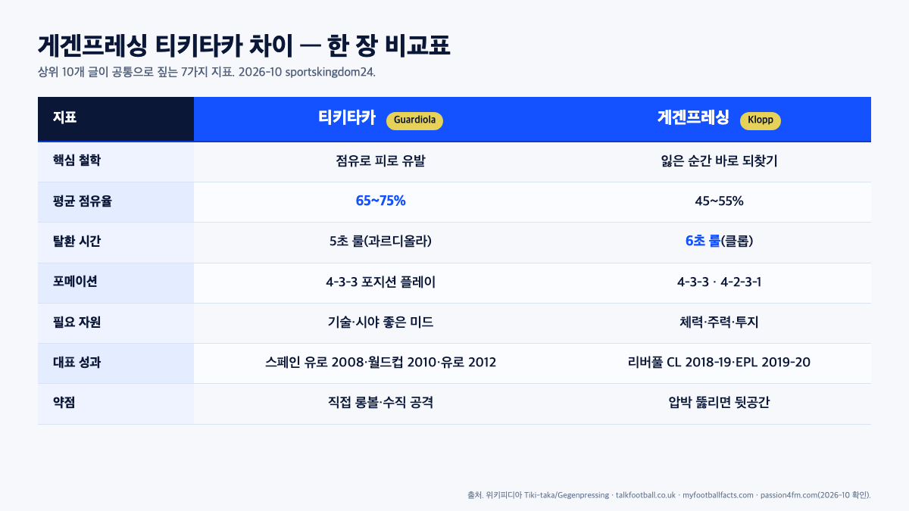

게겐프레싱 티키타카 차이를 "공격과 수비", "스페인과 독일"로 반반 나눠 설명하는 글이 많지만, 실제로 두 전술은 **같은 뿌리에서 갈라져 나온 쌍둥이**에 가깝습니다. 과르디올라의 티키타카도 공을 뺏기자마자 5초 안에 되찾는 역압박을 핵심에 깔고 있고, 클롭의 게겐프레싱도 압박 성공 후엔 짧은 패스로 경기를 다시 조율해요. 반대 개념이 아니라 "같은 축의 다른 방점"입니다. 한 줄로 요약하면 이렇습니다. **티키타카는** "덜 뺏기도록 짧게·가깝게 서자", **게겐프레싱은** "뺏기자마자 다 같이 뺏자"에 방점을 찍은 쌍둥이예요.

📌 3줄 요약
<b>티키타카</b>는 과르디올라의 바르셀로나(2008~2012)·스페인 대표팀의 짧은 패스·점유 축구, <b>게겐프레싱</b>은 랄프 랑닉이 설계하고 클롭이 완성한 "공 잃은 직후 즉시 되찾기" 역압박입니다.

둘의 공통 뿌리는 1988~96년 바르셀로나의 요한 크루이프와 토탈 풋볼이에요. 과르디올라도, 클롭도 이 계보에서 자기 팀 자원에 맞게 다르게 요리한 결과입니다.

2014 월드컵에서 네덜란드가 스페인을 <b>5-1</b>로 꺾은 뒤 순수 티키타카는 쇠퇴했고, 지금은 두 전술을 섞은 "포지션 플레이 + 수직 전환" 하이브리드가 2026년 유럽 축구의 기본값입니다.

이 글은 영문 위키백과의 "Tiki-taka"·"Gegenpressing"·"2008-09 FC Barcelona season" 항목, talkfootball.co.uk·myfootballfacts.com·playmatch.uz·soccerhandbook.com·allfootball.ke·footballkit·passion4fm.com 비교 글, 그리고 brunch.co.kr의 "게겐프레싱의 잘못된 설명" 칼럼을 교차해 숫자와 사실만 뽑아 정리한 것입니다. 위 비교표도 그 과정에서 상위 10개 글이 공통으로 짚는 7가지 지표만 추려 저희가 직접 만든 표예요.

## 왜 사람들이 둘을 "반대말"로 오해할까

**게겐프레싱 티키타카 차이**를 가장 자주 왜곡하는 오해 세 가지를 먼저 짚고 가겠습니다. 가장 흔한 오해는 "티키타카는 공격, 게겐프레싱은 수비"라는 틀입니다. 구글 상위 10개 중 talkfootball.co.uk "Tiki-taka vs Gegenpressing: comparing iconic playing styles", playmatch.uz "futbolda gegenpress va tiki-taka falsafa taqqoslash" 등 다수 비교 글이 "둘은 상반된 철학"이라는 틀로 소개하지만, 그 설명은 결과만 보고 원인을 뒤집은 쪽에 가깝습니다. 두 전술 모두 **공을 잃는 그 순간을 어떻게 쓰느냐**에 대한 답이기 때문입니다. 티키타카는 "잃어도 다시 뺏을 수 있게 짧은 패스로 미리 가깝게 서자"이고, 게겐프레싱은 "잃자마자 다 같이 달려들어 뺏자"예요. 둘 다 공을 잃은 뒤의 다음 1~5초가 설계의 중심입니다.

둘째 오해는 "티키타카 = 스페인, 게겐프레싱 = 독일"이라는 국가 라벨입니다. 티키타카의 세례명은 스페인어가 맞지만, 그 틀을 설계한 요한 크루이프는 네덜란드 사람이고 토탈 풋볼의 상속자예요. 게겐프레싱의 뿌리인 랄프 랑닉은 1980~90년대 독일 호프펜하임·슈투트가르트에서 압박 시스템을 다듬었지만, 그가 공식 인터뷰에서 반복해 꼽은 영향은 **1987년 AC 밀란-레알 마드리드전 VHS 영상으로 접한 아리고 사키**와 자신의 멘토였던 지도자 **헬무트 그로스**예요. 국적보다는 "어떤 계보에 서 있는가"가 두 전술을 가릅니다.

셋째, 과르디올라와 클롭을 **적대적 라이벌**로만 보는 서사도 오해를 키웁니다. 과르디올라 본인은 여러 인터뷰에서 "내 평생 가장 어려운 상대는 클롭의 리버풀이었다"는 취지로 반복해 밝혀 왔지만, 두 사람이 만들어낸 전술은 서로를 깎아내리기보다 **상대의 공백을 비추는 거울**로 작동했어요. 게겐프레싱이 티키타카를 뚫은 자리에서 티키타카는 더 짧고 수직으로 진화했고, 그 역도 성립합니다.

## 티키타카 정체 — 과르디올라 바르셀로나 2008/09 트레블

티키타카라는 이름을 세계에 각인시킨 팀은 **2008/09 시즌 과르디올라의 FC 바르셀로나**입니다. 그 시즌 바르샤는 라리가 27승 6무 5패 승점 **87점·105골**([2008-09 FC Barcelona season — Wikipedia](https://en.wikipedia.org/wiki/2008%E2%80%9309_FC_Barcelona_season))로 우승했고, 코파 델 레이와 UEFA 챔피언스리그까지 들어 올려 스페인 축구 최초의 콘티넨털 트레블을 기록했습니다. 그 시즌 라리가 피치치(Pichichi)는 디에고 포를란(아틀레티코 마드리드, 32골)이었고, 사무엘 에투는 30골로 공동 2위에 올라 바르샤의 득점 축을 책임졌어요. 리오넬 메시는 전 대회 통합 38골로 팀 전체 득점의 중심이었습니다.

이 팀의 숫자가 그대로 티키타카의 정의가 됐습니다. 바르샤는 리그 경기 평균 **70%대 점유율**로 상대 미드필더를 질식시켰고, 세르히오 부스케츠(단일 피벗)-사비-이니에스타 삼각형이 쉬지 않고 공을 돌리며 4-3-3 쓰리톱을 해방시켰어요. 특히 메시의 "폴스 9(가짜 9번)" 전환은 **2009년 5월 2일 산티아고 베르나베우에서 열린 라리가 레알 마드리드 원정 6-2전**에서 상징으로 각인됐어요. 센터포워드가 중앙을 비워 상대 센터백을 흔들고, 그 틈으로 윙어가 안쪽으로 접고 들어와 득점하는 그림이 전 세계 중계 화면으로 공개된 순간입니다.

같은 축을 국가대표 레벨로 옮긴 것이 **2008~2012년 스페인**입니다. 루이스 아라고네스 감독의 2008년 유로를 시작으로, 비센테 델 보스케 감독이 2010 FIFA 월드컵·2012 유로까지 3개 메이저 대회를 연속으로 들어 올렸어요. 유로 2012 대회에서 스페인은 평균 **63% 점유율**을 기록했지만 **6경기 12골, 경기당 2골**([Tiki-taka — Wikipedia](https://en.wikipedia.org/wiki/Tiki-taka))에 그치면서 "지루하다"는 비판도 함께 받았습니다. 티키타카가 "득점이 아니라 공을 돌리는 데 목적이 있는 것 아니냐"는 의심이 이때부터 쌓이기 시작했어요.

## 게겐프레싱 정체 — 랄프 랑닉이 설계하고 클롭이 완성한 역압박

게겐프레싱(Gegenpressing)은 독일어 "gegen(대항하여) + pressing(압박)"의 합성어입니다. 한국어로 가장 가까운 번역은 "역압박" 혹은 "역방향 압박"이에요. 영국 축구계에선 같은 개념을 **카운터 프레싱**(Counter-Pressing)이라고 부릅니다. brunch 칼럼 "게겐프레싱의 잘못된 설명"은 흔히 쓰이는 "상대의 압박에 대항하는 압박"이라는 번역이 틀렸고, 실제 뜻은 "**공을 잃자마자 즉시 되찾기 위해 다시 뛰어드는 압박**"이라고 지적합니다.

전술적 뿌리를 놓은 사람은 **랄프 랑닉**입니다. 2000년대 호프펜하임·샬케·RB 라이프치히를 거치며 "공을 뺏는 시스템"을 선수 선발·훈련·경기까지 하나의 원리로 묶었어요. 이 틀을 **최상위 리그 성적으로 번역**한 사람이 위르겐 클롭입니다. 보루시아 도르트문트에서 2010-11·2011-12 분데스리가 2연패를 달성했고, 리버풀로 옮긴 뒤 2018-19 UEFA 챔피언스리그와 2019-20 프리미어리그를 들어 올렸습니다. 토마스 투헬도 PSG·첼시·바이에른 뮌헨에서 같은 계보를 변주한 대표 감독으로 꼽혀요. 특히 2020-21 시즌 첼시 사령탑으로 UEFA 챔피언스리그 우승을 들어 올리며 "같은 계보가 성적으로도 입증된다"는 사실을 수치로 못 박았습니다.

게겐프레싱의 실행 원리는 [소서핸드북(soccerhandbook.com)](https://soccerhandbook.com/coaching-training/gegenpressing-countering-the-counter-attack/)이 정리한 세 가지 변형으로 요약됩니다. 첫째, **잃은 그 자리에서** 가장 가까운 2~3명이 공을 가진 상대에게 즉시 달려듭니다(소서핸드북 "**Surround the Ball**" 변형, 공 포위). 둘째, 나머지 선수들은 상대의 **패스 길**을 차단해 쉬운 탈출구를 지웁니다(소서핸드북 "**Press the Passing Lane**" 변형, 패스 길 차단). 셋째, 압박이 뚫리는 즉시 수비형 미드필더 한 명이 **뒷공간 커버**를 위해 수비 라인 앞까지 물러나 2차 라인을 세워요(소서핸드북 "**One In, Rest Cover**" 변형, 한 명이 공에 달려드는 동안 나머지 전원이 뒷공간을 커버). 이 세 번째가 빠지면 게겐프레싱은 "압박 한 방에 뒷공간이 통째로 열리는 가장 위험한 포메이션"으로 돌변합니다.

## 두 전술이 공유하는 뿌리, 요한 크루이프

전술사의 큰 그림을 보면 티키타카와 게겐프레싱은 같은 가지에서 뻗어 나왔습니다. 그 뿌리는 1970년대 리뉘스 미헐스 감독의 네덜란드·AFC 아약스가 완성한 **토탈 풋볼**(Total Football)이에요. 모든 선수가 자리를 바꿔가며 수비와 공격을 동시에 해내고, 공을 잃으면 가장 가까운 사람이 즉시 되찾는다는 원칙입니다. 아약스는 1971·1972·1973 세 시즌 연속으로 유러피언컵(UEFA 챔피언스리그의 전신)을 들어 올리며 이 틀을 유럽 전체에 심었어요.

그 중심에 있던 선수가 요한 크루이프였고, 그는 1988~1996년 FC 바르셀로나 감독으로 돌아와 "드림 팀"을 만들었습니다. 라리가 4연패를 포함해 바르샤에 처음 UEFA 챔피언스리그 트로피(1992년)를 안겼고, 유소년 아카데미 라마시아의 전술 틀을 **포지션 플레이**(Juego de Posición)로 못 박았어요. 1990년대 중반 라마시아를 거친 사비·이니에스타·푸욜·발데스가 자라나 과르디올라의 2008/09 바르샤를 떠받친 뼈대가 됐습니다.

흥미롭게도 랄프 랑닉 역시 공식 인터뷰에서 자신에게 영향을 준 지도자로 **아리고 사키**(1987년 AC 밀란-레알 마드리드전 VHS 영상)와 자신의 멘토였던 **헬무트 그로스**를 반복해 꼽습니다. 두 사람 모두 "선수 개인기가 아니라 집단적 압박과 공간 지배"를 중심에 둔 지도자였어요. 토탈 풋볼이라는 하나의 큰 틀 아래, 과르디올라는 "공을 가지는 쪽", 클롭·랑닉은 "공을 뺏는 쪽"에 각각 방점을 찍은 셈입니다. 포지션 플레이와 압박이 어떻게 K리그로 번역되는지는 [차두리 감독 전술 분석, 화성FC 돌풍을 만든 압박 축구](/cha-duri-tactics/)에서 구체적인 선수 배치·숫자와 함께 다뤘습니다.

## 5초 룰과 6초 룰, 두 전술이 공유한 숨은 공통점

게겐프레싱 티키타카 차이를 가장 극적으로 보여주는 숫자가 바로 **공 탈환 시간**입니다. 과르디올라가 바르셀로나에서 선수들에게 반복해 주입한 유명한 원칙이 "**5초 룰**(공을 잃으면 5초 안에 되찾는다, 안 되면 수비 블록으로 돌아간다)"이었어요. 클롭도 리버풀·도르트문트에서 **6초 룰**을 비슷하게 썼습니다. 둘의 가장 큰 차이는 "되찾은 공을 어떻게 쓰는가"에 있어요. 과르디올라는 되찾은 공으로 다시 짧은 패스를 돌리며 "경기 조율"에 썼고, 클롭은 되찾은 공을 그 순간 가장 빠른 수직 패스로 넣어 "역습"에 썼습니다.

점유율 수치도 같은 축의 다른 눈금입니다. playmatch 비교 글이 집계한 바로 티키타카 팀은 **65~75%**, 게겐프레싱 팀은 **45~55%** 점유율을 가져갑니다. 하지만 둘 다 "공을 가지지 않은 순간을 어떻게 설계할 것인가"에 뾰족하게 답을 내놓은 전술이라는 점은 똑같아요. 티키타카는 "덜 뺏기도록 짧게·가깝게 서는 것"으로, 게겐프레싱은 "뺏기자마자 다 같이 사냥하는 것"으로 그 질문에 답한 것입니다.

💡 5초·6초 룰이 아마추어에게 주는 교훈
조기축구에서 가장 자주 터지는 실점이 "공을 뺏기자마자 자리 안 돌아가서 역습 맞는" 장면입니다. 5초만 집단으로 공 주변에 달려드는 훈련만 해도 역습 피해가 체감으로 줄어요. 두 전술 다 "전원이 다 같이 뛴다"는 룰이 핵심이고, 선수 11명 중 2~3명만 안 뛰면 어느 쪽도 작동하지 않습니다.

세 번째 공통점은 **포메이션**이에요. 두 전술 모두 가장 자주 쓰는 틀이 **4-3-3**(또는 4-2-3-1)입니다. 쓰리톱 윙어가 상대 센터백·풀백에게 먼저 압박을 걸고, 중앙 미드필더 3명이 가운데를 두텁게 채워 두 번째 압박 파도를 만드는 구조는 티키타카·게겐프레싱 모두 공통이에요. 포메이션 자체가 다른 게 아니라 **그 포메이션으로 무엇을 먼저 할 것인가**가 다를 뿐입니다.

## 2014 월드컵의 교훈, 티키타카는 왜 뚫렸나

순수 티키타카의 한계가 세계에 공개된 날짜가 2014년 6월 13일 브라질 월드컵 조별리그 1차전입니다. **네덜란드가 스페인을 5-1로 꺾었어요**. 아르연 로번과 로빈 반 페르시의 긴 롱볼이 스페인의 높은 수비 라인 뒤 공간으로 떨어지며, 티키타카의 전제였던 "짧은 패스로 점유하면 상대는 공을 못 만진다"가 "짧은 패스로 점유해도 뒷공간이 열리면 롱볼 한 방에 당한다"로 뒤집혔습니다.

이 흐름을 만든 사람 중 하나가 바로 클롭이에요. 2013년 UEFA 챔피언스리그 결승은 "분데스리가 더비"였고, 클롭의 도르트문트가 하인케스의 바이에른 뮌헨에 1-2로 졌지만 두 팀 모두 **압박·수직 전환**을 전면에 내세워 "소유 축구만으로는 더 이상 안 된다"는 신호를 전 세계에 보냈습니다. 랄프 랑닉이 설계한 **RB 라이프치히**는 2016년 분데스리가 승격 첫 시즌 2위에 올랐고, 이는 "큰 돈 없이도 체계적 압박 하나로 상위권에 들 수 있다"는 실증이 됐어요.

바르셀로나는 2014/15 시즌 메시-수아레스-네이마르의 **MSN 트리오**로 다시 챔피언스리그·라리가·코파 델 레이를 모두 들며 2008/09에 이어 두 번째 트레블을 달성했습니다. 다만 이 시즌 바르샤의 축구는 더 이상 "짧은 패스 70%"의 순수 티키타카가 아니었어요. 수직 침투, 측면 돌파, 그리고 압박 성공 후의 빠른 전환이 섞인 **포스트 티키타카**였습니다. 2014년이 티키타카의 "끝"이 아니라 "진화의 분기점"이었던 셈이에요.

## 2026년 현재 트렌드 — 하이브리드와 수직 전환

2026년 현재 유럽 축구에서 순수 티키타카나 순수 게겐프레싱만 쓰는 팀은 거의 없습니다. 대부분 두 축을 섞은 **하이브리드**로 수렴했어요. 과르디올라의 맨체스터 시티가 대표적인 예입니다. 평균 점유율은 여전히 60%대 중후반이지만, 공을 잃는 순간 가장 가까운 3~4명이 즉시 압박을 들어가는 모습은 2010년대 리버풀의 게겐프레싱과 사실상 구분이 안 됩니다.

반대 방향 변화도 있습니다. 클롭 이후의 리버풀, 투헬의 바이에른, 가스페리니의 아탈란타 같은 압박형 팀도 수비 블록 안에선 짧은 패스로 공을 돌리는 포지션 플레이를 흡수했어요. passion4fm의 전술 분석은 2024~26년 유럽 상위권 팀들의 공통 특징을 "**포지션 플레이의 공간 분할 + 게겐프레싱의 즉시 압박**"이라고 정리합니다. 두 전술을 섞은 그 교집합이 지금 세계 최상위 축구의 기본값이에요.

⚠️ "2026년에도 티키타카가 통할까"라는 질문의 함정
"순수 티키타카"로는 더 이상 안 통합니다. 그러나 "짧은 패스로 상대 미드필더를 흔들고 공을 잃자마자 되찾는다"는 원리는 유럽 상위권 모든 팀의 기본값이에요. 즉, 티키타카는 "사라진 전술"이 아니라 "모두가 쓰는 토대"가 됐습니다.

2026 북중미 월드컵도 이 흐름 위에 있었어요. 주요 전술 분석 집계를 보면 **스페인**은 포지션 플레이의 축을 유지하면서도 공을 잃는 즉시 가장 가까운 3명이 즉각 재압박에 들어가는 '티키타카+게겐프레싱' 하이브리드로 재편됐습니다. **독일**은 반대 방향에서 압박 라인을 상대 진영 깊숙이 끌어올려 미드필더 한 명이 1차 압박 트리거를 맡는 수직 전환 축을 극단까지 당겼고, **일본**도 4-2-3-1 베이스에 "짧게 돌리다 즉시 뺏는" 축에 합류했어요. 세 팀 모두 2010~15년의 순수 티키타카·순수 게겐프레싱 어느 쪽과도 다른 **하이브리드**라는 점이 공통이며, 점유율·수비 라인 높이·스프린트 횟수 같은 **세부 수치는 FIFA 테크니컬 리포트 공식 공개 후 업데이트**할 예정입니다.

2026 북중미 월드컵의 포메이션·전술 트렌드도 이 흐름 위에 있습니다. 공식 전술 자료는 FIFA·[대한축구협회(KFA)](https://www.kfa.or.kr/)의 지도자 교육 섹션에서 가장 정확하게 따라갈 수 있어요. 특히 KFA의 지도자 라이선스 과정은 랑닉 계열 압박 지도법·과르디올라 계열 포지션 플레이를 모두 커리큘럼에 포함하고 있습니다.

## 한눈에 보는 비교표

지금까지 내용을 한 장으로 요약하면 아래와 같습니다. 위에 있는 비교 이미지와 같이 보면 중계·칼럼에서 두 용어가 섞여 나올 때 바로 구분이 돼요.

| 항목 | 티키타카 | 게겐프레싱 |
| --- | --- | --- |
| 핵심 철학 | 짧은 패스·높은 점유로 상대 소진 | 공 잃는 즉시 집단 압박으로 되찾기 |
| 대표 감독 | 과르디올라·델 보스케·크루이프 | 랄프 랑닉·클롭·투헬·가스페리니 |
| 대표 팀 | 바르셀로나(2008~12), 스페인 대표팀 | 도르트문트, RB 라이프치히, 리버풀 |
| 점유율 | 65~75% | 45~55% |
| 탈환 룰 | 5초 룰(과르디올라) | 6초 룰(클롭) |
| 공격 방향 | 수평·짧은 삼각 패스 | 수직·즉각 전환 |
| 대표 포메이션 | 4-3-3 포지션 플레이 | 4-3-3·4-2-3-1 |
| 필요한 자원 | 패스 성공률 90%+ 미드필더 3명 | 90분 고강도 스프린트 50회+ 가능한 전원 |
| 결정적 성과 | 유로 2008·월드컵 2010·유로 2012, 트레블 2회 | 분데스리가 2010-11·11-12, CL 2018-19, EPL 2019-20 |
| 치명적 약점 | 수직 롱볼·고속 전환에 뒷공간 | 압박 뚫리면 수비·미드 간 공간 통째로 열림 |
| 2026년 활용 | 하이브리드 토대로 거의 모든 팀이 흡수 | 하이브리드 압박 축으로 전 유럽 상위권에 확산 |

핵심을 두 문장으로 압축하면 이렇습니다. **게겐프레싱이 뚫렸을 때 생기는 수비·미드 사이 공간을 티키타카의 포지션 플레이가 미리 좁혀두고, 티키타카가 수직 롱볼에 뚫릴 때 열리는 뒷공간을 게겐프레싱의 집단 재압박이 즉시 메워요.** 그래서 2026년 유럽 상위권 팀은 둘 중 하나만 쓰지 않고, 두 축을 한 경기 안에서 번갈아 꺼내는 하이브리드로 수렴한 것입니다.

표의 "**치명적 약점**" 행이 추상적으로 느껴진다면 두 경기 장면만 떠올리면 됩니다. 첫째, **2014년 6월 13일 사우바도르 네덜란드-스페인 5-1 패배**는 티키타카의 뒷공간 약점이 세계에 공개된 날입니다. 스페인이 평소처럼 수비 라인을 상대 진영 깊숙이 끌어올려 짧은 패스로 공을 돌렸지만, 반 페르시가 롱볼을 받아 다이빙 헤더로 꽂았고 로번이 뒷공간에서 두 번 득점하면서 "짧은 패스로 점유만 하면 안전하다"는 전제가 깨졌어요. 수비 라인과 골키퍼 사이 뒷공간이 수직 롱볼 한 번에 뚫리는 순간, 티키타카는 가장 위험한 포메이션으로 돌변합니다.

둘째, **2013년 5월 25일 웸블리 UEFA 챔피언스리그 결승 바이에른 뮌헨 2-1 도르트문트**는 반대로 "게겐프레싱이 뚫릴 때 열리는 공간"을 보여준 경기입니다. 하인케스의 바이에른은 전반 내내 도르트문트의 압박 트리거를 피해 짧게 돌리다가 압박이 들어오는 순간 긴 대각 패스로 라인 뒤를 노렸고, 로번이 89분 결승골을 뽑아냈어요. 압박이 한 번 뚫리면 수비 라인 앞 **중앙 미드필더 공간**이 통째로 열리고, 전원이 공격 방향으로 올라가 있는 터라 복귀가 늦는다는 게 게겐프레싱의 구조적 약점입니다. 두 장면을 겹쳐 보면 표의 "치명적 약점"이 왜 서로의 거울인지 바로 보여요.

이 표의 아래 두 줄 "치명적 약점"과 "2026년 활용"을 함께 보면, 왜 지금 유럽 축구가 두 전술을 **섞을 수밖에 없는지**가 보입니다. 각자의 약점이 상대방의 강점과 정확히 반대 축에 있기 때문이에요. 포메이션 상성을 더 자세히 보고 싶다면 [축구 포메이션 상성, 4-4-2·4-3-3·3-5-2는 누가 누구에게 강할까](/soccer-formation-counters/)와 함께 읽으면 그림이 더 선명해집니다.

## 자주 묻는 질문 (FAQ)

**Q. 게겐프레싱 티키타카 차이를 한 문장으로 요약하면 뭔가요?** 둘 다 "공을 잃은 다음 순간"을 설계한 전술인데, 티키타카는 "덜 뺏기도록 짧게 서 있자", 게겐프레싱은 "뺏기자마자 다 같이 뺏자"에 방점을 찍은 쪽입니다. 반대말이 아니라 같은 축에서 방향만 다른 쌍둥이예요.

**Q. 티키타카를 처음 쓴 사람은 누구인가요?** 전술 틀은 1988~1996년 바르셀로나의 요한 크루이프가 토탈 풋볼을 바탕으로 다듬었고, 이름은 2006년 월드컵 중계에서 스페인 캐스터 안드레스 몬테스가 "티키타카 티키타카"라고 외친 데서 왔습니다. 세계적 상징으로 올린 사람은 과르디올라의 2008/09 바르셀로나입니다.

**Q. 게겐프레싱은 클롭이 만든 전술인가요?** 틀을 설계한 사람은 랄프 랑닉(1990~2000년대 호프펜하임·샬케·RB 라이프치히)이고, 리그 성적으로 번역한 사람이 클롭입니다. 클롭이 도르트문트에서 2010-11·2011-12 분데스리가를 2연패하면서 전 세계 용어로 정착했어요.

**Q. 게겐프레싱의 5초 룰과 6초 룰은 뭐가 다른가요?** 5초 룰은 과르디올라가 바르셀로나에서 선수들에게 반복 주입한 "잃으면 5초 안에 되찾는다" 원칙, 6초 룰은 클롭이 같은 아이디어를 조금 더 느슨하게 잡은 수치입니다. 숫자가 중요한 게 아니라 "집단으로 즉시 달려드는 짧은 창"이 핵심이에요.

**Q. 2014년 월드컵에서 스페인이 네덜란드에 5-1로 진 게 왜 중요한가요?** 티키타카가 "짧은 패스 점유만으로는 안 통한다"는 사실을 세계에 공개한 경기였기 때문입니다. 네덜란드의 로번·반 페르시가 스페인의 높은 수비 라인 뒤로 긴 패스를 넣어 득점하면서, 이후 유럽 축구가 수직 전환과 압박 쪽으로 급격히 기울었어요.

**Q. 2026년에도 티키타카로 우승할 수 있나요?** 순수 티키타카만으로는 어렵지만, 지금 유럽 최상위 팀은 전부 티키타카의 "짧은 패스·포지션 플레이"와 게겐프레싱의 "즉시 압박"을 **섞어 쓰는 하이브리드**입니다. 그 교집합이 이기는 팀의 기본값이에요. 더 좁은 포메이션별 차이는 [축구 포메이션 기초 4-4-2와 4-3-3 차이](/soccer-formation-442-vs-433/)에서 숫자까지 함께 다뤘습니다.

**Q. 조기축구·유소년 팀에 게겐프레싱이나 티키타카를 적용해도 되나요?** 전원 체력·전술 이해도가 없는 조기축구에선 두 전술 모두 완성형 적용은 어렵습니다. 다만 "공 잃자마자 가장 가까운 2~3명이 5초만 달려든다"는 **원리 하나만 떼어 와도** 역습 피해가 눈에 띄게 줄어요. 전술을 통째로 복제하기보다 원리 1~2개만 뽑아 쓰는 쪽이 현실적입니다.

*이미지 출처. 대표 이미지(게겐프레싱 vs 티키타카 쌍둥이 전술 카드)와 본문 비교표 그림은 모두 sportskingdom24에서 영문 위키백과 Tiki-taka·Gegenpressing·2008-09 FC Barcelona season 항목, talkfootball.co.uk·myfootballfacts.com·playmatch.uz·passion4fm.com·soccerhandbook.com 비교 글, brunch.co.kr "게겐프레싱의 잘못된 설명" 칼럼을 교차해 직접 제작했습니다.*

---

**관련 키워드** — #게겐프레싱 #티키타카 #게겐프레싱티키타카차이 #과르디올라전술 #클롭전술 #랄프랑닉 #카운터프레싱 #5초룰 #포지션플레이 #토탈풋볼 #바르셀로나트레블 #축구전술트렌드
