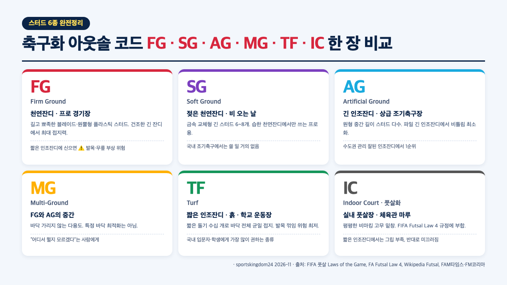
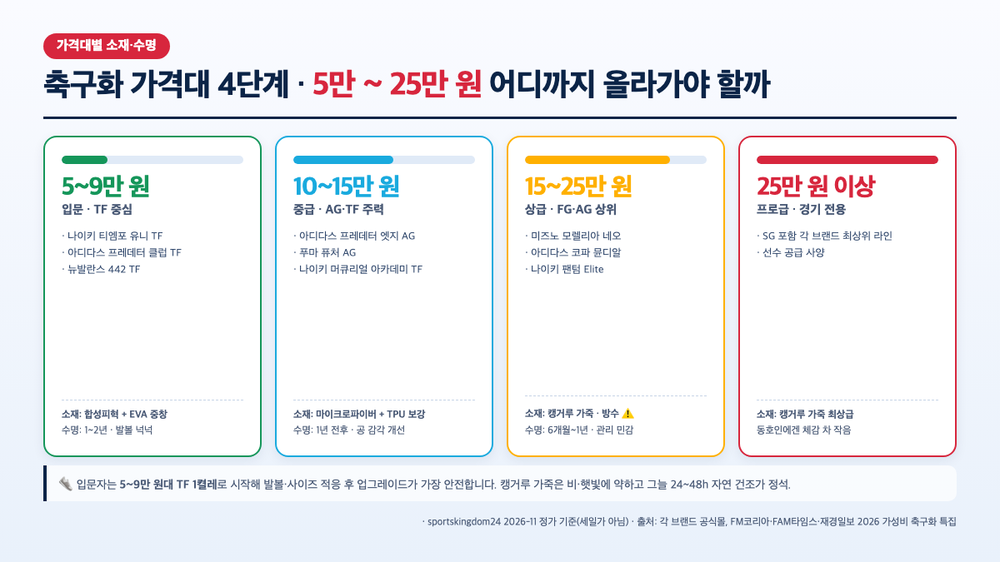

**축구화 고르는 법**은 디자인이나 가격이 아니라 "**어디서 뛰느냐**"부터 정하는 게 정답입니다. 천연잔디·긴 인조잔디·짧은 인조잔디·풋살장(실내)에서 신어야 하는 신발 종류가 다 다르고, 특히 **아웃솔(밑창)의 스터드 모양이 틀리면 발목·무릎 부상 위험이 커지기 때문이에요**. 2026년 11월 기준 국내 조기축구·동호인이 가장 자주 밟는 바닥은 **짧은 인조잔디와 긴 인조잔디** 두 가지(TF·AG)이고, 실내 풋살장은 **FIFA 풋살 Law 4**가 "고무 솔·캔버스 또는 부드러운 가죽 갑피"로 신발 재질을 명시해 둬 금속 스터드가 원천 금지됩니다. 이 글은 FIFA·FA 공식 풋살 규정과 영문 Wikipedia Futsal 항목, 국내 축구 전문 매체 FAM타임스·FM코리아의 스터드 분류 글들을 교차 확인해, 축구화 한 켤레를 고르기 전 꼭 알아야 할 것을 한 번에 정리한 글이에요.

📌 3줄 요약
<b>가장 먼저 볼 것</b>: 디자인이 아니라 밑창. 스터드 모양(FG·SG·AG·MG·TF·IC) 6가지 중 내가 뛰는 바닥에 맞는 하나를 먼저 고르면 선택지의 80%가 끊어집니다.

<b>국내 기준 단순 공식</b>: 짧은 인조잔디·흙 운동장은 <b>TF</b>, 잘 관리된 긴 인조잔디는 <b>AG</b>, 프로급 천연잔디는 <b>FG</b>, 실내 풋살장은 <b>IC(실내화)</b> 또는 전용 풋살화. FG를 짧은 인조잔디에서 신으면 스터드 길이가 쿠션재 깊이와 맞지 않아 접지가 불안정해져 부상 위험이 커져요.

<b>풋살은 축구화가 아니라 풋살화</b>: FIFA 풋살 Law 4가 "고무 솔의 캔버스 또는 부드러운 가죽 신발"로 못 박아서 스터드 자체가 금지입니다. 코트는 25~42m × 16~25m, 공은 저반발(사이즈 4·400~440g)이라 신발도 다르게 설계돼 있어요.

이 글은 FIFA 풋살 Laws of the Game, FA(잉글랜드축구협회) 풋살 Law 4, 영문 Wikipedia "Futsal" 항목, 국내 축구 매체 FAM타임스·FM코리아 "축구화·풋살화 고르는 팁" 글, 그리고 대한축구협회(KFA)의 유소년 장비 안내를 교차 확인해 정리했습니다.

## 축구화 고르는 법 결론 요약 — 바닥만 보면 선택지의 80%가 끊어진다

축구화를 고를 때 가장 먼저 봐야 할 것은 "**내가 어디서 뛰느냐**"예요. 축구화 아웃솔은 **잔디 위에서 미끄러지지 않고 치고 나가기 위한 설계**이고, 잔디 상태(천연·인조·실내)에 따라 스터드의 길이·개수·재질이 다르게 만들어져 있습니다. **같은 "축구화"라는 이름이 붙어도 FG와 TF는 완전히 다른 신발**이라는 걸 먼저 인정해야 해요.

국내 기준으로 가장 많이 신는 조합은 네 가지로 압축됩니다. 첫째, **짧은 인조잔디·학교 운동장·흙 구장**에서는 돌기가 촘촘한 **TF**(터프화). 둘째, **잘 관리된 긴 인조잔디**에서는 돌기가 조금 더 긴 **AG**(인조잔디 전용). 셋째, **프로 경기장급 천연잔디**에서는 긴 블레이드형 스터드가 달린 **FG**(천연잔디 전용). 넷째, **실내 풋살장**(체육관 바닥)에서는 평평한 고무 밑창의 **IC**(실내화) 또는 풋살화예요. 이 네 가지 중 자신이 가장 자주 뛰는 바닥을 고르면, 품목·가격대·브랜드 중에서 고를 수 있는 선택지가 애초에 크게 좁혀집니다.

반대로 가장 위험한 선택은 **긴 FG 스터드를 짧은 인조잔디에서 신는 것**이에요. 짧은 인조잔디는 쿠션재가 얕아 스터드가 바닥에 깊이 박히지 못하고, 그 상태에서 방향 전환을 하면 발이 고정된 채 상체만 돌아가면서 **무릎 인대·반월판·발목 인대**에 과부하가 걸립니다. 국내 축구 매체들이 공통으로 "**학생·동호인은 TF 또는 AG로 가라**"라고 조언하는 이유가 여기 있어요. 신발이 잔디와 "**미끄러짐·접지·충격 흡수**" 세 요소에서 어떻게 설계됐는지 아는 게 축구화 고르는 법의 뼈대입니다.

## 축구화·풋살화 가장 큰 차이 — 아웃솔이 전부다

**축구화와 풋살화의 결정적 차이는 아웃솔**(밑창)이에요. 겉모양이 비슷해 보여도, 바닥면을 뒤집어 보면 완전히 다른 물건이라는 걸 알 수 있습니다. 축구화는 **잔디 위에서 미끄러지지 않고 추진력을 얻는 용도**로 스터드가 돋아 있고, 풋살화는 **딱딱한 실내 코트 위에서 바닥을 그립하는 용도**로 아웃솔이 평평한 고무로 돼 있어요.

이 차이는 그냥 디자인 차이가 아니라 **FIFA 공식 풋살 규정이 명시한 규정 차이**입니다. FIFA Futsal Laws of the Game과 FA(잉글랜드축구협회)의 Futsal Law 4 선수 장비 조항은 신발을 "**canvas or soft leather training or gymnastic shoes with soles of rubber or a similar material**"(캔버스 또는 부드러운 가죽 재질의 트레이닝·체조 신발, 고무 또는 유사 재질 밑창)로 못 박아 뒀어요. 즉 **금속 스터드·긴 돌기가 달린 축구화는 풋살 공식 규정상 사용 불가**입니다. 반대로 축구화의 긴 스터드로 실내 마루를 뛰면 바닥이 긁히고, 체육관에서 사용을 금지하는 이유도 여기 있어요.

쿠셔닝 설계도 반대예요. **잔디는 그 자체로 푹신한 쿠션 역할**을 하기 때문에 축구화는 중창이 얇고 공 감각을 최우선으로 만든 반면, **풋살장 바닥(하드 코트·마루)은 충격을 전혀 흡수하지 않기 때문에** 풋살화는 발바닥 피로를 덜어 주는 **중창 쿠션이 반드시 들어가 있습니다**. 국내 축구용품 매체 FAM타임스도 "풋살은 딱딱한 인조 잔디·마루 위에서 뛰어야 하기 때문에 신발 내피 중간에 중창이 필요하다"고 설명해 두고 있어요. 그래서 축구화를 풋살장에서 신으면 미끄러질 뿐 아니라 발 피로가 훨씬 빨리 옵니다.

## 스터드 6가지 완전정리 — FG·SG·AG·MG·TF·IC 한 장 비교

축구화·풋살화 아웃솔은 크게 **6가지 코드**로 나뉘어요. 신발 상자나 제품 설명에 반드시 **FG·SG·AG·MG·TF·IC**(또는 IN) 중 하나가 적혀 있으니, 이 알파벳 두 글자만 읽어도 "어디서 신을 신발인지" 바로 알 수 있습니다.

| 코드 | 풀네임 | 스터드 모양·재질 | 적합 구장 | 추천 대상 |
| --- | --- | --- | --- | --- |
| **FG** | Firm Ground | 길고 뾰족한 블레이드·원뿔형 플라스틱 | 건조한 **천연잔디**(프로 경기장) | 프로·엘리트 선수, 잘 관리된 잔디 |
| **SG** | Soft Ground | **금속 교체형** 6~8개 긴 스터드 | **젖은 천연잔디**(비 오는 날) | 프로·클럽 선수, 우천 경기 |
| **AG** | Artificial Ground | 중간 길이 **원형 플라스틱 스터드** 다수 | **긴 인조잔디**(잘 관리된 조기축구장) | 조기축구·동호인(인조잔디 상급) |
| **MG** | Multi-Ground | 중간 길이 스터드로 다용도 | FG와 AG의 중간 | 짧은 인조와 긴 인조를 번갈아 뛰는 동호인 두 번째 축구화를 따로 사기 어려운 입문자 |
| **TF** | Turf | **짧고 촘촘한** 고무·플라스틱 돌기 수십 개 | **짧은 인조잔디·흙·학교 운동장** | 학생·동호인·입문자 |
| **IC/IN** | Indoor Court | **평평한 비마킹 고무** 밑창 | **실내 풋살장·체육관 마루** | 풋살·실내 축구·입문자 |

**FG**(Firm Ground, 천연잔디용)는 축구화의 원형이에요. **길고 뾰족한 블레이드형 플라스틱 스터드**가 깊이 박히면서 최대의 접지력을 만들어 줍니다. 단, "제대로 관리된 천연잔디" 위에서만 제대로 작동하고 **짧은 인조잔디에서는 되려 위험**합니다.

**SG**(Soft Ground, 젖은 잔디용)는 **금속 재질의 긴 스터드 6~8개**가 달린 프로용 축구화예요. 비 오는 날 미끄러운 천연잔디에서 교체형 스터드를 더 긴 것으로 바꿔 끼울 수 있다는 게 가장 큰 특징입니다. 국내 조기축구에서 쓸 일은 거의 없어요.

**AG**(Artificial Ground, 인조잔디 전용)는 **파일이 긴 상급 인조잔디** 전용으로 2010년대 중반부터 유럽에서 상품화된 카테고리예요. **원형 스터드가 FG보다 많고 짧게** 배치돼 있어, 긴 스터드가 바닥에 걸려 비틀어지는 사고를 줄이면서 접지력은 유지합니다. 국내에서 조기축구를 하는 분들이 가장 자주 선택하는 등급이기도 해요.

**MG**(Multi-Ground, 다용도)는 AG와 FG 사이의 "**중간 길이 스터드**"로 바닥을 가리지 않고 쓸 수 있게 한 종류입니다. "어디서 뛸지 모르겠다"는 사람에게는 편하지만, 특정 바닥에 최적화된 설계보다는 성능이 어중간해요.

**TF**(Turf, 짧은 인조잔디·흙 구장)는 국내 아마추어가 가장 많이 신는 카테고리입니다. **밑창 전체에 짧은 돌기가 수십 개 촘촘히** 박혀 있어, 짧은 인조잔디와 흙 바닥에서 접지력을 균일하게 분산시켜 줘요. 돌기가 짧아 발목이 꺾일 위험도 가장 작고, 가격대도 5~10만 원대 입문용이 가장 많습니다.

**IC/IN**(Indoor Court, 실내화)은 **아웃솔이 완전히 평평**하고 비마킹 고무로 만든 실내 전용 신발이에요. 풋살화의 기본형이기도 하고, 체육관 마루처럼 바닥에 마크가 남지 않아야 하는 시설에서 꼭 필요합니다. 짧은 인조잔디에서 IC를 신으면 반대로 그립이 부족해 미끄러지니, "**실내화는 실내에서만**"을 지키는 게 안전합니다.

## 잔디 종류별 올바른 선택 — 천연·긴 인조·짧은 인조·실내 네 경우

**잔디 종류를 네 가지로 압축해서 보는 게 가장 실용적**이에요. 국내에서 뛰는 축구·풋살장은 사실상 아래 네 범주 안에 다 들어갑니다. 각 바닥에 맞는 스터드와 **잘못 신었을 때 생기는 문제**를 함께 보면 선택이 훨씬 쉬워져요.

| 바닥 상태 | 1순위 | 2순위 | **피해야 할 선택** | 피해야 하는 이유 |
| --- | --- | --- | --- | --- |
| **천연잔디**(프로 경기장) | FG | MG | TF·IC | 긴 잔디에 접지가 안 돼 미끄러짐 |
| **긴 인조잔디**(관리 잘됨) | AG | MG·TF | SG·긴 FG | 긴 스터드가 쿠션재에 걸려 발목 꺾임 |
| **짧은 인조잔디·흙 운동장** | TF | AG | FG·SG | 스터드 길이가 쿠션재 깊이와 안 맞아 접지 불안정 |
| **실내 풋살장·체육관** | IC·풋살화 | — | FG·AG·TF 전부 | 규정 위반 + 바닥 긁힘 + 미끄러짐 |

표에서 눈에 띄는 역설은 **실내화(IC)를 야외 인조잔디에서 신으면 안 되는 이유**예요. IC의 비마킹 고무 아웃솔은 체육관·마루 같은 평평한 바닥에 밀착해 접지하도록 설계돼 있어서, 인조잔디처럼 파일(풀 가닥) 사이사이로 접지면이 끼어야 하는 바닥에서는 접지가 뜨고 금방 미끄러집니다. 앞 섹션에서 "짧은 인조잔디에서 IC를 신으면 미끄러진다"고 적은 이유도 이것이에요.

**천연잔디**(프로 경기장)는 국내에서 뛰어 볼 일이 사실상 드물어요. 월드컵·K리그 1급 경기장과 일부 축구 전용 구장이 여기 속하고, 이 바닥에서는 **FG가 유일한 정답**입니다. 짧은 스터드의 TF를 신으면 긴 풀잎 사이로 접지면이 떠서 미끄러져요.

**긴 인조잔디**(잘 관리된 조기축구장)는 요즘 수도권 축구장에서 가장 많이 볼 수 있는 상태입니다. 쿠션재가 충분히 깔려 있고 파일도 길면 **AG가 1순위**, 어중간한 관리 상태라면 TF나 MG도 괜찮아요. 긴 FG 스터드는 **쿠션재에 걸려 발목이 꺾이는 사고**가 가끔 보고되기 때문에 피해야 합니다.

**짧은 인조잔디·학교 운동장·흙 구장**은 국내 일반 동호인·학생이 가장 자주 밟는 바닥입니다. 여기서는 **TF가 거의 유일한 정답**이에요. 짧은 돌기가 많아 바닥 전체가 균일하게 닿고, 발목·무릎에 가해지는 비틀림이 최소화됩니다. 바닥 상태가 들쭉날쭉한 학교 운동장에서는 **AG보다 TF가 더 안정적**이라는 평이 많아요.

**실내 풋살장·체육관**은 따로 설명이 필요 없습니다. **FIFA 풋살 Law 4가 고무 솔을 명시**하고 있고, 스터드가 달린 신발은 아예 시설 자체가 출입을 금지합니다. 전용 풋살화 또는 IC(실내화)만 쓸 수 있어요.

## 풋살화 vs 실내화(IC) 차이 — FIFA 공식 규정부터 보기

**풋살화와 실내화(IC)는 자주 혼동되지만 설계 철학이 조금씩 달라요**. 둘 다 **평평한 비마킹 고무 밑창**이라는 공통점이 있고, 실제로 아마추어 수준에서는 둘을 섞어 신어도 큰 문제가 없습니다. 다만 풋살 전용 코트에서 경기를 치른다면 "**풋살화**" 쪽이 공 감각과 코트 그립에서 조금 더 유리해요.

**FIFA 풋살 Law 4**가 명시한 신발 규정은 짧고 분명합니다. "**캔버스 또는 부드러운 가죽의 트레이닝·체조 신발, 고무 또는 유사 재질의 밑창**"으로, 금속 스터드나 뾰족한 돌기는 금지돼 있어요. FA(잉글랜드축구협회)도 동일한 문구로 규정을 유지하고 있고, 국제 풋살 경기는 모두 이 규정을 따릅니다. 즉 "풋살화"라는 상품명이 붙지 않아도, 이 조건만 맞추면 **공식 경기에서 신을 수 있는 "풋살 규격 신발"로 인정**됩니다.

풋살화와 IC 실내화의 세부 차이는 세 가지예요. 첫째, **밑창 두께**. 풋살화는 공 터치 감각을 최우선으로 해서 아웃솔이 매우 얇고, IC는 조금 더 두꺼운 쿠션형이 많습니다. 둘째, **갑피(윗부분) 재질**. 풋살화는 발과 공의 접촉 면을 민감하게 만들기 위해 얇은 캥거루 가죽·마이크로파이버를 쓰고, IC는 좀 더 두꺼운 합성피혁이 많아요. 셋째, **용도 표기**. 풋살화는 보통 "FUT"·"Sala"·"IC"가 아니라 "**Futsal**" 또는 "Sala"(스페인어 "실내")로 표기되고, IC는 "Indoor Court"의 약자입니다.

**풋살 공과 코트 특성**도 신발 설계에 영향을 줍니다. 영문 Wikipedia Futsal 항목에 따르면 **풋살 코트는 국내 경기 기준 25~42m × 16~25m, 국제 경기 기준 40m × 20m**(핸드볼 코트와 같은 규격)이고, **공은 사이즈 4(둘레 62~64cm·무게 400~440g)로 저반발 소재**로 만들어져 있어요. 축구공보다 작고 무거우면서 튀어 오르지 않는 공을 좁은 코트에서 다루기 때문에, **빠른 발 전환·정교한 발바닥 터치**가 필요하고, 풋살화는 이 동작에 맞춰 밑창이 얇게 설계돼 있는 거예요.

## 사이즈·발볼 선택 기준 — 운동화와 다르게 사는 법

**축구화·풋살화는 평소 운동화보다 5~10mm 작게 신는 게 일반적**이에요. 축구화는 **발과 공 사이의 감각**을 극대화하기 위해 발에 딱 맞게 설계됐고, 헐렁하면 공 컨트롤이 흐려지고 발 안에서 발이 미끄러져 물집이 생깁니다. 다만 "작게 신는다"는 게 **발가락이 눌릴 만큼 작게 신는다는 뜻은 절대 아니에요**. 엄지발가락 끝과 신발 끝 사이가 **3~5mm** 정도 남는 선이 적정입니다.

브랜드별 발볼(폭) 차이는 매우 큽니다. 일반적으로 **미즈노(일본) > 아슬레타(일본) > 아디다스 > 푸마 > 나이키** 순서로 발볼이 넓어요. 한국인 평균 발볼은 서양인보다 넓은 편이라, **나이키의 얇은 모델(머큐리얼 베이퍼 등)은 발볼이 압박감이 심한 경우가 많고**, **미즈노 모렐리아·모나르시다(Monarcida) 계열은 발볼이 넓은 사람에게 가장 편하다**는 평이 많아요. 아디다스는 "WF"(Wide Fit) 모델을, 나이키는 "AF"(Adaptive Fit) 모델을, 미즈노는 "WIDE" 모델을 별도로 출시합니다.

실측 방법은 간단해요. **발 길이는 서서 벽에 발뒤꿈치를 대고** 발가락 끝까지의 거리를 재고, **발볼은 발 가장 넓은 부분의 둘레**를 줄자로 잽니다. 이 두 숫자를 브랜드 홈페이지의 사이즈 차트와 맞추면 됩니다. **스포츠 양말을 신고 쟀을 때의 사이즈**를 기준으로 하는 게 좋아요. 일반 양말은 얇아서 사이즈를 작게 인식하고, 매장에서 "스포츠 양말 없이" 사이즈를 재면 실제 플레이 때 꽉 끼게 느껴지는 일이 많습니다.

소재별 사이즈 차이도 있어요. **캥거루 가죽**은 신는 과정에서 1~2mm 정도 늘어나기 때문에 **살짝 작게**, **마이크로파이버 합성피혁**은 신어도 거의 안 늘어나니 **처음부터 딱 맞게** 사는 게 정석입니다. 발볼이 넓은 사람이 "길이를 늘려서 발볼을 맞추는" **선택은 가장 나쁜 조합**이에요. 길이가 남으면 발이 신발 안에서 앞뒤로 움직여 발톱이 멍들고 접지력도 떨어집니다.

## 처음 사는 사람을 위한 체크리스트 — 5분 안에 고르는 순서

**축구화·풋살화를 처음 사는 사람이 매장이나 쇼핑몰에서 바로 적용할 수 있는 순서**를 7단계로 정리했어요. 이 순서를 지키면 "예쁜데 못 신는 신발"을 사는 사고를 피할 수 있습니다.

🥾 축구화 고르는 7단계
<b>1단계. 바닥 정하기</b>. 내가 뛰는 곳이 천연잔디·긴 인조잔디·짧은 인조잔디·실내 풋살장 중 어디인지 먼저 결정. 두 곳 이상이면 가장 자주 뛰는 바닥 기준.

<b>2단계. 아웃솔 코드 확인</b>. FG·SG·AG·MG·TF·IC 중 바닥에 맞는 것으로 범위 축소.

<b>3단계. 사이즈 측정</b>. 벽에 발뒤꿈치 대고 서서 발 길이·발볼 둘레 측정. 스포츠 양말 신고.

<b>4단계. 브랜드별 발볼 체크</b>. 발볼이 유난히 넓다고 느껴지면 일본 브랜드(미즈노·아슬레타)부터 신어 보고, 평범하면 아디다스·푸마, 발볼이 좁은 편이면 나이키도 괜찮아요. 수치보다 매장 시착 느낌을 기준 삼으세요.

<b>5단계. 가격대 설정</b>. 입문 5~8만 원대 TF, 중급 10~15만 원대 AG, 상급 20만 원대 FG 캥거루 가죽.

<b>6단계. 사이즈 두 개 시착</b>. 평소 운동화 사이즈·그보다 5mm 작은 사이즈 두 개를 모두 신어 보고 엄지 공간 3~5mm 확인.

<b>7단계. 걸음·점프 테스트</b>. 매장에서 좌우로 발을 비틀어 보고, 발뒤꿈치가 들리지 않는지·발가락이 눌리지 않는지 확인.

**온라인 쇼핑**에서 사는 경우에는 반품 가능 여부를 먼저 보는 게 가장 중요해요. 아디다스·나이키·푸마 공식몰은 **구매 후 7~30일 내 무료 반품**을 지원하는 기간이 있고, 쿠팡·11번가 같은 종합몰도 미사용 상태라면 반품이 수월합니다. **포인트·세일 적용 전 반품 조건을 꼭 확인**해 두세요. 세일가로 산 축구화는 반품이 제한되는 경우가 있습니다.

입문자에게는 **TF 1켤레부터 시작**하라는 조언이 가장 많아요. 그 이유는 세 가지입니다. 첫째, TF는 **가격이 가장 저렴**(5~10만 원대)해서 "맞춰 보고 다음에 업그레이드"하기 좋고. 둘째, TF는 **대부분의 국내 바닥에 두루 쓸 수 있어** 활용도가 높고. 셋째, TF는 **발목·무릎 부상 위험이 가장 적은** 종류라 입문 단계에서 다치지 않고 축구와 친해질 수 있어요.

## 가격대별 접근 — 입문 5만·중급 10만·상급 20만원대

**축구화·풋살화 가격대는 크게 세 구간**으로 나뉘어요. 각 구간이 다른 이유는 **갑피 소재·생산 방식·브랜드 프리미엄**에서 큰 차이가 나기 때문입니다. 국내 유통되는 라인업을 가격 구간별로 묶으면 아래 표와 같아요.

| 가격대 | 대표 소재 | 주요 모델군 | 특징 |
| --- | --- | --- | --- |
| **입문 5~9만 원** | 합성피혁·EVA | TF 중심(나이키 티엠포 유니 TF·아디다스 프레데터 클럽 TF·뉴발란스 442 등) | 가성비·내구성 중심, 발볼 보통 |
| **중급 10~15만 원** | 마이크로파이버·일부 가죽 | AG·TF 주력(아디다스 프레데터 엣지·푸마 퓨처·나이키 머큐리얼 베이퍼 아카데미) | 접지력 향상·공 감각 개선 |
| **상급 15~25만 원** | 캥거루 가죽·고급 합성 | FG·AG 최상위(미즈노 모렐리아 네오·아디다스 코파 문디알(Copa Mundial)·나이키 팬텀 Elite) | 경량·공 감각 최상, 내구성은 소재 따라 다름 |
| **프로급 25만 원 이상** | 캥거루 가죽 최상급 | SG 포함 최상위 라인 | 경기 전용, 대부분 상·하급자 체감 차이 크지 않음 |

<small>* 표의 모델명은 각 가격대의 대표 라인업 예시이며, 실제 가격·세일·재고 조건은 브랜드 공식몰과 판매처 공지를 확인하세요.</small>

**입문 5~9만 원대**는 **합성피혁(PU)과 EVA 중창**이 기본이에요. 공 감각과 경량성에서는 상급 라인에 밀리지만, **내구성은 오히려 더 좋은 경우가 많고** 발볼도 넉넉한 편입니다. 조기축구를 시작하는 분, 주 1회 이하 플레이어, 아이·학생에게 가장 적합한 구간이에요.

**중급 10~15만 원대**는 **마이크로파이버 갑피에 부분 TPU 보강**을 더한 구조가 많습니다. 공과의 접촉 감각이 뚜렷이 좋아지고, 아웃솔 설계도 AG 전용·FG 전용으로 더 세분화돼 있어요. 주 2~3회 플레이어, 동호회 리그·소셜 경기에 자주 나가는 분들의 "메인 축구화" 구간입니다.

**상급 15~25만 원대**는 **캥거루 가죽**이 들어가는 구간이에요. 캥거루 가죽은 가볍고 공 감각이 압도적이지만 **방수에 약하고 관리가 까다롭다**는 단점이 있습니다. 비 오는 날에 신으면 가죽이 상할 수 있고, 습기에 약해 신고 난 뒤 꼭 **신문지로 속을 채워 자연 건조**해야 수명이 길어집니다. 미즈노 모렐리아 라인은 캥거루 가죽의 대표 모델이에요.

**프로급 25만 원 이상**은 **엘리트 선수 경기용 라인**입니다. 대부분의 동호인은 중급·상급 구간 안에서 자신에게 맞는 모델을 찾으면 충분하고, 프로급 최상위 라인은 "같은 돈을 더 자주 교체하는 용도"로 쓰기보다 **특수 소재에 관심이 큰 경우**에만 권할 만합니다.

## 축구화 관리와 수명 — 오래 신기 위한 세 가지 습관

**축구화·풋살화는 소재와 관리에 따라 수명이 두 배 이상 차이**가 나요. 특히 중·상급 라인은 캥거루 가죽·고급 합성소재가 들어가서 관리에 민감합니다. 오래 신기 위한 핵심 습관은 세 가지로 정리돼요.

**① 신고 난 직후 흙 털기와 건조**. 경기 직후 10분 안에 신발 바닥·갑피의 흙을 솔로 털고, 축축해졌다면 **젖은 수건으로 겉면을 닦은 뒤 신문지로 안쪽을 채워** 자연 건조해 주세요. 뜨거운 바람·햇빛·라디에이터 위에 올리는 "빠른 건조"는 가죽이 갈라지고 접착제가 녹아 수명을 심하게 줄입니다. 캥거루 가죽은 **24~48시간 그늘 건조**가 정석이에요.

**② 교체 시점 판단**. 축구화 수명은 대개 **6개월~2년**이고, 조기축구 주 1회 기준이면 1년 전후가 평균입니다. 교체 신호는 세 가지예요. 첫째, **스터드가 1/3 이상 닳았을 때**(접지력 급격히 떨어짐). 둘째, **갑피와 아웃솔 접합부가 벌어졌을 때**(수리 어려움, 방수성 상실). 셋째, **신발 안에서 발이 좌우로 흔들릴 때**(내피·중창 변형). 세 중 하나라도 보이면 바로 교체하는 게 부상 예방에 좋습니다.

**③ 2켤레 로테이션**. 같은 신발을 연속 이틀 신으면 안쪽 습기가 빠지지 않아 **수명이 30~40% 짧아지는** 것으로 알려져 있어요. 자주 뛰는 분이라면 **2켤레를 번갈아 신고**, 한 켤레는 완전히 말린 뒤 다시 사용하는 로테이션을 권합니다. 가격이 같아도 수명은 길어져서 결과적으로는 더 저렴해요.

유소년 지도자들은 공통적으로 **학생 선수의 경우 1~2달에 한 번은 축구화 상태를 점검**하라고 권고해요. 성장기에는 발 크기도 빠르게 변하기 때문에, 발이 커졌는데 억지로 작은 신발을 신으면 **발톱 변형·평발·발목 꺾임 위험**이 커집니다. 유소년 축구 등록·장비 일반 안내는 [대한축구협회(KFA)](https://www.kfa.or.kr/) 공식 홈페이지에서 확인할 수 있어요.

중계 환경까지 함께 챙기고 싶다면 조기축구·풋살 경기 틈틈이 유럽 축구 리그와 K리그를 보면서 **인프런트 킥·인스텝 슈팅·스탠스·중심이동** 같은 디테일을 눈에 익히는 게 훈련보다 효과가 큰 경우도 많아요. 조기축구 출전 전에 유럽 리그를 저렴하게 눈에 익히고 싶다면 [쿠팡플레이 스포츠 패스 요금과 가입 방법 (2026년 기준)](/coupang-play-sports-pass/)이 가장 가볍게 접근할 수 있는 중계 진입점이에요.

## 자주 묻는 질문 (FAQ)

**Q. 축구화 고르는 법에서 가장 중요한 건 무엇인가요?** 디자인·브랜드·가격이 아니라 "내가 뛰는 바닥"입니다. 천연잔디(FG)·긴 인조잔디(AG)·짧은 인조잔디·흙 운동장(TF)·실내 풋살장(IC·풋살화) 네 바닥 중 자신이 가장 자주 뛰는 곳에 맞춘 스터드를 먼저 고르면 선택지의 80%가 끊어져요. 바닥과 스터드가 어긋나면 접지력이 떨어지는 정도가 아니라 발목·무릎 부상 위험이 커지니, 이 순서는 절대 바꿀 수 없습니다.

**Q. 축구화와 풋살화 중 하나만 산다면 뭘 사야 하나요?** 자주 뛰는 곳이 어디인지에 따라 다릅니다. 짧은 인조잔디·학교 운동장 위주라면 TF 축구화, 긴 인조잔디 중심이면 AG, 체육관·실내 풋살장이면 전용 풋살화 또는 IC 실내화를 사세요. 두 바닥을 비슷하게 뛰는 경우라면 TF 1켤레를 입문용으로 사고 나중에 두 번째 켤레를 다른 바닥용으로 늘리는 게 가장 경제적이에요.

**Q. 인조잔디에서 FG 축구화 신으면 왜 위험한가요?** 짧은 인조잔디는 쿠션재가 얕기 때문에 긴 FG 스터드가 바닥에 깊이 박히지 못하고, 방향 전환 때 발이 고정된 상태로 상체만 돌아가면서 무릎 인대(ACL·MCL)와 발목 인대에 큰 비틀림이 걸립니다. 국내 아마추어 조기축구 부상 중 상당수가 "인조잔디에 FG 신어서" 생기는 사례라, 축구용품점과 코치들이 공통으로 FG는 천연잔디 전용임을 강조하는 이유예요.

**Q. 풋살화와 실내화(IC) 차이는 뭔가요?** 둘 다 평평한 비마킹 고무 밑창이 기본이에요. 차이는 갑피 두께와 중창 쿠션에 있습니다. 풋살화는 공 감각을 최우선으로 해서 갑피와 밑창이 모두 얇고, IC는 조금 더 두꺼운 쿠션형이 많아 체육관 다목적 운동에도 쓸 수 있어요. FIFA 풋살 Law 4가 "고무 솔의 캔버스 또는 부드러운 가죽 신발"로 못 박아 둬서, 이 조건만 맞으면 공식 풋살 경기에서 신발 이름과 상관없이 쓸 수 있습니다.

**Q. 축구화 사이즈는 어떻게 고르나요?** 평소 운동화 사이즈보다 5~10mm 작게 신는 게 정석이에요. 다만 발가락이 눌릴 만큼 작게가 아니라 엄지발가락 끝과 신발 끝 사이가 3~5mm 남는 선이 적정입니다. 스포츠 양말을 신고 벽에 발뒤꿈치를 대고 서서 발 길이와 발볼 둘레를 재고, 브랜드 홈페이지의 사이즈 차트와 맞추세요. 캥거루 가죽은 신는 과정에서 1~2mm 늘어나니 처음엔 살짝 타이트하게, 마이크로파이버는 처음부터 딱 맞게 사는 게 맞아요.

**Q. 발볼이 넓은데 어느 브랜드가 좋나요?** 일본 브랜드가 한국인 발볼에 가장 넓게 맞춰져 있어요. 미즈노 모렐리아·모나르시다(Monarcida) 라인과 아슬레타가 대표적이고, 아디다스는 WF(Wide Fit) 모델을, 나이키는 AF(Adaptive Fit) 모델을 별도로 출시합니다. 나이키의 머큐리얼 베이퍼처럼 얇은 모델은 발볼이 넓은 사람에게 압박감이 심한 경우가 많으니, 발볼이 유난히 넓다고 느껴진다면 미즈노나 아디다스 WF 라인부터 신어 보는 게 안전해요.

**Q. 처음 사는 사람이 얼마짜리 사야 하나요?** 5~10만 원대 TF부터 시작하는 걸 가장 많이 권해요. 그 이유는 세 가지입니다. 첫째, TF는 국내 아마추어가 가장 자주 밟는 짧은 인조잔디에 가장 적합하고. 둘째, 가격이 낮아서 "일단 사이즈와 발볼을 맞춰 보고 다음 켤레에서 업그레이드"하기 좋고. 셋째, 돌기가 짧아 부상 위험이 가장 적어 입문 단계에서 다치지 않고 축구와 친해질 수 있어요. 이 가격대에서는 나이키 티엠포 유니 TF·아디다스 프레데터 클럽 TF·뉴발란스 442 TF 같은 라인이 대표적으로 꼽히지만, 실제 가격과 세일 조건은 판매처 공지를 확인하세요.

**Q. 축구화 수명은 얼마나 되나요?** 주 1회 조기축구 기준 평균 1년 전후, 짧으면 6개월 길면 2년까지도 가요. 교체 신호는 스터드가 1/3 이상 닳았을 때, 갑피와 아웃솔 접합부가 벌어졌을 때, 신발 안에서 발이 좌우로 흔들릴 때 세 가지입니다. 두 켤레를 번갈아 신는 "로테이션"을 하면 한쪽 신발의 안쪽이 완전히 마른 뒤 다시 신게 되기 때문에 수명이 30~40% 늘어난다고 알려져 있어요.

**Q. 비 오는 날 축구화는 어떻게 고르나요?** 아마추어 수준에서는 캥거루 가죽을 피하고 마이크로파이버·합성피혁 소재의 TF 또는 AG를 신으면 됩니다. 캥거루 가죽은 방수에 약해 비에 젖으면 쉽게 상해요. 프로·엘리트 선수가 비 오는 천연잔디에서 신는 SG 축구화는 금속 교체형 스터드가 달려 있지만, 국내 조기축구·동호인 바닥에서는 쓸 일이 없고 오히려 부상 위험이 커집니다. 비 오는 날 신은 뒤에는 꼭 신문지로 속을 채워 24~48시간 그늘 건조하세요.

*이미지 출처. 대표 이미지(FG·AG·TF·IC 아웃솔 비교 인포그래픽)와 본문 그림(스터드 6종 비교·가격대별 소재/수명 비교)은 모두 sportskingdom24에서 FIFA 풋살 Laws of the Game, FA Futsal Law 4, 영문 Wikipedia "Futsal", 국내 축구 매체 FAM타임스·FM코리아의 스터드 분류 글을 교차해 직접 제작했습니다.*

---

**관련 키워드** — #축구화고르는법 #풋살화추천 #FG스터드 #AG축구화 #TF축구화 #인조잔디축구화 #풋살화축구화차이 #축구화사이즈 #미즈노모렐리아 #FIFA풋살규정 #조기축구 #발볼넓은축구화
