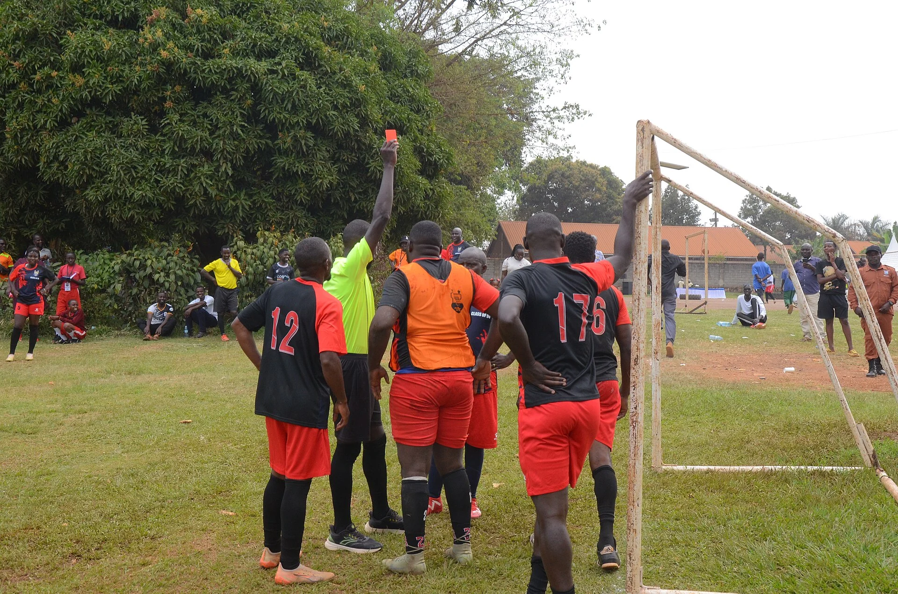
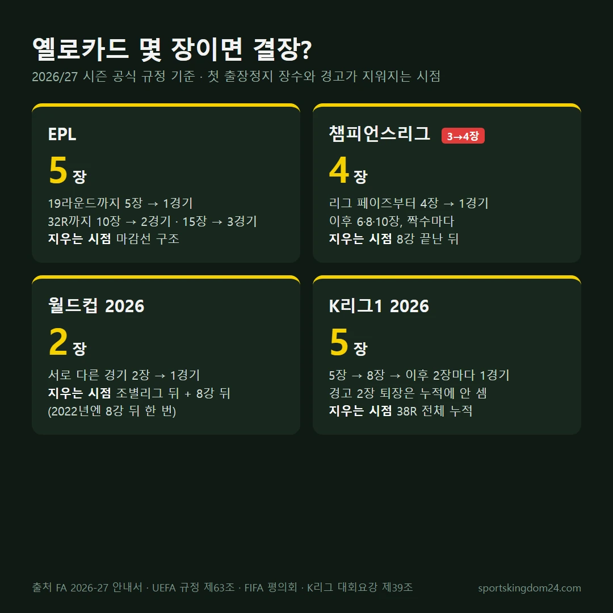

옐로카드를 몇 장 받으면 다음 경기에 못 나올까요? 축구 경고 누적 기준은 대회마다 다릅니다. 2026/27 시즌 기준으로 EPL은 5장, 챔피언스리그는 4장, 월드컵은 2장, K리그1은 5장에서 첫 출장정지가 나와요. 그리고 쌓인 경고가 지워지는 시점도 대회마다 따로 정해져 있습니다.

📌 요약
한 경기에서 옐로카드 2장은 바로 퇴장이고, 여러 경기에 걸쳐 쌓인 경고는 <b>다음 경기 결장</b>으로 이어집니다.

챔피언스리그는 2026/27 시즌부터 3장이 아니라 <b>4장</b>에서 첫 출장정지가 나옵니다.

2026 월드컵은 조별리그 뒤와 8강 뒤, <b>두 번</b> 경고를 지웠습니다.

이 글은 IFAB 경기규칙, 잉글랜드축구협회(FA) 2026-27 선수 안내서, UEFA 2026/27 챔피언스리그 규정 제63조, FIFA 2026 월드컵 규정 발표, K리그 2026 대회요강 제39조를 직접 열어 대조해 정리했습니다. 흔히 퍼져 있는 오해 다섯 가지를 하나씩 바로잡는 순서로 갈게요.

## 축구 경고 누적, 퇴장과 결장은 어떻게 다른가요?

경고 누적에는 두 종류가 있습니다. 한 경기에서 옐로카드 2장을 받아 그 자리에서 나가는 "경고 누적 퇴장"과, 여러 경기에 걸쳐 쌓인 경고로 다음 경기에 못 나오는 "경고 누적 결장"이에요.

[IFAB 경기규칙 제12조](https://www.theifab.com/laws/latest/fouls-and-misconduct/)는 같은 경기에서 두 번째 경고를 받으면 퇴장시킨다고 정합니다. 퇴장당한 선수는 다른 선수로 교체할 수 없어서 팀은 남은 시간을 한 명 적게 뛰어요. 전반에 받은 경고는 후반과 연장전까지 그대로 이어지고 승부차기에는 넘어가지 않는다고 규칙에 적혀 있습니다.

결장은 대회 규정이 정합니다. 경기 규칙은 전 세계가 같지만 몇 장에서 몇 경기를 쉬게 할지는 각 리그와 대회가 따로 정하기 때문에 숫자가 제각각이에요. 경고 사유도 정해져 있는데 반칙 반복, 지연 행위, 항의, 거리 미준수, 비신사적 행위 등이 대표적입니다.

## 오해 1. 옐로카드 2장이면 다음 경기도 못 나온다?

절반만 맞습니다. 한 경기에서 받은 옐로카드 2장으로 퇴장되면 대부분 대회에서 다음 1경기에 출장정지가 붙지만 그 2장이 시즌 누적 장수에 들어가는지는 대회마다 다릅니다.

[FA 2026-27 선수 안내서](https://www.thefa.com/-/media/files/thefaportal/governance-docs/player-essentials/2026-27/essential-information-for-players-2026-27---english-version.ashx) 기준으로 EPL은 두 번째 경고 퇴장에 1경기 출장정지를 줍니다. 다만 그 경고 2장이 시즌 누적 5장·10장에 들어가는지는 안내서 표에 따로 적혀 있지 않아요. 월드컵도 같은 경기 경고 2장이면 퇴장과 다음 1경기 정지가 자동으로 붙지만, 그 2장의 누적 처리는 제가 찾은 FIFA 발표 자료에 명시돼 있지 않았습니다. K리그1은 1경기 출장정지에 제재금 100만원이 붙고 대회요강에 "이 경고는 누적에 산입되지 않는다"고 적혀 있어요. 반대로 경고 1장을 받은 뒤 직접 퇴장을 당하면 요강 표현대로 "경고 1회는 유효하며, 누적에 산입된다"고 봅니다.

챔피언스리그는 퇴장으로 이어지지 않은 옐로카드만 누적 장수로 셉니다. 그래서 K리그와 챔스에서는 경고 2장 퇴장이 누적 장수를 늘리지 않는다는 계산이 나오지만, 그 경기를 한 명 적게 뛰는 손해가 훨씬 큽니다.

## 오해 2. 축구 레드카드는 무조건 3경기 출장정지다?

아닙니다. 레드카드 출장정지는 퇴장 사유에 따라 1경기부터 6경기까지 갈립니다. 이 차이를 표로 다룬 국내 글은 찾기 어려웠어요.

FA 안내서의 EPL 기본 출장정지를 사유별로 옮기면 이렇습니다.

| 퇴장 사유(EPL) | 기본 출장정지 |
| --- | --- |
| 두 번째 경고 | 1경기 |
| 명백한 득점 기회 저지(핸드볼) | 1경기 |
| 명백한 득점 기회 저지(반칙) | 1경기 |
| 공격적·모욕적 언행이나 몸짓 | 2경기 |
| 심각한 반칙 플레이 | 3경기 |
| 폭력 행위 | 3경기 |
| 침 뱉기 | 6경기 |

EPL은 한 시즌에 두 번째로 퇴장당하면 1경기, 세 번째면 2경기를 더 얹습니다. 레드카드 출장정지는 리그와 국내 컵대회에 함께 적용돼요. K리그1은 경고 2장 퇴장 1경기와 100만원, 직접 퇴장 2경기와 120만원, 경고 뒤 직접 퇴장 2경기와 150만원이 기본이고 사안이 무거우면 상벌위원회가 늘립니다. 챔피언스리그는 다음 UEFA 클럽 대회 1경기가 자동 정지이고, UEFA가 더 늘릴 수 있어요.

*▲ 주심이 레드카드를 꺼내는 장면, 사진 Samson Ssemakadde, CC0 (Wikimedia Commons)*

## 오해 3. 챔피언스리그도 경고 3장이면 결장한다?

2025/26 시즌까지는 맞았지만 지금은 틀립니다. UEFA는 2026/27 시즌부터 리그 페이즈 이후 기준을 3장에서 4장으로 올렸어요.

[UEFA 2026/27 챔피언스리그 규정 제63조](https://documents.uefa.com/r/Regulations-of-the-UEFA-Champions-League-2026/27/Article-63-Yellow-and-red-cards-Online) 기준으로 리그 페이즈부터는 4번째 경고에서 1경기 출장정지, 그다음은 6번째, 8번째처럼 짝수 장마다 1경기를 쉽니다. 예전에는 3번째, 5번째, 7번째처럼 홀수 장이었어요. 예선과 플레이오프는 여전히 3번째 경고부터 홀수 장마다 정지이고 이 경고들은 리그 페이즈가 시작될 때 지워집니다.

8강이 끝나면 쌓인 옐로카드가 모두 지워집니다. 8강에서 이미 확정된 출장정지는 4강에서 그대로 쉬어야 하고요. 그래서 4강에서 경고 1장을 받아도 결승 결장으로 이어지지 않습니다. 결승에 못 나오는 경우는 4강에서 퇴장을 당했거나, 앞서 받은 징계를 아직 다 치르지 못한 경우예요. 대회 구조가 궁금하면 [챔피언스리그 완벽 가이드](/champions-league-guide/)에 정리해 뒀어요.

## 오해 4. 경고는 시즌이 끝나야 리셋된다?

대회에 따라 다릅니다. 월드컵과 챔피언스리그는 대회 중간에 경고를 지우고, EPL은 라운드 마감선 구조, K리그1은 38라운드 내내 쌓이는 사다리 구조입니다.

2026 월드컵은 [FIFA 평의회](https://inside.fifa.com/organisation/fifa-council/news/council-update-regulations-world-cup-2026)가 2026년 4월 규정을 바꿔 경고를 두 번 지웠어요. 서로 다른 경기에서 옐로카드 2장이면 1경기 출장정지인 건 같지만 경고 1장은 조별리그가 끝난 뒤 한 번, 8강이 끝난 뒤 다시 한 번 사라졌습니다. 2022 카타르 대회는 8강 뒤 한 번만 지웠어요. 48개국 체제로 토너먼트가 한 라운드 늘어난 점을 고려한 변화로 풀이됩니다.

EPL은 리셋보다 "몇 번째 경기까지 몇 장"이라는 마감선 구조예요. 19라운드까지 5장이면 1경기, 32라운드까지 10장이면 2경기, 시즌 끝까지 15장이면 3경기를 쉬고, 20장이면 규율위원회가 정합니다. 19라운드가 지나면 5장 기준은 사라지고 다음 기준은 10장이 됩니다. 국내 컵대회 경고는 리그와 따로 셉니다.

💡 여기서 많이들 헷갈리는데
EPL에서 19라운드까지 경고 4장이던 선수가 20라운드에 5번째 경고를 받으면 출장정지가 없습니다. 이미 19라운드 마감선이 지났고, 다음 기준은 32라운드까지 10장이기 때문이에요.

## 오해 5. K리그도 경고 3장마다 쉰다?

예전 이야기입니다. K리그1은 2020 시즌부터 "3회마다"를 버리고 첫 출장정지를 5장으로 늦췄어요.

[K리그 2026 대회요강](https://www.kleague.com/about/competition.do) 제39조를 보면 처음 5회 경고에서 1경기, 그 뒤 3회가 더 쌓이면(8회) 1경기, 그 뒤로는 2회마다(10회, 12회…) 1경기를 쉽니다. 이 계산은 38라운드 전체에 이어지고, 요강 문장상 10회째부터 2회마다 쌓일 때는 출전정지와 함께 제재금 70만원이 붙습니다.

K리그는 코칭스태프도 경고 누적이 있습니다. 감독이나 코치는 3번째 경고에서 1경기, 그 뒤 5번째, 그다음부터는 경고마다 벤치에 앉지 못해요. IFAB 규칙도 팀 임원에게 카드를 줄 수 있게 하고 누가 했는지 모르면 기술 지역의 선임 지도자가 받는다고 정합니다. 시즌 일정과 팀 구성은 [K리그 2026 가이드](/k-league-2026-guide/)에서 볼 수 있어요.

## 대회별 축구 경고 누적 기준, 한 장으로 비교하면?

네 대회 규정을 나란히 놓고 같은 항목으로 다시 묶었습니다. 제가 각 규정 원문에서 숫자만 뽑아 같은 칸에 맞춘 표예요.

*▲ 킹덤이 4개 대회 규정을 대조해 직접 만든 비교 그림*

| 항목 | EPL 2026/27 | 챔스 2026/27 | 월드컵 2026 | K리그1 2026 |
| --- | --- | --- | --- | --- |
| 첫 출장정지 | 19R까지 5장 | 4장(리그 페이즈~) | 2장 | 5장 |
| 그다음 | 32R까지 10장(2경기), 15장(3경기) | 6·8·10장… 짝수마다 | 다시 2장 | 8장, 이후 2장마다 |
| 경고 지우는 시점 | 마감선 구조(19R·32R) | 리그 페이즈 시작, 8강 뒤 | 조별리그 뒤, 8강 뒤 | 38R 전체 누적 |
| 경고 2장 퇴장 | 1경기 | 1경기(자동) | 1경기(자동) | 1경기, 100만원 |
| 그 경고 2장 누적 산입 | 안내서에 명시 없음 | 안 셈 | 발표 자료에 명시 없음 | 안 셈 |
| 직접 퇴장 | 사유별 1~6경기 | 1경기(자동), 연장 가능 | 1경기(자동), 징계위가 늘릴 수 있음 | 2경기, 120만원 |
| 선수 카드 제재금 | 개인 자동 벌금 없음(클럽 벌금은 보도 기준) | 확인 안 됨 | 확인 안 됨 | 누적 70만원(10회째부터)·100·120·150만원 |

이 표를 만들면서 계산해 보니, 같은 선수가 경고를 5장째 받는 순간의 결과가 대회마다 갈렸습니다.

| 5번째 경고를 받는 상황 | 결과 |
| --- | --- |
| EPL 19라운드까지 | 1경기 결장 |
| EPL 20라운드 이후 | 결장 없음(다음 기준은 32라운드까지 10장) |
| 챔스 리그 페이즈 이후 | 결장 없음(4장째에 이미 1경기 쉼, 다음은 6장째) |
| K리그1 | 1경기 결장 |
| 월드컵 | 해당 없음(2장마다 1경기, 조별리그 뒤·8강 뒤 소멸) |

같은 5장이라도 리그마다 감독이 경고를 관리하는 방식이 달라지는 이유가 여기 있어요.

## 경고 누적, 감독과 팀은 어떻게 관리하나요?

경고 누적이 무서운 건 중요한 경기 직전에 터질 때입니다. 그래서 감독들은 마감선과 리셋 시점을 보고 선수 기용을 조절해요.

EPL에서는 19라운드 마감선을 앞두고 경고 4장인 선수의 출전을 조절하는 감독도 있습니다. 챔스는 8강 뒤 경고가 지워지니 8강까지 버티면 4강 이후엔 부담이 줄어요. 월드컵은 이번 대회부터 조별리그 뒤에도 지워져서 토너먼트 첫 경기 결장 위험이 크게 낮아졌습니다.

일부러 경고를 받아 덜 중요한 경기에서 결장을 소화하는 "카드 세탁"은 추가 징계로 돌아올 수 있습니다. UEFA는 2019년 2월 아약스와의 16강 1차전에서 일부러 경고를 받은 것으로 판단한 세르히오 라모스에게 누적 결장 1경기를 포함해 2경기 출장정지를 내렸어요. 두 번째 경고가 명백히 잘못됐을 때 VAR이 개입하는 2026/27 개정은 [VAR 판독 대상 정리](/var-reviewable-decisions/)에 따로 적어 두었습니다.

## 축구 옐로카드 벌금도 있나요?

K리그1은 있습니다. EPL은 선수 개인에게 자동으로 붙는 카드 벌금이 FA 안내서 표에 없어요.

K리그1 대회요강 기준 제재금은 10회째부터의 경고 누적 출장정지 70만원, 경고 2장 퇴장 100만원, 직접 퇴장 120만원, 경고 뒤 직접 퇴장 150만원입니다. EPL은 한 경기에서 한 팀이 경고 6장 이상을 받으면 클럽에 2만5천 파운드 벌금을 물리고, 반복되면 금액이 오른다는 보도가 있어요. 이 부분은 FA 문서가 아니라 보도 기준이라 시즌마다 다시 확인하는 게 안전합니다.

챔피언스리그와 월드컵에서는 선수 개인에게 카드마다 자동으로 붙는 벌금을 찾지 못했습니다. 대신 팀 전체의 징계 기록은 대회 징계위원회가 따로 다룹니다. 축구 용어가 낯설다면 [축구 용어 사전](/soccer-glossary/)을 같이 보면 편해요.

## 자주 묻는 질문 (FAQ)

**Q. 축구 옐로카드 몇 장이면 다음 경기 못 나오나요?** 대회마다 다릅니다. 2026/27 기준 EPL은 19라운드까지 5장, 챔피언스리그는 4장, 월드컵은 2장, K리그1은 5장에서 첫 출장정지가 나옵니다.

**Q. 한 경기에서 옐로카드 2장 받으면 다음 경기도 결장인가요?** 네, 대부분 대회에서 다음 1경기를 쉽니다. 다만 그 2장이 시즌 누적 장수에 들어가는지는 대회 규정마다 다르고 K리그1은 넣지 않습니다.

**Q. 축구 레드카드 받으면 몇 경기 못 뛰나요?** EPL은 사유에 따라 1경기부터 6경기까지입니다. 두 번째 경고와 득점 기회 저지는 1경기, 폭력 행위와 심각한 반칙은 3경기, 침 뱉기는 6경기예요.

**Q. 챔스 경고는 언제 리셋되나요?** 예선 경고는 리그 페이즈가 시작될 때, 그 뒤 경고는 8강이 끝난 뒤 지워집니다. 8강에서 확정된 출장정지는 4강에서 소화합니다.

**Q. 월드컵 2026 경고는 언제 초기화됐나요?** 조별리그가 끝난 뒤 한 번, 8강이 끝난 뒤 한 번, 두 번 지워졌습니다. 2022 대회는 8강 뒤 한 번뿐이었어요.

**Q. 감독도 옐로카드를 받나요?** 받습니다. IFAB 규칙상 팀 임원도 경고와 퇴장 대상이고 K리그는 코칭스태프 경고 3번째에서 첫 출장정지가 나옵니다.

*이미지 출처. 대표 이미지는 주심이 옐로카드를 꺼내는 장면(사진 ⓒ Tadeáš Bednarz, CC BY-SA 4.0, Wikimedia Commons, 일부 잘라 사용), 레드카드 장면은 사진 Samson Ssemakadde(CC0, Wikimedia Commons), 대회별 비교 그림은 sportskingdom24 직접 제작입니다.*

---

**관련 키워드** — #축구경고누적 #경고누적퇴장 #옐로카드규칙 #옐로카드리셋 #레드카드징계 #레드카드출장정지 #EPL경고누적 #챔스경고누적 #월드컵경고초기화 #K리그경고누적 #축구규칙
