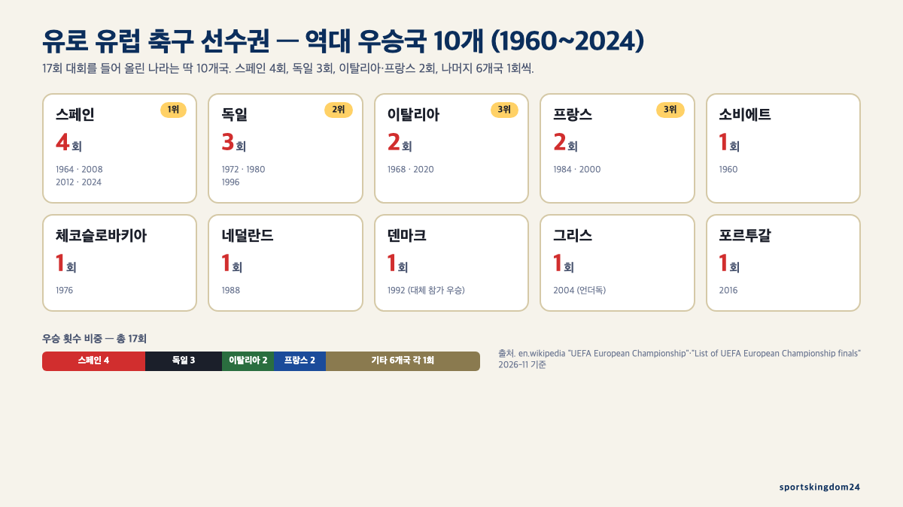
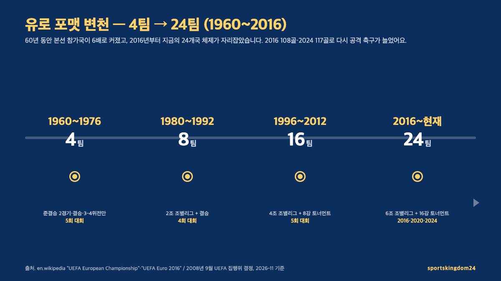
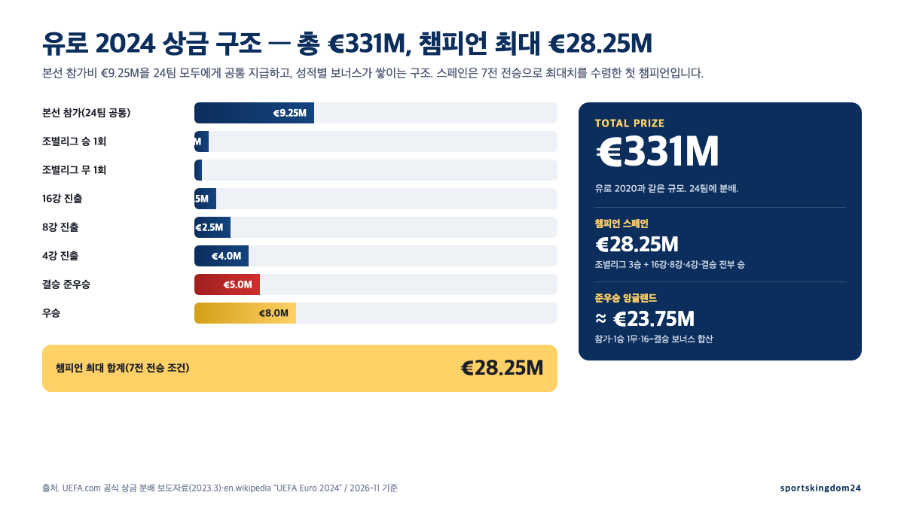

**유로 유럽 축구 선수권**은 1960년 프랑스에서 시작해 **4년에 한 번**, **월드컵과 번갈아 열리는** 유럽 국가대항 축구 대회입니다. 2024년 독일 대회까지 **총 17번** 열렸고, **스페인이 4회 우승**(1964·2008·2012·2024)**으로 단독 1위**, 독일 3회, 이탈리아·프랑스 각 2회가 뒤를 이어요. 2024년에는 24개국이 **51경기·117골·평균 관중 52,574명**을 기록했고, **총상금 €331M·챔피언 최대 €28.25M**이 걸렸습니다. 다음 대회인 **유로 2028은 2028년 6월 9일~7월 9일 영국 3개국**(잉글랜드·스코틀랜드·웨일스)**과 아일랜드**에서 열려요. 이 글은 UEFA 공식 자료와 영문·한국어 Wikipedia의 대회별 항목을 교차해, 유로 하나로 궁금한 것을 한 장에 정리했습니다.

📌 3줄 요약
<b>무엇</b>: 유로는 UEFA(유럽 축구 연맹)가 1960년부터 4년 주기로 여는 유럽 국가대항전이에요. 원래 이름은 <b>UEFA 유러피언 네이션스컵</b>이었다가 1968년부터 지금 이름으로 바뀌었습니다.

<b>규모</b>: 1960년 4개국 → 1980년 8개국 → 1996년 16개국 → <b>2016년부터 24개국</b> 체제. 2024 독일 대회는 24개국·51경기·117골·평균 관중 52,574명이었습니다.

<b>왕국</b>: 스페인이 2024년 잉글랜드를 2-1로 꺾고 <b>단일 국가 최초 4번째 우승</b>. 독일 3회, 이탈리아·프랑스 각 2회가 뒤를 잇고, 10개국만 우승 경험이 있습니다.

이 글은 영문 Wikipedia의 "UEFA European Championship", "UEFA Euro 2024", "UEFA Euro 2028", "UEFA Euro 2024 qualifying", "UEFA European Championship qualifying", "List of UEFA European Championship finals" 항목과 한국어 Wikipedia "UEFA 유럽 축구 선수권 대회"·"UEFA 유로 2024", UEFA.com의 공식 상금 분배 보도자료·라민 야말 기록 특집 기사를 교차 확인해 정리한 것입니다.

## 유로 한 줄 결론 — "브라질·아르헨티나만 빠진 미니 월드컵"인 이유

유로의 성격을 가장 짧게 설명하는 표현이 한국어 Wikipedia에 나와 있어요. "**브라질과 아르헨티나만 빠진 미니 월드컵**이라 불릴 정도로 월드컵 다음으로 영향력이 큰 국가별 대항 축구 대회". 유럽은 전 세계 축구 강국이 가장 두텁게 모인 대륙이고, 이 대륙의 국가대표팀만 모아 **4년에 한 번** 토너먼트를 여니 결과물의 밀도가 월드컵 바로 다음이라는 얘기예요.

구체적으로 유로 2024는 **스페인·프랑스·독일·잉글랜드·포르투갈·이탈리아·네덜란드·벨기에·크로아티아** 같은 FIFA 랭킹 상위 10위권 국가 거의 전부가 본선에 올라왔습니다. 2024년 7월 결승은 **스페인 2-1 잉글랜드**(베를린 올림피아슈타디온, 2024년 7월 14일)로, 스페인은 1964·2008·2012·2024 네 번째 우승을 들어 올렸어요. 이로써 **단일 국가 최다 우승이 3회**(독일)**에서 4회**(스페인)**로 바뀐 것**이 유로 2024가 남긴 가장 큰 숫자입니다.

유로는 **FIFA 월드컵과 번갈아 짝수년도에 열립니다**. 월드컵이 2022년(카타르)·2026년(북중미) 열리면 유로는 그 사이인 2024년·2028년에 열리는 식이에요. 단, **코로나19로 유로 2020이 1년 연기돼 2021년 열린 예외**가 있고, 2020년 대회라는 이름은 그대로 유지됐습니다. 이 변칙 때문에 "유로 2020이 2021년에 열렸다"는 사실이 의외의 상식 문제로 남아 있어요.

## 유로 역사 — 1960 파리에서 시작해 17번 열린 대회

유로는 **1960년 7월 프랑스 파리에서 처음 열렸습니다**. 원래 이름은 **UEFA 유러피언 네이션스컵**(UEFA European Nations Cup)이었고, **1968년 제3회 대회부터 지금 이름**(UEFA 유럽 축구 선수권 대회)**으로 바뀌었어요**. 1960년 대회는 **단 4팀**이 참여하는 미니 토너먼트였고, 소비에트 연방이 유고슬라비아를 2-1(연장)으로 꺾고 초대 챔피언이 됐습니다.

17회 대회를 요약하면 "**월드컵과 번갈아 열린 60년 역사**"예요. 1960년 프랑스·1964년 스페인·1968년 이탈리아·1972년 벨기에·1976년 유고슬라비아처럼 매번 1개국 단독 개최였다가, **2000년부터 공동 개최가 등장**합니다. 개최 방식의 흐름을 한 줄로 요약하면 **단독**(1960~1996) → **공동**(2000 네덜란드·벨기에) → **단독**(2004 포르투갈) → **공동**(2008 오스트리아·스위스·2012 폴란드·우크라이나) → **단독**(2016 프랑스) → **분산**(2020 11개국) → **단독**(2024 독일) 흐름이에요. 공동 개최기 사이에 **2004년 포르투갈 단독**과 **2016년 프랑스 단독**이 끼어 '단독↔공동' 리듬이 유지됐고, **2020년은 유럽 11개 도시 분산 개최**(런던·뮌헨·로마·부쿠레슈티·암스테르담 등)로 가장 이례적인 형태였습니다. 60주년 기념이라는 상징성이 있었지만 코로나19 대응이 겹쳐 결과적으로 운영이 가장 복잡한 대회로 남았어요.

역대 결승 중 숫자로 가장 인상적인 경기는 **1976년**입니다. 체코슬로바키아가 서독을 **2-2**(연장) **뒤 승부차기 5-3**으로 꺾었는데, 승부차기 마지막 키커가 **안토닌 파넨카**였어요. 그가 골키퍼 쪽으로 곧장 느리게 띄운 "파넨카 킥"이 그 경기에서 태어났고, 이후 전 세계 축구에 고유명사로 남았습니다. **2012년 스페인 4-0 이탈리아**(결승 최다 점수 차)와 **2020년 이탈리아 1-1 잉글랜드 뒤 승부차기 3-2**(웸블리, 홈팀의 아픔)도 자주 언급되는 명장면이에요. 참고로 **2012년 스페인**은 2008년 유로·2010년 월드컵에 이은 메이저 대회 3연패를 달성해 "국가대표 역사상 유일한 3연패" 기록을 남겼습니다.

## 유로 포맷 변천 — 4팀에서 24팀까지, 50개국이 노리는 24장

유로의 포맷은 시대마다 커져 왔어요. 아래 표가 60년 변천을 한 장에 담은 그림입니다.

| 시기 | 본선 팀 | 포맷 | 대회 수 |
| --- | --- | --- | --- |
| 1960~1976 | **4팀** | 준결승 2경기·결승·3-4위전만 | 5회 |
| 1980~1992 | **8팀** | 2조(각 4팀) 조별리그 + 결승 | 4회 |
| 1996~2012 | **16팀** | 4조 조별리그 + 8강부터 토너먼트 | 5회 |
| 2016~현재 | **24팀** | 6조 조별리그 + 16강부터 토너먼트 | 3회(2016·2020·2024) |

**24개국 체제**는 2008년 9월 UEFA 집행위가 결정해 **2016년 프랑스 대회부터 적용**됐습니다. 6조(각 4팀)로 36경기 조별리그를 치른 뒤 **각 조 1·2위 12팀 + 각 조 3위 중 성적 상위 4팀 = 16팀이 16강**으로 올라오는 구조예요. 이 "3위 와일드카드 4장" 때문에 **3위 팀들 사이에서도 승점·골득실 눈치 싸움**이 벌어지는 게 24개국 포맷의 특징입니다. 2016 대회는 108골·경기당 2.12골로 1996년 이후 최저 득점률이었던 반면, **2024 대회는 117골·경기당 2.29골**로 공격 축구가 다시 살아났어요.

**예선**은 본선보다 더 방대합니다. 유로 2024 예선에는 **UEFA 53개국**이 참가해 10개 조로 나뉘었고(5개 조는 5팀·3개 조는 6팀), **조 1·2위 20팀 + 개최국 독일 + 플레이오프 승자 3팀 = 24팀**이 본선에 올라왔어요. 플레이오프는 **UEFA 네이션스리그 성적**으로 12팀을 추려 3개 경로로 치러집니다(2024년 3월, 단판 토너먼트). 유로 2028부터는 **예선 조가 12개로 늘고**, 공동 개최국 4개국(잉글랜드·스코틀랜드·웨일스·아일랜드)도 **예선에 똑같이 참가**합니다. 다만 "**예선에 떨어져도 개최국 중 상위 2팀까지는 자동 진출 자리를 보장**"하는 안전장치가 UEFA 입찰 규정에 들어 있어, 개최국이 전원 본선 진출 실패하는 극단적 시나리오는 막혀 있어요.

## 역대 우승국 10개 — 스페인 4·독일 3·이탈리아·프랑스 2

60년 역사에서 유로 트로피를 들어 올린 나라는 딱 **10개국**입니다.

| 우승 횟수 | 국가 | 연도 |
| --- | --- | --- |
| **4회** | 스페인 | 1964·2008·2012·2024 |
| **3회** | 독일(서독 포함) | 1972·1980·1996 |
| **2회** | 이탈리아 | 1968·2020 |
| **2회** | 프랑스 | 1984·2000 |
| **1회** | 소비에트 연방 | 1960 |
| **1회** | 체코슬로바키아 | 1976 |
| **1회** | 네덜란드 | 1988 |
| **1회** | 덴마크 | 1992 |
| **1회** | 그리스 | 2004 |
| **1회** | 포르투갈 | 2016 |

이 표에서 눈여겨볼 지점이 세 가지예요. 첫째, **스페인의 1964년 첫 우승과 2008년 두 번째 우승 사이는 44년**이라는 긴 공백기였습니다. 그 사이 스페인은 "**8강의 벽**"으로 유명했어요. 둘째, **덴마크**(1992)와 **그리스**(2004)는 소위 "**언더독 챔피언**"의 상징이에요. 덴마크는 유고슬라비아가 유엔 제재로 대회 직전 실격되자 **대신 참가해 그대로 우승**한 역사 유일의 "대체 참가 우승국"이고, 그리스는 1배당 100배 이상 배당률의 완전한 아웃사이더였습니다. 셋째, **잉글랜드는 유로 결승 2회**(1996 홈·2020 홈) **모두 패배**해 "**유로 준우승 반복팀**"이라는 쓰린 별명을 얻었어요.

**준우승 국가를 포함**하면 숫자가 더 섬세해집니다. 영문 Wikipedia 결승 목록 기준 "**결승에 올랐지만 아직 우승 없는 나라**"는 **유고슬라비아**(1960·1968)·**벨기에**(1980)·**잉글랜드**(2020·2024) 세 나라예요. 잉글랜드는 2020·2024 2연속 준우승이라 "**결승은 가는데 들지는 못하는**" 패턴으로 굳어지는 중입니다.

역대 우승 감독 쪽도 흥미로워요. 스페인의 최근 3회 우승 감독 계보는 **2008년 루이스 아라고네스 → 2012년 비센테 델 보스케 → 2024년 루이스 데 라 푸엔테**로 이어졌습니다. 아라고네스는 44년 만의 두 번째 유로 트로피를 찾아왔고, 델 보스케는 2012년 결승 **4-0 이탈리아** 대승으로 결승 최다 점수 차 기록을 남겼으며, 데 라 푸엔테는 2024년 7전 전승으로 스페인을 네 번째 정상에 올렸어요. **2016년 포르투갈의 페르난두 산투스**가 자주 언급되고, **2004년 그리스의 오토 레하겔**(독일 출신)은 "**독일 감독이 그리스를 데리고 독일식 수비축구로 포르투갈을 홈에서 꺾은**" 아이러니로 전술 교과서에 자주 올라옵니다.

## 유로 2024 하이라이트 — 스페인 4번째, 야말·로드리·오야르자발

**유로 2024**는 **독일 10개 도시**(베를린·뮌헨·도르트문트·슈투트가르트·겔젠키르헨·함부르크·뒤셀도르프·프랑크푸르트·쾰른·라이프치히)에서 **2024년 6월 14일~7월 14일**, 한 달간 열렸습니다. 51경기·117골·평균 관중 52,574명·총 관중 2,681,288명. 개막전은 **독일 5-1 스코틀랜드**(뮌헨 알리안츠 아레나, 비르츠 10분·무시알라 19분·하베르츠 45+1분 PK·필크루크 68분·귄도안 90+3분)로, 독일 개막전 유로 역사상 최다 점수 차 승리였어요.

**스페인은 전승 우승**(조별리그 3승·16강·8강·4강·결승 모두 승)을 거둬 24팀 유로 시대 최초의 "**7전 전승 챔피언**"이 됐습니다. 결승은 2024년 7월 14일 베를린에서 **잉글랜드에 2-1 승**. 득점 장면은 **후반 2분 니코 윌리엄스**(야말 어시스트), **후반 28분 콜 파머**(잉글랜드 동점), **후반 41분 미켈 오야르자발 결승골**. 대회 최우수 선수(**Rodri**, 맨시티·2024 발롱도르 수상자)와 **영 플레이어 상**(라민 야말)이 모두 스페인 선수에게 돌아갔어요.

**라민 야말 기록**이 유로 2024의 또 다른 상징입니다. UEFA 공식 보도 기준으로 야말은 아래 다섯 개의 "최연소" 기록을 한 대회에서 다 가져갔어요.

- 유로 본선 최연소 출장 — **16세 338일**(크로아티아전, 2024년 6월 15일)
- 유로 본선 최연소 득점 — **16세 362일**(프랑스 준결승, 2024년 7월 9일)
- 월드컵/유로 통틀어 최연소 준결승 출전 — 16세 362일
- 월드컵/유로 통틀어 **최연소 결승 출전 — 17세 1일**(펠레의 1958년 월드컵 결승 17세 249일 기록 경신)
- 유로 예선 최연소 득점 — 16세 57일(조지아전, 2023년 9월 8일)

야말은 대회 7경기 중 6경기 선발로 나와 **1골 4어시스트**를 기록했고, 결승 다음날 UEFA에서 **영 플레이어 상**을 받았습니다.

다섯 기록이 파편적으로 보이지 않는 건, 스페인의 압박·점유 축구가 결승까지 어떻게 작동했는지와 맞물려 있기 때문이에요. 야말·니코 윌리엄스의 양쪽 돌파가 터지려면 중원에서 로드리가 2선을 누르고 올모가 공간을 찍는 구조가 먼저 돌아가야 했는데, 이 흐름을 [게겐프레싱·티키타카 차이, 반대가 아니라 쌍둥이 전술인 이유](/soccer-pressing-tactics/)에서 숫자와 함께 뜯어 뒀습니다.

대회 공동 득점왕은 **3골 6명**(해리 케인·조지 미카우차제·자말 무시알라·코디 하크포·이반 슈란츠·다니 올모)으로, "3골 공동 1위 6명"은 유로 역사상 가장 많은 공동 득점왕 기록이기도 해요. 이 중 **조지아의 미카우차제**는 데뷔 대회에서 조별리그 3골로 조별 득점 1위를 기록하며 **첫 유로 출전국 조지아의 16강 진출**을 이끌었습니다.

## 유로 2028 — 영국 3국·아일랜드 공동 개최, 바뀐 개최국 자격

**유로 2028**은 **2028년 6월 9일~7월 9일**, **잉글랜드·스코틀랜드·웨일스·아일랜드** 4개국이 공동 개최해요. 북아일랜드가 애초 포함됐지만 캐스먼트 파크 재건 지연으로 2023년에 빠졌고, 최종 구도가 **영국 3개국 + 아일랜드 1개국**으로 굳었습니다. 개최 경기장은 9개입니다.

- **잉글랜드** (6곳): 웸블리 스타디움(90,000·결승 개최) · 토트넘 홋스퍼 스타디움(62,850) · 에티하드 스타디움(61,470·맨체스터) · **에버턴 스타디움**(명명권 Hill Dickinson Stadium, 공식 발표 기준 약 52,888·출처에 따라 52,769 표기도 있어 공식 공지로 재확인 권장) · 세인트 제임스 파크(52,264·뉴캐슬) · 빌라 파크(50,000·버밍엄)
- **스코틀랜드**: 햄든 파크(51,866·글래스고)
- **웨일스**: 프린시팰리티 스타디움(73,931·카디프)
- **아일랜드**: 아비바 스타디움(51,711·더블린)

**결승은 2028년 7월 9일 웸블리 스타디움**에서 열립니다. 본선은 24개국 6조 포맷을 그대로 유지(조 1·2위 + 3위 상위 4팀 = 16강)해요. 가장 큰 변화는 **개최국 자격 규칙**입니다. 과거 유로는 개최국에 자동 본선 진출권을 줬지만, **2028년부터는 공동 개최 4개국도 모두 예선에 참가**해야 합니다. 다만 UEFA 입찰 규정이 "**개최국 중 상위 2팀까지는 자동 자리를 보장**"하도록 명문화해, 4개국이 모두 예선에 떨어지는 극단적 시나리오는 막혀 있어요. 이는 2020년 11개국 분산 개최와 2024년 독일 단독 개최에서 "**개최국의 조기 탈락이 흥행에 큰 상처**"가 된다는 반성에서 나온 조정입니다. 축구 포지션·전술 기본기 복습은 [축구 포지션 완전 정리, 골키퍼부터 윙어까지 11개 역할 한눈에](/soccer-positions-guide/)에서 11개 역할별로 정리해 뒀어요.

💡 유로 2028 티켓은 어떻게 사나
UEFA 티켓 포털은 통상 대회 1년 전인 2027년 중반에 1차 신청(랜덤 추첨)을 엽니다. 과거 유로 2024 기준 결승 최하위 카테고리 €95·최상위 €1,000, 조별리그 €30·€200 선이었어요. 영국 3개국+아일랜드 공동 개최는 "국내선 비행·열차 이동"이 필수인 경기 조합이 생기므로, 이동 수단까지 함께 설계해야 합니다.

## 유로 상금 구조 — 총액 €331M, 챔피언 최대 €28.25M

**유로 2024 총상금은 €331M**으로 2020년과 같은 규모를 유지했습니다. UEFA 공식 보도자료 기준 상금 분배는 **본선 참가비 €9.25M을 모두에게 주고**, 그 위에 경기 성적별로 보너스가 쌓이는 구조예요.

| 항목 | 금액 |
| --- | --- |
| **본선 참가비** (24팀 공통) | €9.25M |
| **조별리그 승 1회** | €1.0M |
| **조별리그 무 1회** | €500K |
| **16강 진출** | €1.5M |
| **8강 진출** | €2.5M |
| **4강 진출** | €4.0M |
| **결승 준우승** | €5.0M(추가) |
| **우승** | €8.0M(추가) |
| **챔피언 최대 수령액** | **€28.25M** |

**최대 €28.25M**은 "**조별리그 3전 3승 + 16강·8강·4강·결승 전부 승**"의 가장 깔끔한 시나리오를 밟아야 받을 수 있어요. 스페인은 2024 대회에서 **7전 전승 우승**으로 정확히 이 조건을 달성해 **최대치 €28.25M**을 수령한 첫 챔피언이 됐습니다. 월드컵 2022년 아르헨티나 우승 상금 $42M(≈ €38.6M)과 비교하면 **대략 73% 수준**이에요. 자세한 다른 축구 트로피 상금 구조는 [월드컵 2026 우승 상금, 역대 챔피언이 받은 금액 총정리](/worldcup-2026-prize-money-champions/)에서 함께 보실 수 있습니다.

**준우승 잉글랜드는 참가비 €9.25M + 그룹 1승 2무**(€1.0M + €1.0M) **+ 16강 €1.5M + 8강 €2.5M + 4강 €4.0M + 준우승 €5.0M ≈ €24.25M**을 챙긴 것으로 공식 기준 추산돼요(잉글랜드의 조별리그 실제 성적은 **세르비아 1-0승·덴마크 1-1무·슬로베니아 0-0무**로 1승 2무). **16강에서 떨어진 조별리그 2승팀**은 참가비·승 보너스·16강 보너스를 합쳐 **€12.75M** 선에 머물러, "**조별리그 3승 vs 2승**"의 보상 차이가 €1M 안팎이라는 점도 참고할 만합니다.

## 한국에서 유로 보기 — 중계·시간대·낯익은 K리거

한국과 유로의 거리는 **서머타임 기준 시차 7~8시간**(독일·중부유럽 CEST는 한국보다 7시간 느리고, 영국 BST는 8시간 느립니다)이에요. 유로 2024 독일 대회 조별리그 저녁 시합이 **한국 시간 새벽 1시·새벽 4시** 두 트랙으로 편성됐고, 결승처럼 현지 밤 9시 킥오프 경기는 **한국 시간 다음날 새벽 4시** 시작이었습니다. 풀타임 시청은 체력 부담이 크지만, 대부분 플랫폼이 다시보기와 하이라이트를 제공해 "**출근 전 짧은 압축본 → 퇴근 후 전체**" 흐름으로 보는 시청자가 많아요.

유로 2024 라운드별 한국 시간 킥오프를 한 장에 정리하면 이렇게 돼요.

| 라운드 | 독일 현지 킥오프(CEST) | 한국 시간(KST) |
| --- | --- | --- |
| 조별리그 오후 경기 | 15:00 | 당일 22:00 |
| 조별리그 저녁 경기 | 18:00 | 익일 01:00 |
| 조별리그 심야 경기 | 21:00 | 익일 04:00 |
| 16강 | 18:00 / 21:00 | 익일 01:00 / 04:00 |

주요 토너먼트 경기를 **한국 시간** 기준으로 더 쪼개 보면, **8강 4경기**(2024년 7월 5~6일)**는 새벽 1시·4시 두 트랙**, **준결승 2경기**(7월 10~11일)**는 모두 새벽 4시**, **결승**(7월 15일)**은 새벽 4시** 시작이었습니다. 유로 2028은 영국 BST 기준이라 한국과 8시간 차이가 벌어지는데, 영국 현지 밤 8시(20:00) 킥오프는 한국 시간 다음날 **새벽 4시**로 2024년 심야 트랙과 체감이 비슷해요.

**한국 중계**는 **티빙**(TVING)이 2024년 유로 **51경기 전 경기 생중계**를 맡았습니다. 티빙은 KBO·시즌별 K리그 중계와 함께 유로 2024 중계권을 확보했고, 해설은 축구 전문 유튜브 "이스타 TV"의 **이주헌 해설위원·박종윤 캐스터**가 투입됐어요. 직전 유로 2020은 쿠팡플레이·SBS 라인업이었는데, **유로 2024는 티빙 단독 송출**로 체제가 바뀌었다는 점이 한국 시청자가 알아 둘 포인트입니다.

**K리그와 연결고리**도 있었습니다. 울산 HD FC 소속 **마틴 아담**(헝가리 국가대표)과 전 광주 FC 소속 **아사니**(알바니아 국가대표)가 유로 2024 본선 명단에 포함됐어요. K리그 유니폼을 입은 선수가 유로 본선 무대를 밟는 장면 자체가 한국 팬에게는 꽤 가까워진 흐름이라, 리그 중계에서 보던 얼굴이 국가대표 유니폼으로 바뀐 걸 바로 알아보는 재미가 있습니다. 한국 팬이 유로를 가깝게 느끼는 지점은 이렇게 **중계 플랫폼의 확장**과 **K리그 외국 선수의 유로 출전** 두 축이 함께 작동할 때예요. 대한축구협회(KFA)의 국제 대회·국가대표 일정은 [대한축구협회(KFA)](https://www.kfa.or.kr/) 공식 사이트에서 함께 확인할 수 있습니다.

⚠️ 유로 티켓 암표·가짜 스트리밍 주의
대형 국제 대회 전후로는 "저가 유로 2028 티켓 예약"·"무료 생중계 링크" 광고가 급증합니다. UEFA는 공식 티켓 포털 외 어떤 재판매도 공식 인정하지 않고, 공식 중계 외 스트리밍은 국내에서 법적으로 문제가 됩니다. 한국에서는 티빙·SBS·쿠팡플레이처럼 라이선스가 확인된 플랫폼만 쓰는 쪽이 안전해요.

## 자주 묻는 질문 (FAQ)

**Q. 유로 유럽 축구 선수권이 뭔가요?** UEFA(유럽 축구 연맹)가 1960년부터 4년에 한 번 여는 유럽 국가대항 축구 대회예요. 원래 이름은 UEFA 유러피언 네이션스컵이었다가 1968년부터 지금 이름으로 바뀌었고, 월드컵과 번갈아 짝수년도에 열립니다. 2024년까지 17번 열렸고, 10개국만 우승 경험이 있어요.

**Q. 유로 역대 우승국은 몇 개국인가요?** 10개국입니다. 스페인(4회·1964·2008·2012·2024)이 최다, 독일 3회, 이탈리아·프랑스 각 2회, 그리고 소비에트 연방·체코슬로바키아·네덜란드·덴마크·그리스·포르투갈이 각 1회씩 우승했어요. 결승에 올랐지만 아직 우승이 없는 나라는 유고슬라비아·벨기에·잉글랜드 셋입니다.

**Q. 유로 2024 결승은 어떻게 끝났나요?** 2024년 7월 14일 베를린 올림피아슈타디온에서 스페인이 잉글랜드를 2-1로 꺾고 네 번째 우승을 차지했습니다. 득점은 후반 2분 니코 윌리엄스(라민 야말 어시스트), 후반 28분 콜 파머(잉글랜드 동점), 후반 41분 미켈 오야르자발 결승골이에요. 스페인은 조별리그 3승 포함 7전 전승으로 우승했습니다.

**Q. 유로 참가국은 몇 팀이고 어떻게 뽑히나요?** 본선은 24팀이고, 2016년부터 지금까지 같은 숫자예요. 유로 2024 기준 UEFA 53개국이 10개 조 예선을 치러 조 1·2위 20팀이 직행하고, 개최국 1팀(2024년 독일)과 UEFA 네이션스리그 성적 기반 플레이오프 승자 3팀이 추가돼 24팀이 완성됩니다. 유로 2028부터는 개최국 4개국도 모두 예선에 참가해요.

**Q. 유로 상금은 얼마인가요?** 유로 2024 총상금은 €331M이에요. 본선 참가비 €9.25M을 모든 팀에게 공통 지급하고, 조별리그 승 €1.0M·무 €500K, 16강 €1.5M·8강 €2.5M·4강 €4.0M, 결승 준우승 €5.0M·우승 €8.0M이 성적별로 추가됩니다. 챔피언이 받을 수 있는 최대액은 €28.25M이고, 스페인이 2024년 7전 전승으로 이 최대치를 수령했어요.

**Q. 라민 야말이 유로 2024에서 세운 기록은 뭔가요?** 유로 본선 최연소 출장(16세 338일), 최연소 득점(16세 362일), 월드컵·유로 통틀어 최연소 결승 출전(17세 1일, 펠레의 1958 월드컵 결승 기록 경신) 등 다섯 개의 "최연소" 기록을 한 대회에서 묶었습니다. 7경기 중 6경기 선발로 1골 4어시스트, 영 플레이어 상 수상이에요.

**Q. 유로 2028은 어디서 열리고 티켓은 언제 열리나요?** 2028년 6월 9일부터 7월 9일까지 잉글랜드·스코틀랜드·웨일스·아일랜드 4개국 9개 경기장에서 열립니다. 결승은 7월 9일 웸블리 스타디움에서 예정돼 있어요. UEFA 티켓 포털은 통상 대회 1년 전인 2027년 중반에 1차 추첨 신청을 열어 왔고, 유로 2024 기준 조별리그 티켓은 €30~€200, 결승은 €95~€1,000 선이었습니다.

**Q. 한국에서 유로를 어떻게 보나요?** 유로 2024는 티빙(TVING)이 51경기 전 경기 생중계를 맡았고, 이주헌 해설위원·박종윤 캐스터 조합이 투입됐어요. 유로 2028 중계권은 대회 1년 전후로 발표되는 게 통례라, 2027년 중반쯤 공식 공지에서 사업자를 확인해야 합니다(현재 시점에서 특정 플랫폼을 단정할 수는 없어요). 시차는 서머타임 기준 한국이 영국보다 8시간 빠르니, 영국 현지 밤 8시 킥오프 경기는 한국 시간 다음날 새벽 4시 시작이에요.

*이미지 출처. 대표 이미지(10개 우승국 트로피 수 분포)와 본문 다이어그램(포맷 변천 타임라인·2024 상금 분배 바 차트)은 모두 sportskingdom24에서 영문 Wikipedia "UEFA European Championship"·"UEFA Euro 2024"·"UEFA Euro 2028"·"List of UEFA European Championship finals" 항목과 UEFA.com 공식 상금 분배 보도자료를 교차해 직접 제작했습니다.*

---

**관련 키워드** — #유로 #유럽축구선수권 #UEFA유로2024 #유로2028 #스페인유로4회우승 #라민야말최연소 #유로상금 #유로우승국 #유로역사 #티빙유로중계 #유로2024결승 #UEFA예선
