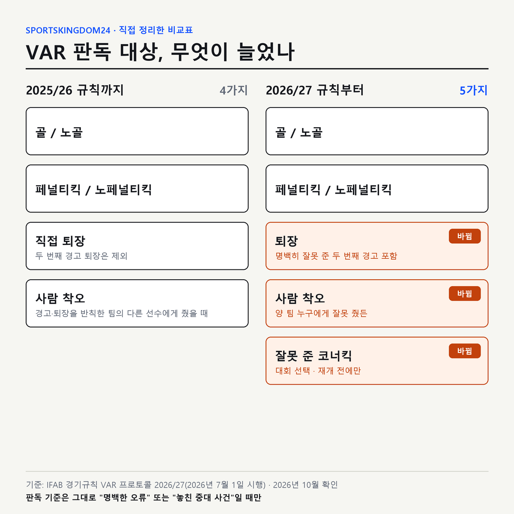
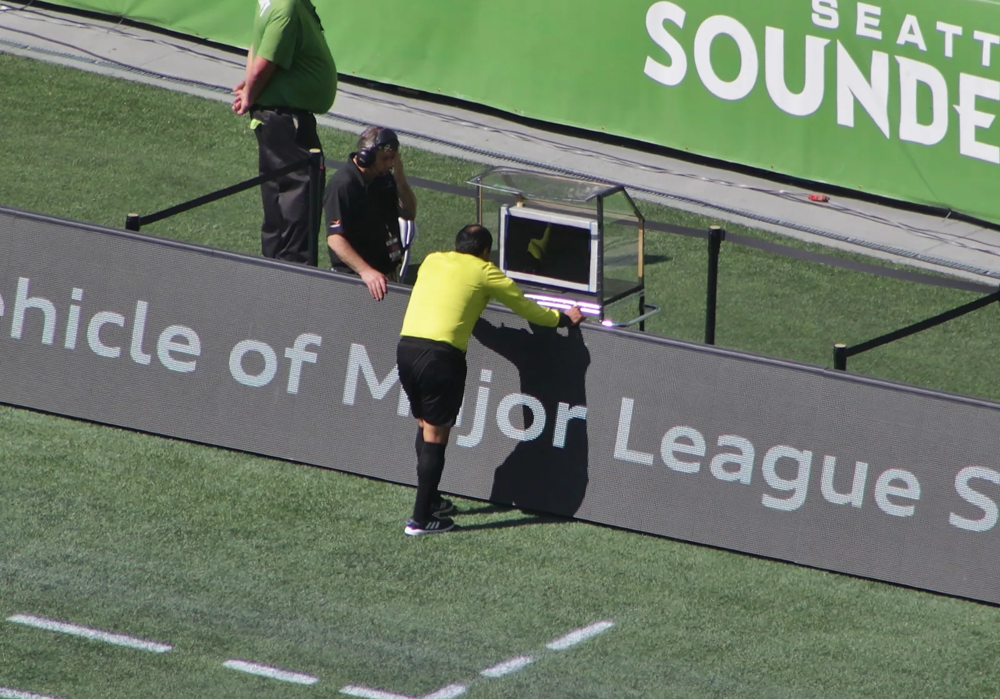

2026년 7월 1일부터 **축구 VAR 판독 대상**은 4가지에서 5가지로 늘었습니다. 국제축구평의회(IFAB)가 2026/27 경기규칙에서 잘못 준 두 번째 경고로 나온 퇴장, 엉뚱한 선수에게 준 카드, 잘못 준 코너킥까지 VAR이 고칠 수 있게 바꿨거든요. 그런데 구글 상위에 뜨는 한국어 설명은 아직 대부분 "골·페널티킥·직접 퇴장·사람 착오 4가지"에 머물러 있습니다. 그래서 IFAB 규칙서의 VAR 프로토콜을 2025/26판과 2026/27판으로 나란히 놓고, 지워진 문구와 새로 들어간 문구를 한 줄씩 대조해 정리했습니다.

📌 요약
VAR은 <b>명백한 오류</b>나 <b>놓친 중대 사건</b>일 때만 개입합니다. 애매한 판정을 다시 보는 장치가 아닙니다.

2026/27 규칙부터 판독 대상은 <b>골·페널티킥·퇴장·사람 착오·코너킥(대회 선택)</b> 5가지입니다. 두 번째 경고 퇴장도 이제 판독 대상입니다.

판독을 시작하는 사람도, 최종 결정을 내리는 사람도 <b>주심 한 명</b>입니다. 선수나 감독은 VAR을 요청할 수 없습니다.

## 축구 VAR 판독 대상은 정확히 무엇인가요?

VAR(Video Assistant Referee, 비디오 판독 심판)은 경기 영상을 따로 보는 심판입니다. IFAB VAR 프로토콜 1번 원칙은 VAR이 주심을 도울 수 있는 경우를 아주 좁게 묶어 둡니다. 판정이 **명백한 오류**이거나 주심이 **중대한 사건을 놓쳤을 때**, 그리고 그 장면이 아래 범주에 들어갈 때만입니다.

2026/27 규칙 기준 판독 대상은 다섯 가지입니다.

| 범주 | 판독하는 것 | 2026/27에서 바뀐 점 |
|---|---|---|
| 골 / 노골 | 득점 직전 공격 과정의 반칙·오프사이드·공 아웃 | 그대로 |
| 페널티킥 / 노페널티킥 | 박스 안 반칙 여부, 반칙 지점이 박스 안인지 밖인지 | 그대로 |
| 퇴장 | 레드카드를 줘야 했는지, 잘못 줬는지 | 명백히 잘못 준 두 번째 경고 퇴장도 포함 |
| 사람 착오 | 경고·퇴장을 엉뚱한 선수에게 줬을 때 | "반칙한 팀 선수" 제한이 빠져 양 팀 모두 대상 |
| 코너킥 | 명백히 잘못 준 코너킥 | 새로 추가, 대회가 고르는 선택 사항 |

이 표 밖의 판정은 VAR이 아무리 오심을 봐도 끼어들 수 없습니다. 평범한 경고 한 장이 맞았는지, 스로인·프리킥 방향, 득점·페널티와 상관없는 중원의 일반 반칙, 추가시간 길이가 대표적입니다. 여기서 많이 오해하는데, VAR은 "모든 오심을 잡는 장치"가 아니라 "경기 결과를 바꿀 만한 큰 오심만 잡는 안전망"입니다.

## 2026/27 개정으로 VAR 판독 대상이 어떻게 늘었나요?

IFAB는 2026년 2월 28일 제140차 연례총회에서 개정안을 승인했고, 새 규칙은 2026년 7월 1일부터 적용됐습니다. 2026 북중미 월드컵도 이 규칙으로 치러졌습니다. 규칙서 원문에서 바뀐 부분은 세 군데입니다.

첫째, 퇴장 항목의 문구가 "직접 퇴장(명백히 잘못 준 두 번째 경고는 제외)"에서 "퇴장(명백히 잘못 준 두 번째 경고 포함)"으로 바뀌었습니다. 예전에는 두 번째 경고가 오심이어도 퇴장이 그대로 남았습니다. 이제는 그 경고가 명백히 잘못됐다면 VAR이 퇴장을 되돌릴 수 있습니다.

둘째, 사람 착오 항목에서 "반칙한 팀의"라는 말이 지워졌습니다. 주심이 반칙을 한 팀을 착각해 반대편 선수에게 카드를 준 경우까지 바로잡을 수 있게 된 겁니다. 원칙은 카드를 받을 사람을 바로잡는 것이고, 득점·페널티·퇴장과 무관한 반칙 자체를 다시 재판하지는 않습니다.

셋째, 코너킥 항목이 새로 생겼습니다. 조건이 까다롭습니다. 대회 주최 측이 이 옵션을 택해야 하고, 판정을 즉시 바꿀 수 있으며 재개를 늦추지 않을 때만 정정합니다. 공격팀이 코너킥을 빨리 차 버리면 그 판정은 그대로 굳습니다. 위 비교표는 IFAB 2026/27 VAR 프로토콜의 삭제·추가 표시를 그대로 옮겨 제가 직접 만든 것입니다.

제가 대조한 삭제 문구가 실제로 쓰인 장면도 있습니다. 2026 북중미 월드컵 8강 스위스-아르헨티나전에서 주심은 처음에 아르헨티나의 레안드로 파레데스에게 태클 경고를 줬습니다. 그런데 VAR 영상을 보니 스위스의 브릴 엠볼로가 접촉 전에 이미 넘어진 장면이었고, 경고는 사람 착오 규정에 따라 엠볼로의 시뮬레이션 경고로 바뀌었습니다. 엠볼로는 이미 경고가 한 장 있어 퇴장당했습니다(ESPN, 2026년 7월). 예전 규칙이었다면 "반칙한 팀의 선수"가 아니라 상대 팀 선수에게 카드가 옮겨 가는 이 판정은 VAR이 손댈 수 없었습니다. 이 장면처럼 카드를 받을 사람이 바뀌면 반칙의 성격도 함께 정정될 수 있습니다.

## '명백한 오류' 기준은 무슨 뜻인가요?

VAR이 다시 본다고 판정이 바뀌는 건 아닙니다. 규칙서는 "주심의 원래 판정은 영상이 명백한 오류를 분명히 보여 주지 않는 한 바뀌지 않는다"고 적고 있습니다. 쉽게 말하면 영상을 본 열 명 중 대부분이 "이건 틀렸다"고 할 장면이어야 한다는 뜻입니다.

그래서 반칙의 강도처럼 보는 사람마다 의견이 갈리는 장면은 주심의 원래 판단이 대부분 유지됩니다. 반대로 오프사이드 위치나 공이 선을 넘었는지처럼 선을 그어 확인할 수 있는 장면은 판정이 바뀌기 쉽습니다. 같은 VAR 판독인데 어떤 장면은 몇 초 만에, 어떤 장면은 한참 걸리는 이유가 여기 있습니다.

규칙서는 시간 제한도 두지 않습니다. 프로토콜은 정확한 결정이 빠른 결정보다 중요하다고 적고 있습니다. 판독이 길어지는 건 규칙 위반이 아니라 규칙이 허락한 일이라는 뜻입니다.

## VAR 판독 절차는 어떤 순서로 진행되나요?

절차는 크게 네 단계입니다. 대표 이미지의 흐름도는 이 과정을 판정 갈래까지 펼쳐 그린 것입니다.

1. **체크.** VAR은 판독실(VOR)에서 모든 득점·페널티·퇴장 후보 장면을 자동으로 확인합니다. 문제가 없으면 경기는 그냥 이어지고 관중은 체크가 있었는지도 모릅니다. 중계에서 "조용한 체크(silent check)"라고 부르는 단계입니다.
2. **리뷰 권고.** 명백한 오류가 보이면 VAR이 주심에게 리뷰를 권합니다. 권할 수만 있고, 리뷰를 시작하는 사람은 주심입니다.
3. **판정 확인.** 판정 성격에 따라 두 갈래로 나뉩니다(다음 섹션).
4. **최종 결정.** 주심이 결정을 내리고, 손으로 TV 화면 모양의 사각형을 그린 뒤 판정을 알립니다.

규칙서에는 경기가 다시 시작된 뒤에는 판정을 되돌릴 수 없다는 원칙도 있습니다. 예외는 사람 착오, 그리고 폭력 행위·침 뱉기·물기·극도로 모욕적인 행동 같은 퇴장 상황뿐입니다. 결정적 득점 기회 저지 같은 다른 퇴장감은 경기가 재개되면 되돌릴 수 없습니다. 그래서 VAR 체크가 진행 중이면 주심이 손을 귀에 대고 재개를 잠시 막는 장면을 볼 수 있습니다.

## 온필드 리뷰와 VAR-only 리뷰는 어떻게 다른가요?

리뷰는 두 종류입니다. 이 구분을 알면 주심이 왜 어떤 장면은 모니터로 뛰어가고 어떤 장면은 귀만 대고 끝내는지 이해가 됩니다.

| 구분 | 언제 쓰나 | 예시 |
|---|---|---|
| VAR 정보로 정정(VAR-only 리뷰) | 사실을 확인하는 판정 | 오프사이드 위치, 공 아웃, 반칙 지점이 박스 안인지 밖인지 |
| 온필드 리뷰(OFR) | 주관적 판단이 필요한 판정 | 페널티킥 반칙의 정도, 퇴장감 태클 |

VAR-only 리뷰에서도 판정을 바꾸는 사람은 주심입니다. 주심이 VAR이 전한 사실 정보를 받아들여 정정할 뿐입니다. 온필드 리뷰에서는 주심이 경기장 옆 판독 구역(RRA)의 모니터로 직접 영상을 봅니다. 결정은 주심이 직접 보고 내려야 한다는 원칙 때문입니다.

*▲ 2018년 MLS 경기에서 주심이 경기장 옆 모니터로 온필드 리뷰를 하는 장면 — 사진 ⓒ SounderBruce, CC BY-SA 4.0 (Wikimedia Commons)*

오프사이드 위치는 반자동 오프사이드 기술(SAOT)이 선을 그어 주는 대회가 늘었고, 월드컵에서는 2022 카타르 대회부터 썼습니다. 판정 원리와 리그별 도입 시점은 [축구 오프사이드 규칙 정리](/soccer-offside-rule/)에 따로 풀어 두었습니다.

## 선수나 감독이 VAR을 요청할 수 있나요?

요청할 수 없습니다. 규칙서는 리뷰를 시작할 수 있는 사람을 주심 한 명으로 정해 두었습니다. 선수가 손으로 TV 사각형을 과하게 그리며 판독을 요구하면 오히려 경고를 받을 수 있습니다.

배구나 테니스처럼 팀이 신청하는 비디오 판독과 가장 다른 점입니다. 축구 VAR에 "신청 횟수"가 없는 이유도 같습니다. 주심이 필요하다고 볼 때마다 몇 번이든 리뷰할 수 있습니다.

예외로 FIFA가 만든 [FVS(Football Video Support)](https://inside.fifa.com/news/what-is-football-video-support)가 있습니다. VAR을 갖추기 어려운 대회를 위한 간이 제도로, 감독이 경기당 2번 판독을 요청할 수 있고 판정이 바뀌면 요청 횟수가 그대로 남습니다. 대한축구협회가 국내 도입을 검토하며 질의한 결과 VAR과 FVS는 한 대회에서 함께 쓸 수 없다는 답을 받았다는 머니투데이 보도도 있었습니다(2026년 9월).

## VAR은 언제 도입됐고 K리그는 언제부터 썼나요?

연도를 한 표로 묶으면 이렇습니다.

| 시기 | 일 |
|---|---|
| 2017년 7월 1일 | K리그1(당시 K리그 클래식) VAR 도입 |
| 2018년 3월 3일 | IFAB 제132차 연례총회, VAR을 경기규칙에 공식 포함 |
| 2018년 6월 | 러시아 월드컵, 월드컵 첫 VAR 사용 |
| 2018시즌 | K리그2 VAR 도입 |
| 2022년 11월 | 카타르 월드컵, 월드컵 첫 반자동 오프사이드 사용 |
| 2025년 7월 1일 | 주심의 판독 결과 장내 발표가 대회 선택 사항으로 정식화 |
| 2026년 7월 1일 | 판독 대상 4가지에서 5가지로 확대 |

K리그가 경기규칙 공식 포함보다 먼저 VAR을 쓴 건 IFAB가 2016년부터 허용한 VAR 시험 운영 기간에 참여했기 때문입니다. IFAB 제132차 총회일(2018년 3월 3일)이 K리그1 시행일(2017년 7월 1일)보다 8개월 늦어서, 저는 시험 운영 기록을 따로 찾아 순서를 맞췄습니다. K리그 도입일은 골닷컴(2017년 6월)과 경북매일(2018년 1월) 보도를 기준으로 했습니다. 2025년 8월에는 K리그도 주심이 판독 이유를 장내에 직접 알리는 VAR 판정 방송을 시범 운영했습니다.

💡 중계 볼 때 이것만 보세요
주심이 <b>귀에 손만 대고</b> 끝내면 VAR 체크나 사실 판정입니다. <b>모니터로 걸어가면</b> 온필드 리뷰라서 판정이 바뀔 가능성이 큽니다. 코너킥 판정은 공격팀이 빨리 차 버리면 정정 기회가 사라집니다.

## VAR 판정을 보는 팬이 자주 하는 오해

"**VAR이 봤으면 오심은 없다**"는 틀린 생각입니다. VAR은 명백한 오류만 고치기 때문에, 애매한 장면에서는 오심 논란이 남는 게 오히려 규칙대로입니다.

"**판독이 길면 무조건 판정이 바뀐다**"도 아닙니다. 오프사이드 선 긋기처럼 확인할 게 많아서 길어질 뿐 원심이 유지되는 경우도 많습니다.

"**경고는 VAR 대상이 아니다**"는 반만 맞습니다. 평범한 경고의 옳고 그름은 여전히 판독하지 않습니다. 하지만 2026/27부터는 그 경고가 엉뚱한 선수에게 갔을 때, 그리고 잘못 준 두 번째 경고로 퇴장이 나왔을 때는 판독 대상입니다.

## 자주 묻는 질문 (FAQ)

**Q. 축구 VAR 판독 대상은 몇 가지인가요?** 2026/27 IFAB 경기규칙 기준으로 골, 페널티킥, 퇴장, 사람 착오, 코너킥(대회 선택) 5가지입니다. 2025/26까지는 4가지였습니다.

**Q. 두 번째 경고로 받은 퇴장도 VAR로 취소될 수 있나요?** 2026년 7월 1일부터는 가능합니다. 두 번째 경고가 명백히 잘못됐다면 VAR이 리뷰를 권할 수 있습니다.

**Q. 축구에서 감독이 VAR 판독을 신청할 수 있나요?** 신청할 수 없습니다. 리뷰를 시작하는 사람은 주심뿐이고, 감독이 2번까지 요청하는 방식은 VAR이 없는 대회용 FVS 제도입니다.

**Q. VAR 판독은 몇 번까지 할 수 있나요?** 횟수 제한이 없습니다. 판독 대상에 해당하는 장면이면 주심이 필요할 때마다 리뷰할 수 있습니다.

**Q. VAR 판독 시간에 제한이 있나요?** 규칙서에는 시간 제한이 없습니다. IFAB 프로토콜은 빠른 결정보다 정확한 결정이 중요하다고 적고 있습니다.

**Q. K리그는 언제부터 VAR을 썼나요?** K리그1은 2017년 7월 1일, K리그2는 2018시즌부터 VAR을 썼습니다.

VAR 판독 대상의 공식 원문은 [IFAB 경기규칙 VAR 프로토콜](https://www.theifab.com/laws/latest/video-assistant-referee-var-protocol/)에서 확인할 수 있습니다. 시즌마다 바뀌니 경기 전에 해당 시즌판을 보는 게 가장 정확합니다.

## 이미지 출처

- 대표 이미지·비교표 — sportskingdom24 직접 제작(IFAB VAR 프로토콜 2026/27 기준)
- 온필드 리뷰 사진 — SounderBruce, CC BY-SA 4.0, Wikimedia Commons "Baldomero Toledo checks VAR - Seattle Sounders vs. Sporting Kansas City"

---

**관련 키워드** — #축구VAR #VAR판독대상 #VAR판독절차 #축구VAR규칙 #온필드리뷰 #VAR기준 #축구VAR신청 #축구VAR횟수 #K리그VAR #VAR도입년도 #IFAB경기규칙 #반자동오프사이드
