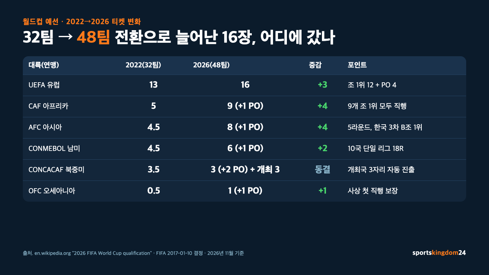
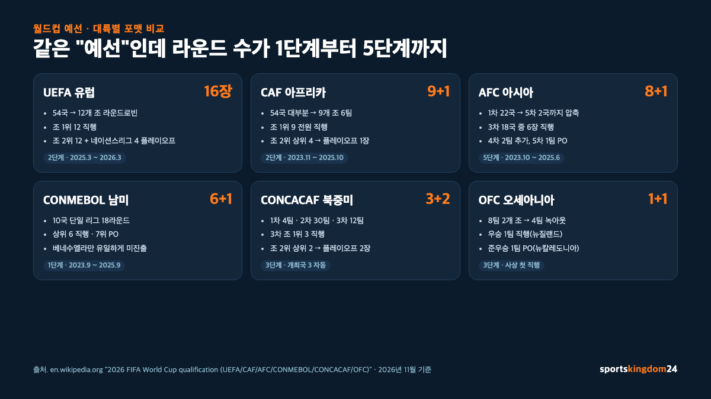

**월드컵 예선 방식**은 2026년부터 **본선 48팀 체제**로 바뀌면서 대륙별 출전권이 전부 재배분됐습니다. 2026 북중미 월드컵 기준 대륙별 직행 티켓은 **UEFA(유럽) 16·CAF(아프리카) 9·AFC(아시아) 8·CONMEBOL(남미) 6·CONCACAF(북중미) 3+개최국 자동 진출 3·OFC(오세아니아) 1**이고, 여기에 **대륙간 플레이오프 2장**이 더해져 총 48장이 완성돼요. 각 대륙 예선은 "홈 앤드 어웨이 라운드로빈"이 공통 뼈대지만, 아시아는 5라운드, 남미는 10개국 단일 리그 같은 식으로 모양이 크게 다릅니다. 이 글은 FIFA 공식, 영문·한국어 Wikipedia의 2026 월드컵 예선 항목을 교차 확인해, "월드컵 예선이 어떻게 굴러가는지"를 대륙 순서대로 한 번에 정리했어요.

📌 3줄 요약
<b>왜 바뀌었나</b>: 본선이 32팀에서 48팀으로 늘어난 건 2017년 1월 10일 FIFA 결정이고, 2026 북중미 대회부터 적용됐어요. 티켓이 16장(32→48) 더 늘면서 대륙별 할당이 전부 손질됐습니다.

<b>직행 티켓(45장)</b>: UEFA 16, CAF 9, AFC 8, CONMEBOL 6, CONCACAF 3, OFC 1, 그리고 개최국(캐나다·멕시코·미국) 3자리 자동 진출. OFC는 월드컵 역사상 처음으로 직행 자리를 받았어요.

<b>나머지 2장</b>: UEFA를 뺀 5개 대륙 각 1팀 + 개최 대륙(CONCACAF) 추가 1팀 = 6팀이 2026년 3월 26·31일 멕시코 과달라하라·몬테레이에서 대륙간 플레이오프로 2장을 가립니다.

이 글은 영문 Wikipedia "2026 FIFA World Cup qualification", "2026 FIFA World Cup qualification (UEFA)", "(AFC)", "(CAF)", "(CONCACAF)", "(CONMEBOL)", "(OFC)", "FIFA World Cup qualification", 한국어 Wikipedia "FIFA 월드컵 예선"·"2026년 FIFA 월드컵 아시아 지역 예선", 그리고 FIFA.com 공식 자료를 교차 확인해 정리한 것입니다.

## 월드컵 예선 큰 그림 — 32에서 48로, 티켓 16장이 어디로 갔나

**2026 북중미 월드컵부터 본선이 48팀으로 늘어난** 결정은 2017년 1월 10일 FIFA 이사회가 내렸어요. 1998년부터 2022년 카타르 대회까지 유지돼 온 "32팀 체제"가 24년 만에 바뀌는 큰 사건입니다. 늘어난 16장이 그냥 큰 대륙에 몰린 게 아니라, **아프리카·아시아에 크게 늘려 주고, 오세아니아에도 역사상 처음으로 직행 1장을 보장**한 게 포인트예요.

2022 카타르(32팀) → 2026 북중미(48팀) 대륙별 할당 변화를 한 장에 보면 이렇게 됩니다.

| 대륙(연맹) | 2022(32팀) | 2026(48팀) | 증감 |
| --- | --- | --- | --- |
| UEFA(유럽) | 13 | **16** | +3 |
| CAF(아프리카) | 5 | **9(+1 PO)** | +4 |
| AFC(아시아) | 4.5 | **8(+1 PO)** | +4 |
| CONMEBOL(남미) | 4.5 | **6(+1 PO)** | +2 |
| CONCACAF(북중미) | 3.5 | **3(+2 PO) + 개최국 3** | +2(개최국 자동 포함 계산 시) |
| OFC(오세아니아) | 0.5 | **1(+1 PO)** | +1 |
| 대륙간 플레이오프(실 티켓) | 2 | **2** | 동결 |

눈여겨볼 포인트가 세 가지예요. 첫째, **CONCACAF 수가 그대로인 듯 보여도 실은 개최국 3자리를 빼고 나눈 숫자**입니다. 2023년 2월 14일 FIFA 이사회가 캐나다·멕시코·미국 3개국 전부에 자동 진출을 부여하면서, CONCACAF 예선은 **직행 3장 + 플레이오프 2장**만 다투는 구조로 바뀌었어요. 둘째, **CAF가 5 → 9로 거의 두 배**가 됐습니다. 이건 2010 남아공 월드컵 이후 가장 큰 폭의 증가예요. 셋째, **OFC가 역사상 처음으로 "0.5장 플레이오프 티켓"이 아닌 "직행 1장"을 보장받은** 대회가 2026입니다.

예선의 공통 뼈대는 **홈 앤드 어웨이 라운드로빈**이에요. 참가 팀이 자기 대륙 안에서 홈 경기와 원정 경기를 모두 한 번씩 치르고 승점을 쌓는 방식. 큰 대륙은 조를 여럿으로 쪼개고 조 1위·2위를 추려 올라가는 단계를 반복하고, 작은 대륙은 단일 리그로 치르는 식이에요. 이게 "**대륙별 평균 실력·가맹국 규모·축구 열기**"에 따라 티켓 수와 포맷이 다르게 설계되는 이유입니다.

한 가지 더, 2026 대회는 **46개 참가 확정 자리(직행 45 + 개최국 3이 CONCACAF 할당에 포함되는 계산으로 44+3)와 대륙간 플레이오프 2장 = 48장**이 완성되는 구조예요. 즉 **대륙간 플레이오프 티켓은 늘 마지막 2장**이고, 조추첨은 2025년 12월 5일 미국 워싱턴에서 열렸습니다.

## UEFA(유럽) 16장 — 12개 조 1위 직행 + 플레이오프 4팀

**유럽은 가장 많은 16장을 받습니다**. 이전 대회(13장)보다 3장 늘었고, 전 세계 48장 중 3분의 1이 유럽 몫이에요. 2026 UEFA 예선 포맷은 "**12개 조 라운드로빈 + 플레이오프**" 구조입니다.

**예선 구성**은 아래 표에 담긴 두 단계예요.

| 단계 | 참가·조 구성 | 통과 조건 | 티켓 |
| --- | --- | --- | --- |
| 1단계 조별리그 | **54개 UEFA 회원국**을 **12개 조**(4팀 조 6개 + 5팀 조 6개)로 나눠 홈&어웨이 | 각 조 **1위 12팀** | **12장 직행** |
| 2단계 플레이오프 | 각 조 **2위 12팀** + **네이션스리그 조 1위 4팀** = 16팀, 4개 경로로 단판 토너먼트(준결승+결승) | 각 경로 결승 승자 4팀 | **4장 직행** |

조별리그는 2025년 3월 21~22일(5팀 조)·2025년 9월(4팀 조)에 시작해 2025년 11월 종료, 플레이오프는 2026년 3월 26·31일에 열렸습니다. 유럽은 "조 1위면 자동 직행"이라는 명쾌한 규칙 덕분에 팀마다 목표가 뚜렷해요.

**눈여겨볼 포인트**는 플레이오프 경로 설계입니다. 조 2위 12팀만으로 플레이오프를 치르는 게 아니라, **UEFA 네이션스리그 성적으로 "직행 실패한 조 1위 4팀"을 추가**해 16팀을 만들어요. 네이션스리그에서 조 1위를 했더라도 월드컵 예선 자기 조에서 1·2위를 못 하면 플레이오프 패자부활권을 받는 구조라, "네이션스리그를 월드컵 예선 플레이오프 안전망"으로 쓰는 2세대 UEFA 포맷의 핵심이에요. 2022 카타르 사이클에서 처음 도입된 이 안전망이 2026 사이클에서도 유지됐습니다.

플레이오프는 **4개 경로**로 나뉘고, 경로당 **준결승 1경기·결승 1경기 모두 단판**이에요. 이게 왜 중요하냐면, 2022 사이클 때 **포르투갈이 플레이오프에서 북마케도니아를 2-0으로 꺾고 간신히 올라간** 장면이 상징적이거든요. 조 1위가 아니면 한 번의 실수로 탈락할 수 있는 압박 구조라, 유럽 플레이오프는 월드컵 본선만큼 긴장감이 큽니다. 같은 유럽 국가대표 대회의 리그·대진 흐름이 궁금하다면 [유로(유럽 축구 선수권) 완전 정리](/uefa-euro-championship-guide/)를, 유럽 클럽 레벨의 최고 대회가 궁금하다면 [챔피언스리그란? 대회 방식과 일정, 역대 우승팀](/champions-league-guide/)을 함께 보면 그림이 선명해집니다.

## CAF(아프리카) 9+1장 — 9개 조 1위 모두 월드컵 직행

**아프리카는 5장 → 9장으로 거의 두 배**가 된 대륙입니다. 2026 CAF 예선 포맷은 극도로 단순해요. "**9개 조로 나눠, 조 1위 9팀이 전원 월드컵 직행**".

**CAF 예선 구성**은 이렇습니다.

| 단계 | 참가·조 구성 | 통과 조건 | 티켓 |
| --- | --- | --- | --- |
| 1단계 조별리그 | **54개 CAF 회원국** 대부분을 **9개 조**(각 조 6팀)로 나눠 홈&어웨이 | 각 조 **1위** | **9장 직행** |
| 2단계 플레이오프 | 각 조 **2위 중 성적 상위 4팀**이 단판 토너먼트(준결승+결승) | 결승 승자 1팀 | 대륙간 **플레이오프 1장** |

경기는 2023년 11월부터 2025년 10월까지 2년에 걸쳐 진행됐습니다. **54개 회원국이 전부 참가하는 단일 사이클**이라, 아프리카 축구의 저변을 그대로 보여 주는 구조예요.

**눈여겨볼 포인트**는 조 2위 처리 방식입니다. CAF는 조 2위 전원을 플레이오프로 보내지 않고, **조 2위 중 "성적 상위 4팀"만 추려서** 단판 토너먼트를 하나 치러요. 이 토너먼트의 최종 승자 1팀이 **대륙간 플레이오프에 아프리카 대표로 출전**합니다. 즉 CAF는 "직행 9 + 대륙간 플레이오프 티켓 1"로 최대 10팀이 월드컵에 갈 가능성을 열어 뒀어요.

2026 사이클에서 가장 흥미로웠던 사건은 **카보베르데의 월드컵 첫 출전 확정**입니다. 인구 55만 명 규모의 작은 섬나라가 조 1위로 월드컵 본선에 올라갔어요. **요르단·우즈베키스탄·카보베르데**(AFC·AFC·CAF)가 월드컵 사상 "첫 출전국" 명단에 올라간 것이 2026 예선이 남긴 가장 큰 숫자 중 하나입니다. 이는 "본선 확대가 새 얼굴을 얼마나 만들어 냈나"의 직접 증거예요.

## AFC(아시아) 8+1장 — 5라운드 구조와 한국·일본 경로

**아시아는 4.5장 → 8+1장(8장 직행 + 플레이오프 1장)으로 늘었습니다**. AFC 예선은 **5라운드 구조**로 설계돼 있어, 6개 대륙 중 라운드가 가장 많아요. 가맹국 수(47개국)가 많아서, 하위권에서 시작해 단계별로 압축하는 형태입니다.

**AFC 예선 5라운드 구조**는 이렇게 흐릅니다.

| 라운드 | 참가 | 포맷 | 통과 조건 |
| --- | --- | --- | --- |
| 1차 | FIFA 랭킹 하위 **22팀** | 홈&어웨이 2경기 | 승자 11팀 2차 |
| 2차 | 상위 25팀 + 1차 승자 11팀 = **36팀** | **9개 조 4팀** 홈&어웨이 | 조 1·2위 **18팀** 3차 |
| 3차 | **18팀** | **3개 조 6팀** 홈&어웨이 | 조 1·2위 **6팀 직행**, 조 3·4위 **6팀** 4차 |
| 4차 | **6팀** | **2개 조 3팀** 중립지 | 조 1위 **2팀 직행**, 조 2위 **2팀** 5차 |
| 5차 | **2팀** | 홈&어웨이 플레이오프 | 승자 1팀 **대륙간 PO** |

**한국은 3차 B조 1위로 2025년 6월 5일 본선 진출을 확정**했고, 요르단과 함께 조 1·2위를 가져가 직행했어요. 한국은 2차 예선 때 중국·태국·싱가포르와 C조에 묶였고, 3차 예선 B조에서 요르단·이라크·오만·팔레스타인·쿠웨이트와 겨뤘습니다. 일본은 3차 C조에서 이란과 함께, 호주·사우디·우즈베키스탄도 각 조 상위 2위 안에 들어 조기 직행했고요.

💡 AFC 3차가 왜 "진짜 예선"인가
AFC 1차·2차는 사실상 하위권 거르는 단계라, 축구 팬들 사이에서 "<b>진짜 예선은 3차부터</b>"라는 말이 있어요. 3차에서 18팀이 3개 조로 나뉘어 홈&어웨이 10경기를 치르는데, 조 1·2위가 바로 월드컵 직행이라 긴장감이 폭발합니다. 한국이 2025년 6월 5일 B조 1위로 진출 확정한 경기도 이 3차 라운드였어요.

**4차와 5차는 "마지막 2장"을 가리는 토너먼트**예요. 3차에서 조 3·4위를 한 6팀이 중립지에서 2개 조 3팀으로 미니 리그를 치르고, 각 조 1위가 **직행 7·8번 티켓**을 가져갑니다. 5차는 4차에서 올라온 2팀의 홈&어웨이 플레이오프로, 승자가 **대륙간 플레이오프**로 넘어가는 구조예요. **요르단·우즈베키스탄은 이 사이클에서 월드컵 첫 출전을 확정**해 AFC 티켓 확대의 수혜를 본 두 국가로 기록됐습니다.

## CONMEBOL(남미) 6+1장 — 10개국 홈 앤 어웨이 리그

**남미는 포맷이 가장 단순하고 가장 혹독합니다**. 10개국이 홈 앤 어웨이 18라운드 **단일 라운드로빈**을 치러, 상위 6팀이 직행하고 7위 1팀이 대륙간 플레이오프로 가는 구조예요. 조도 없고 플레이오프 라운드도 없어요. 2년 동안 쌓은 승점 그대로 순위가 티켓이 됩니다.

2026 CONMEBOL 예선은 2023년 9월부터 2025년 9월까지 **18라운드**가 열렸습니다. 매년 6라운드씩 3년에 걸쳐 진행했고, 최종 순위는 이렇게 끝났어요.

| 순위 | 국가 | 승점 | 결과 |
| --- | --- | --- | --- |
| 1 | 아르헨티나 | 38 | 직행 |
| 2 | 에콰도르 | 29 | 직행 |
| 3 | 콜롬비아 | 28 | 직행 |
| 4 | 우루과이 | 28 | 직행 |
| 5 | 브라질 | 28 | 직행 |
| 6 | 파라과이 | 28 | 직행 |
| 7 | 볼리비아 | 20 | 대륙간 PO |
| 8 | 베네수엘라 | 18 | 탈락 |

*출처. CONMEBOL/FIFA 공식 집계, 2025년 9월 예선 종료 시점 기준.*

**눈에 띄는 점이 세 가지**예요. 첫째, **브라질이 5위로 간신히 직행**했습니다. 브라질은 보통 남미 예선 1·2위를 밥 먹듯 하는 팀인데, 2026 사이클에서는 3~6위가 모두 28점으로 묶여 득실차로 순위가 갈렸어요. 득실차는 **콜롬비아 +10·우루과이 +10·브라질 +7·파라과이 +4**로(각각 28-18, 22-12, 24-17, 14-10), 콜롬비아·우루과이가 다득점에서 앞서 3·4위를 가져가고 브라질·파라과이가 5·6위로 밀렸어요. 둘째, **볼리비아가 7위로 대륙간 플레이오프**에 올라갔습니다. 볼리비아는 라파스의 해발 3,650m 홈구장을 활용해 거의 늘 7위권에 있는 팀이에요. 셋째, **베네수엘라가 유일하게 월드컵 본선에 한 번도 못 간 남미 국가**라는 기록을 2026에도 깨지 못했습니다.

CONMEBOL이 혹독한 이유는 간단해요. **참가국 10팀 중 7팀이 월드컵에 갈 수 있는 구조**지만, 10팀이 모두 축구 강국이기 때문입니다. 이번 사이클에서도 칠레(2014·2018 월드컵 베테랑)와 페루(2022에 플레이오프까지 갔던 팀)가 탈락권에 묶였어요. 아르헨티나·브라질을 제외하면 상위 6위 안에 드는 것 자체가 사이클마다 다시 다투는 자리입니다.

## CONCACAF(북중미) 3+2장 — 개최국 3자리 빼고 어떻게 나눴나

**CONCACAF는 특수 케이스예요**. 2026 월드컵 개최국이 캐나다·멕시코·미국 3개국으로, CONCACAF 할당 자체가 "**개최국 자동 진출 3 + 예선 직행 3 + 플레이오프 2**"로 쪼개졌습니다. 즉 CONCACAF 할당은 **최대 6장**(+ 플레이오프 2)인데 개최국 3이 예선 없이 그 자리를 차지했어요.

**CONCACAF 예선 포맷**은 아래와 같습니다.

| 라운드 | 참가 | 포맷 | 통과 조건 |
| --- | --- | --- | --- |
| 1차 | 하위 **4팀**(29~32위) | 홈&어웨이 2경기 | 승자 2팀 2차 |
| 2차 | 상위 28팀 + 1차 승자 2팀 = **30팀** | **6개 조 5팀** 홈&어웨이 | 조 1·2위 **12팀** 3차 |
| 3차 | **12팀** | **3개 조 4팀** 홈&어웨이 | 조 1위 **3팀 직행**, 조 2위 상위 **2팀** 대륙간 PO |

**눈여겨볼 포인트**는 플레이오프 티켓 수예요. CONCACAF는 다른 대륙과 달리 **대륙간 플레이오프 티켓을 2장** 가져갔습니다. 이건 **"개최 대륙 어드밴티지"** 성격으로, "본선 48팀 체제에서 개최 대륙이 조정 변수로 1장을 더 받는다"는 논리가 2017년 포맷 확정 때 적용된 결과예요. 그래서 CONCACAF만 유일하게 "**직행 3 + 플레이오프 2 = 최대 5팀이 예선 통해 본선 진출 가능**" 구조가 됐습니다.

2026 사이클 결과는 **직행 3팀이 쿠라소·아이티·파나마**(조 1위 3팀)로 확정됐고, **플레이오프 2팀은 자메이카·수리남**이 올라갔어요. **쿠라소는 월드컵 사상 첫 출전을 확정**했고, **아이티는 1974년 서독 대회 이후 52년 만에 월드컵 본선 재진출을 확정**했습니다. 2026 CONCACAF 예선이 지역 지형을 크게 흔든 사이클로 남게 됐어요.

**한 가지 더**, CONCACAF 본선 진출국은 3개 개최국까지 합치면 **최대 8팀**이 될 수 있어요. 이게 48팀 본선의 대륙별 분포에서 "UEFA 16 → CONCACAF 8 → CAF 9 → CONMEBOL 6~7 → AFC 8~9 → OFC 1~2" 라는 새로운 균형을 만들었습니다.

## OFC(오세아니아) 1+1장 — 역사상 처음 받은 직행 1장

**오세아니아는 2026 월드컵에서 역사가 바뀐 대륙이에요**. 1998년부터 2022년까지 OFC는 **"0.5장" 플레이오프 티켓** 하나로 다른 대륙과 승부해야 했는데, 2026부터 **"1장 직행 + 1장 대륙간 플레이오프" = 사실상 1.5장**이 보장됩니다. 이게 **OFC가 월드컵 사상 처음으로 받은 직행 자리**예요.

**OFC 예선 3라운드 구조**는 이렇게 흐릅니다.

| 라운드 | 참가 | 포맷 | 통과 조건 |
| --- | --- | --- | --- |
| 1차 | 하위 4팀 | 토너먼트(단판) | 승자 1팀 2차 |
| 2차 | 상위 7팀 + 1차 승자 1팀 = **8팀** | **2개 조 4팀** 라운드로빈 | 조 1·2위 **4팀** 3차 |
| 3차 | **4팀** | 준결승·결승(단판) | **우승 1팀 직행**, 준우승 1팀 대륙간 PO |

**결과**는 **뉴질랜드가 우승해 월드컵 직행**(통산 3번째 출전, 1982·2010 이후), **뉴칼레도니아가 준우승으로 대륙간 플레이오프**에 올라갔어요. 뉴질랜드는 사실상 OFC 디펜딩 챔피언 격이었고, **뉴칼레도니아는 월드컵 사상 첫 출전을 노리는 다크호스**로 주목받았습니다.

**눈여겨볼 포인트**는 OFC가 직행 자리를 받은 배경이에요. FIFA는 2017년 48팀 확대 논의 때부터 "**모든 대륙 연맹에 최소 1장 보장**"을 명시했고, 이게 2026 사이클에서 처음 실현됐어요. 이전까지 OFC는 "자기 대륙 1위를 해도 다른 대륙 팀과 다시 플레이오프를 해야 월드컵에 갈 수 있는" 유일한 대륙이었거든요. **2022 카타르 사이클 뉴질랜드가 코스타리카(CONCACAF)와의 대륙간 플레이오프(2022년 6월 14일, 카타르 알라이얀 아흐마드 빈 알리 스타디움)에서 0-1로 져 탈락**한 게 대표 사례예요. 그 패턴이 2026부터 깨진 것입니다.

## 대륙간 플레이오프 — 6팀이 2장 놓고 다투는 멕시코 토너먼트

**마지막 2장은 대륙간 플레이오프에서 결정됩니다**. 참가 팀은 UEFA를 뺀 5개 대륙 각 1팀과 **개최 대륙(CONCACAF) 추가 1팀 = 6팀**이에요. 조추첨은 2025년 12월 5일 미국 워싱턴에서 열렸고, 경기는 **2026년 3월 26·31일 멕시코 과달라하라·몬테레이**(Estadio Akron·Estadio BBVA)에서 단판으로 치러졌습니다.

**2026 대륙간 플레이오프 6팀과 FIFA 랭킹**(2025년 11월 19일 기준)은 이렇게 구성됐어요.

| 시드 | 팀 | 대륙 | FIFA 랭킹 |
| --- | --- | --- | --- |
| 1 | **DR 콩고** | CAF(아프리카) | 56위 |
| 2 | **이라크** | AFC(아시아) | 58위 |
| 비시드 | 자메이카 | CONCACAF | 70위 |
| 비시드 | 볼리비아 | CONMEBOL | 76위 |
| 비시드 | 수리남 | CONCACAF | 123위 |
| 비시드 | 뉴칼레도니아 | OFC | 149위 |

*출처. FIFA 공식 랭킹 2025년 11월 19일 발표 기준.*

**포맷은 "6팀을 2개 경로(Pathway)로 나눠, 각 경로 결승 승자가 티켓을 받는" 구조**예요. 각 경로에서 **비시드 2팀이 준결승을 치르고**, 그 승자가 **시드팀과 결승**을 벌여, 결승 승자가 월드컵 본선에 올라갑니다. 즉 시드팀(FIFA 랭킹 상위 2팀, DR 콩고·이라크)은 준결승을 건너뛰고 **결승 한 경기만** 치르면 되는 혜택을 받았어요. 대진은 조추첨 결과 **Pathway 1: 자메이카 vs 뉴칼레도니아 승자 → DR 콩고**, **Pathway 2: 볼리비아 vs 수리남 승자 → 이라크**로 묶였습니다.

**경기 결과**는 역사의 한 페이지가 됐어요. **Pathway 1에서는 자메이카가 뉴칼레도니아를 준결승에서 꺾고 올라왔지만, 결승에서 자메이카 0-1 DR 콩고(과달라하라 Estadio Akron, 2026년 3월 31일, 연장 전반 Axel Tuanzebe 결승골)로 DR 콩고가 월드컵 본선행을 확정**했습니다. **Pathway 2에서는 볼리비아가 수리남을 준결승에서 꺾었지만, 결승에서 볼리비아 1-2 이라크(몬테레이 Estadio BBVA, 2026년 3월 31일, 이라크 Ali Al-Hamadi 10분·Aymen Hussein 53분 득점, 볼리비아 Moisés Paniagua 38분 만회골)로 이라크가 본선 티켓을 가져갔어요**. 최종 DR 콩고와 이라크가 월드컵 본선 48번째·47번째 티켓을 확보했습니다.

**이 포맷의 핵심**은 "**단판 토너먼트 + 중립지 멕시코 개최**"입니다. 홈 어드밴티지가 완전히 사라져서, 랭킹 하위 팀이 하루 만에 월드컵 본선행을 뒤집을 수 있는 구조예요. 뉴칼레도니아(149위) 같은 팀도 하루만 이기면 월드컵이라는 이야기가 가능한 셈. 각 경기 결과와 본선 진출팀 정보는 [2026 FIFA 월드컵 예선 공식 결과](https://www.fifa.com/en/tournaments/mens/worldcup/canadamexicousa2026) 페이지에서 확인할 수 있습니다.

## 자주 묻는 질문 (FAQ)

**Q. 월드컵 예선은 몇 년 주기로 열리나요?** 월드컵 본선이 4년 주기(2022→2026→2030)니까 예선도 그 사이 2~3년간 열려요. 2026 월드컵 예선은 CAF 기준 2023년 11월~2025년 10월, UEFA 기준 2025년 3월~2026년 3월, AFC 기준 2023년 10월~2025년 6월로 대륙마다 시작·종료 시점이 다릅니다. 가장 긴 CONMEBOL은 2년 반 걸립니다.

**Q. 2026 월드컵 대륙별 티켓 몇 장씩인가요?** 직행 기준 UEFA 16, CAF 9, AFC 8, CONMEBOL 6, CONCACAF 3+개최국 자동 3, OFC 1장이에요. 여기에 각 대륙에서 올라온 대륙간 플레이오프 티켓을 통해 추가로 2장이 결정되어 총 48장이 완성됩니다. OFC가 월드컵 사상 처음으로 직행 자리를 받은 대회입니다.

**Q. 한국은 몇 차 예선에서 월드컵 본선 진출을 확정했나요?** 2025년 6월 5일 AFC 3차 예선 B조 1위로 본선 진출을 확정했어요. 조 구성은 한국·요르단·이라크·오만·팔레스타인·쿠웨이트였고, 홈 앤드 어웨이 10경기 중 조 1·2위가 직행하는 구조였습니다. 한국은 10회 연속 본선 진출 기록을 2026에도 이어갔어요.

**Q. 대륙간 플레이오프는 몇 팀이 참가하고 어디서 열리나요?** 6팀이 2장을 다퉈요. UEFA를 뺀 5개 대륙 각 1팀과 개최 대륙(CONCACAF) 추가 1팀이 참가합니다. 2026 사이클은 DR 콩고·이라크·자메이카·볼리비아·수리남·뉴칼레도니아가 올라갔고, 2026년 3월 26·31일 멕시코 과달라하라(Estadio Akron)·몬테레이(Estadio BBVA)에서 단판 토너먼트로 치러졌습니다.

**Q. CONCACAF는 왜 다른 대륙보다 티켓이 적어 보이나요?** 개최국 3자리(캐나다·멕시코·미국)가 CONCACAF 할당에 포함돼 있기 때문이에요. 2023년 2월 14일 FIFA 이사회가 개최국 전체에 자동 진출을 부여하면서, 나머지 CONCACAF 예선은 "직행 3 + 대륙간 플레이오프 2" 구조로 재편됐습니다. 사실상 북중미는 월드컵에 최대 8팀(개최국 3 + 예선 통과 5)까지 갈 수 있어요.

**Q. 왜 아시아·아프리카 티켓을 늘렸나요?** 2017년 FIFA가 "글로벌 축구 저변 확대"와 "모든 대륙의 발전 균형"을 명분으로 48팀 확대와 함께 개발도상 대륙 할당을 크게 늘리기로 결정했어요. 실제로 2026 사이클에서 요르단·우즈베키스탄(AFC), 카보베르데(CAF), 쿠라소·아이티(CONCACAF) 같은 첫 출전 또는 오래간만의 출전국이 다수 나왔습니다.

**Q. 유럽 플레이오프는 어떻게 진행되나요?** 2단계로 설계됐어요. 12개 조 2위 12팀 + UEFA 네이션스리그 조 1위 중 월드컵 예선 1·2위에 못 든 4팀 = 16팀이 4개 경로로 나뉘어 단판 준결승·결승을 치릅니다. 각 경로 결승 승자 4팀이 월드컵 본선 직행 자리를 받아요. 경로당 2경기 모두 단판이라 한 번의 실수로 탈락할 수 있는 압박 구조입니다.

**Q. 월드컵 예선 티켓은 언제부터 팔고, 중계는 어떻게 보나요?** 2026 북중미 월드컵은 2026년 6월 11일~7월 19일 열리고, FIFA 공식 티켓 판매는 2025년 9월부터 단계별로 열렸어요. 한국 중계는 **2026년 11월 현재 기준 지상파에서는 KBS가 JTBC와 공동 중계로 확정**됐고, **MBC·SBS는 2026 본선 중계에서 빠졌습니다**. 모바일 스트리밍은 네이버 치지직이 중계에 참여하고, 쿠팡플레이·티빙·웨이브 등 OTT는 중계권을 확보하지 못한 상태예요.

*이미지 출처. 대표 이미지(2026 대륙별 48장 분배 다이어그램)와 본문 인포그래픽(대륙별 예선 포맷 비교)은 모두 sportskingdom24에서 영문 Wikipedia "2026 FIFA World Cup qualification" 및 각 대륙별 예선 항목을 교차해 직접 제작했습니다.*

---

**관련 키워드** — #월드컵예선 #월드컵대륙별출전권 #2026월드컵 #AFC3차예선 #UEFA예선 #CONMEBOL예선 #CAF예선 #OFC월드컵직행 #대륙간플레이오프 #월드컵48개국 #FIFA월드컵예선 #한국월드컵진출
